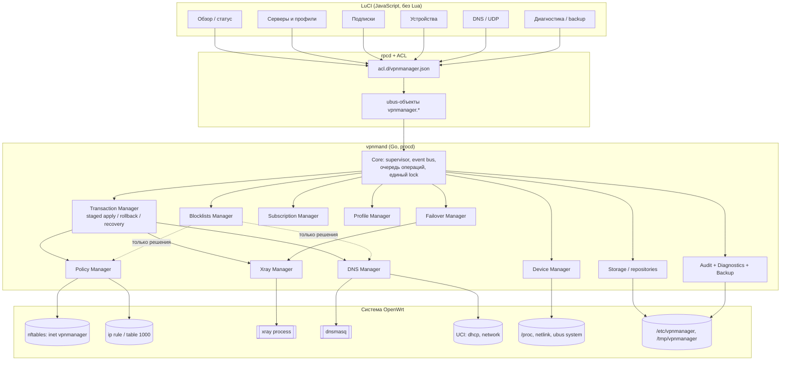
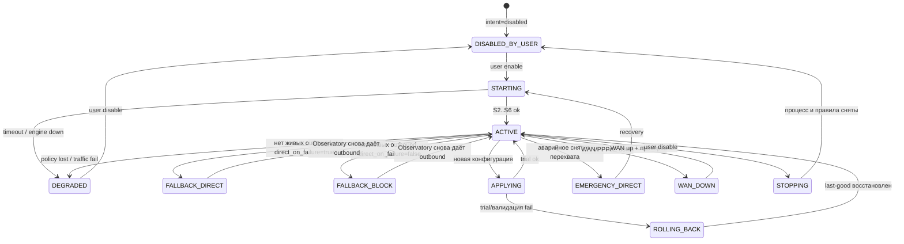
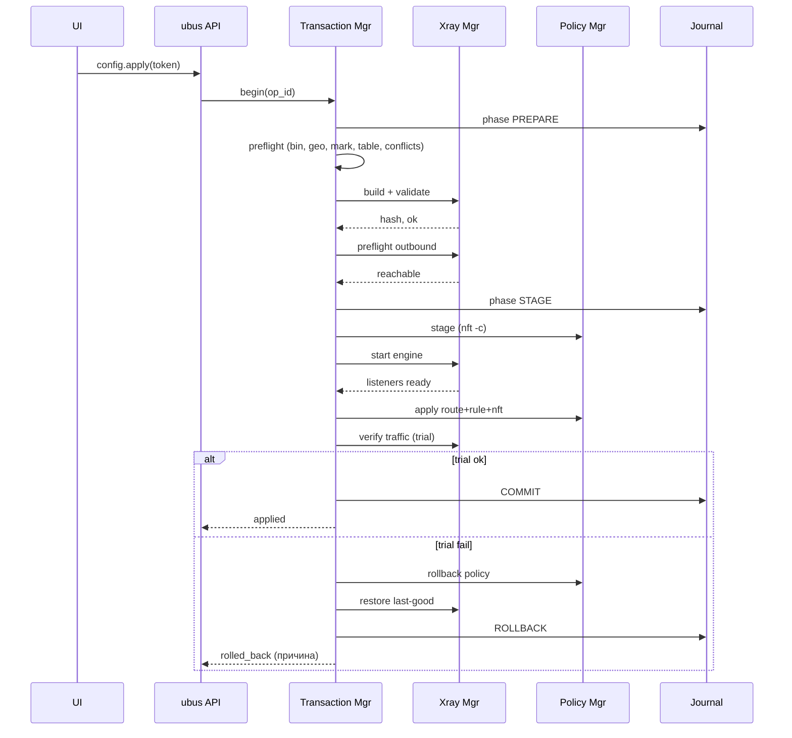
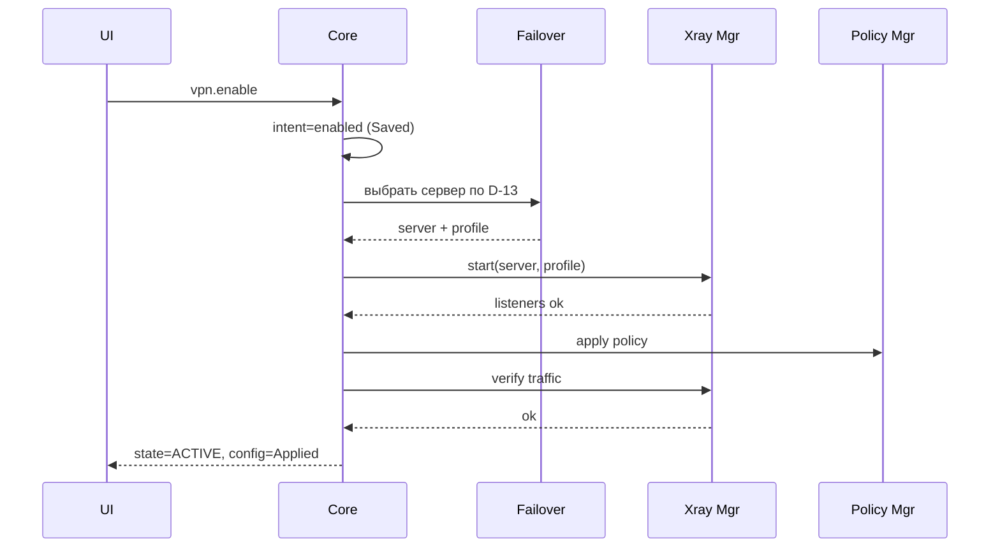
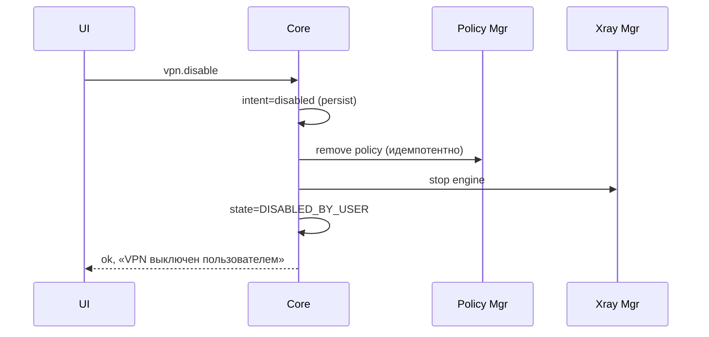
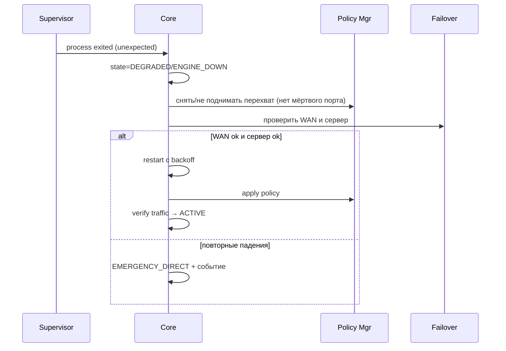
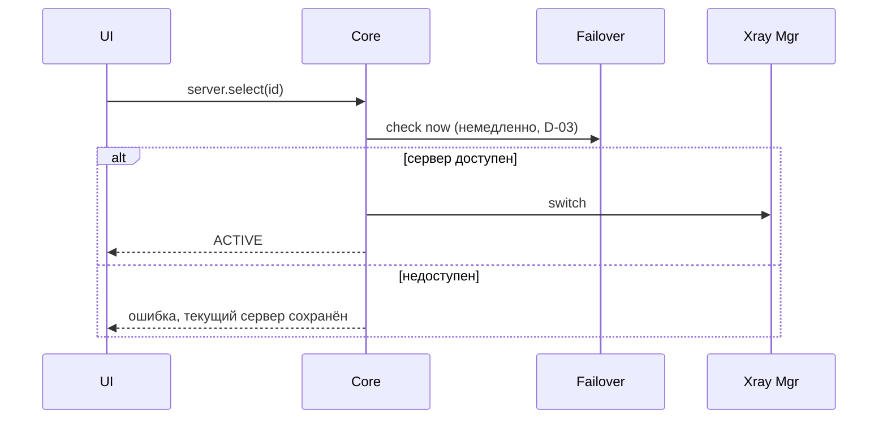
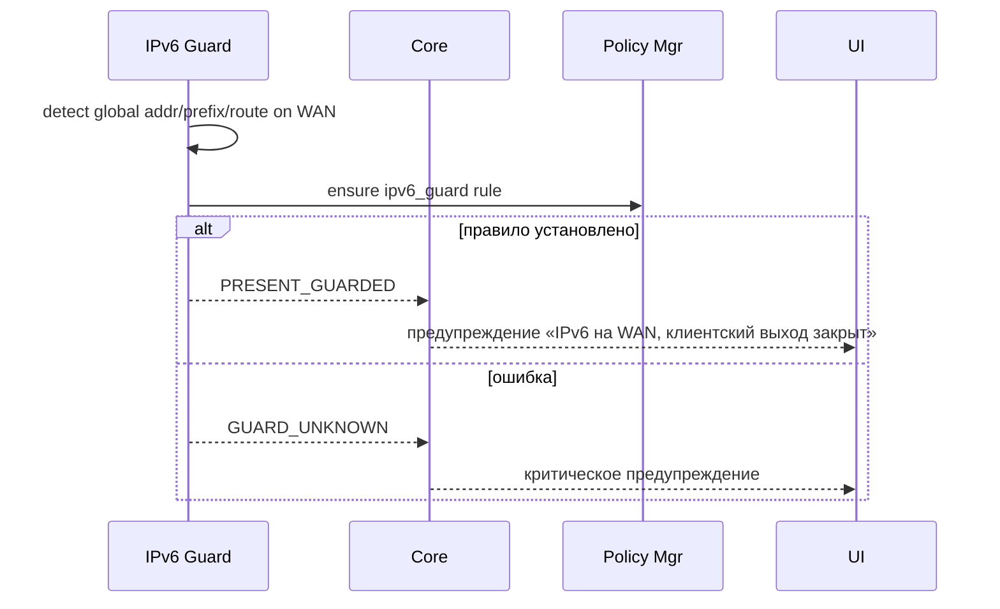

# Документ №10. Этап 2: архитектура Go-демона и подсистем

**Актуализация U9 (26.11.2026, ред. 2).** Действующие компоненты: Core/Supervisor, Policy Manager, Xray Manager (генерация Observatory, balancer, `fallbackTag`, ручной override), Subscription Manager, Profile Manager, Device Manager, Transaction Manager, Storage, аудит, API/ACL, LuCI. **DNS Manager, Failover Manager и Blocklists Manager в архитектуре отсутствуют**; их описания в §4 считаются историческими. Общего журнала событий, аналитики и ресурсного мониторинга в v1 нет. Приложение не хранит состояние доступности серверов: источник — Xray Observatory (§5). Диаграмма §8.4 относится к удалённому failover и является исторической; действующее поведение — №20 §3.

Дата: 22.11.2026
Основание: разрешение владельца на этап 2 (архитектура и контракты). Кодирование, сборка, установка и изменение роутера **не выполнялись и не разрешены**.
Согласовано с: D-01…D-14 (документ №5), этап 1 (документ №8), план (документ №4).
Статусы решений в этом документе: **[У]** — утверждено, **[П]** — предлагается, **[Т]** — требует теста, **[О]** — открытый вопрос.

---

## 1. Границы этапа 2

**Что сделано:** архитектура, контракты, модели данных и состояний, API, матрица владения, матрица ошибок, критерии приёмки.
**Чего нет:** кода, сборки, APK, установки, изменения конфигурации роутера, запуска W-02…W-09 (W-01 запрещён в v1, ТЗ §5).
**Принцип документа:** утверждённые требования не смешиваются с рекомендациями; всё непроверенное помечено **[Т]** или **[О]**.

---

## 2. Архитектурные принципы

| № | Принцип | Основание | Следствие для кода |
|---|---|---|---|
| A1 | Один демон, один владелец каждого ресурса | ТЗ §3.1, §3.4; A-01/A-02 | Нет отдельных скриптов, меняющих nft/route/DNS |
| A2 | Состояние — производное от признаков, а не записанный флаг | D-14, D-06; S1-03 | `ACTIVE` только после проверки трафика; шесть сигналов |
| A3 | Любое изменение сети — транзакция с откатом | D-06; A-03 | Журнал фаз, last-good snapshot, восстановление после ребута |
| A4 | Намерение пользователя — отдельная сущность | D-14 | `intent=disabled` не равно «ошибка» |
| A5 | Fail-safe по умолчанию: нет трафика в неработающий порт | B-05; ТЗ §13 | Порядок «порт готов → правила → проверка» |
| A6 | Нет сетевого порта демона | D-05 | Только ubus/rpcd; ACL + проверка в демоне |
| A7 | Единственный писатель DNS-политики | B-03/B-04; ТЗ §9 | DNS Manager владеет upstream и перехватом 53 |
| A8 | Секреты не покидают демон | ТЗ §17.1 | Маскирование в логах/API/диагностике; файлы 0600 |
| A9 | IPv4-only по внешней маршрутизации; IPv6-подсистема не изменяется; IPv6 Guard и детект глобального IPv6 **вне v1** | D-01 + решение №11 (ТЗ §5) | Ни одной IPv6-цепочки, ни одного IPv6-правила; риск bypass принят (№21 R3-01) |
| A10 | Идемпотентность и сериализация операций | ТЗ §17.3 | Очередь операций, один mutex на изменение сети |
| A11 | Минимальная поверхность: слушатели на loopback/LAN | S1-09, S1-07 | TPROXY только на br-lan; dnsmasq не слушает WAN |
| A12 | Диагностика не меняет состояние | ТЗ §19 | Diagnostics — read-only, отдельные права |

---

## 3. Общая схема



**Потоки:**
- UI → rpcd (проверка ACL) → ubus-метод → Core → очередь операций → модуль → системный адаптер.
- Мониторинг (Failover) работает в отдельной горутине, но **не меняет** политику напрямую: публикует событие/требование, изменение выполняет Transaction Manager под тем же lock.
- События (`vpnmanager.event`) рассылаются всем подписчикам ubus; UI не опрашивает чаще, чем раз в 2 с.

---

## 4. Модули и их место

| Модуль | Роль | Меняет систему | Владеет |
|---|---|---|---|
| Core | жизненный цикл, очередь, lock, события | нет (координирует) | порядок операций, runtime-состояние |
| Transaction Manager | staged apply, rollback, recovery | через модули | журнал транзакций, last-good |
| Policy Manager | nft, fwmark, ip rule, route | **да** | `inet vpnmanager`, таблица 1000, mark |
| Xray Manager | генерация конфига, процесс, валидация, проверки | **да** | `/etc/xray/config.json`, процесс Xray |
| ~~DNS Manager~~ | **superseded U9** — DNS штатный | — | — |
| ~~Blocklists Manager~~ | **superseded U9** — подсистема исключена | — | — |
| ~~IPv6 Guard~~ | ~~детект глобального IPv6, ограничение forward~~ | — | **вне v1** (ТЗ §5); компонент не создаётся |
| Device Manager | обнаружение, идентичность, назначения | нет (данные) | модель устройств |
| Subscription Manager | загрузка, разбор, обновление | нет | подписки, серверы |
| Profile Manager | профили, правила, компиляция | нет | профили, назначения |
| ~~Failover Manager~~ | **superseded U9** — доступность у Xray | — | W-03, W-05 |
| Audit | аудит настроек, Undo | файлы проекта | `audit.jsonl` |
| Storage | атомарная запись, схемы, миграции | файлы проекта | `/etc/vpnmanager` |
| Diagnostics/Backup | отчёты, копии | файлы проекта | архивы |
| ubus API | контракт с UI | нет | объекты и ACL |

Детальные контракты — документ №11; API — №12; данные — №13.

---

## 5. Модель состояний VPN (D-14)

### 5.1 Две независимые оси

1. **Состояние намерения и конфигурации** (что пользователь хочет и что сохранено):

| Состояние | Значение |
|---|---|
| `intent=enabled` / `intent=disabled` | явное намерение пользователя, хранится на Flash |
| `config=Saved` | изменения сохранены, не применены |
| `config=Applied` | применены и подтверждены проверкой |
| `config=PendingReconnect` | профиль ждёт следующего переподключения (D-13) |
| `config=Invalid` | сохранённая конфигурация не проходит валидацию |

2. **Фактическое состояние системы** (вычисляется, не хранится как истина):

`DISABLED_BY_USER`, `STARTING`, `ACTIVE`, `DEGRADED`, `EMERGENCY_DIRECT`, `WAN_DOWN`, `FALLBACK_DIRECT`, `FALLBACK_BLOCK`, `APPLYING`, `ROLLING_BACK`, `STOPPING`, `MAINTENANCE`, `UNKNOWN`. Состояние `SWITCHING` удалено вместе с собственным failover (U9): смена стратегии и ручного override — транзакция `APPLYING`.

`DEGRADED` имеет подпричину: `ENGINE_DOWN`, `POLICY_NOT_APPLIED`, `TRAFFIC_UNVERIFIED`, `CONFIG_STALE`, `STALE_SIGNALS`, `RESIDUAL`, `COLD_START`. Подпричины `SERVER_UNREACHABLE` и `DNS_FAIL` удалены в U9: доступность серверов — предмет Observatory и приложением не хранится, DNS — штатный и вне состояний (№18 §6.1, №20 §3.1).

### 5.2 Шесть признаков (обязательный минимум)

| № | Признак | Источник | Свежесть |
|---|---|---|---|
| S1 | Намерение пользователя | Storage (`intent`) | постоянно |
| S2 | Процесс Xray | procd/ubus service, PID+start time | ≤ 5 с |
| S3 | Конфигурация | хэш файла + `xray -test` + совпадение с генератором | при apply, затем ≤ 60 с |
| S4 | Сетевая политика | наличие/счётчики цепочек, `ip rule`, route | ≤ 10 с |
| S5 | Наблюдаемая доступность серверов (необязательный признак) | Xray Observatory через разрешённый локальный интерфейс чтения — OQ-14; собственной пробы нет | ≤ `probeInterval` + таймаут пробы; при отсутствии интерфейса признак не используется |
| S6 | Реальный трафик | пробный запрос через туннель + счётчики | при apply и ≤ 60 с |

**Правило:** если любой признак старше своего TTL, состояние не может быть `ACTIVE` — выставляется `DEGRADED/STALE_SIGNALS` или `UNKNOWN`. Записанное значение (`mode=vpn`, `alive=1`) признаком не является.

**Ограничение S5.** До решения OQ-14 у приложения нет разрешённого источника данных о доступности серверов: собственная проба удалена вместе с failover. Поэтому S5 не входит в обязательный минимум, не вычисляется «на глаз» и не даёт права показывать доступность серверов или ping в UI. Пять обязательных признаков — S1–S4 и S6.

### 5.3 Приоритет вычисления



Порядок при конфликте признаков (первое совпадение):

| # | Условие | Состояние |
|---|---|---|
| 1 | идёт операция apply/rollback | `APPLYING` / `ROLLING_BACK` |
| 2 | `intent=disabled` и процесс остановлен и правил нет | `DISABLED_BY_USER` |
| 3 | `intent=disabled`, но процесс/правила ещё есть | `STOPPING` (до таймаута), затем `DEGRADED/RESIDUAL` |
| 4 | WAN/PPPoE без default route | `WAN_DOWN` |
| 5 | аварийный latch (ручное или автоматическое снятие) | `EMERGENCY_DIRECT` |
| 6 | нет живых outbound среди серверов подписки (по Observatory), `direct_on_failure=true` | `FALLBACK_DIRECT` — только при разрешённом источнике данных (OQ-14) |
| 6a | то же, `direct_on_failure=false` | `FALLBACK_BLOCK` — то же условие |
| 7 | процесс отсутствует при `intent=enabled` | `STARTING` (в пределах таймаута) → `DEGRADED/ENGINE_DOWN` |
| 8 | процесс есть, политики нет | `DEGRADED/POLICY_NOT_APPLIED` (UI обязан показать «трафик идёт напрямую») |
| 9 | трафик не подтверждён | `DEGRADED/TRAFFIC_UNVERIFIED` |
| 10 | все признаки свежие и положительные | `ACTIVE` |
| 11 | признаков недостаточно | `UNKNOWN` |

**Требование:** «молчаливый DIRECT» невозможен: любое состояние, при котором трафик идёт напрямую при `intent=enabled`, обязано иметь ненулевой код предупреждения в статусе и событие в журнале.

**Уточнение U9-H.** Формулировка относится к наблюдаемому поведению: при `FALLBACK_BLOCK` отсутствие DIRECT обеспечивается конфигурацией Xray (№18 §7.3.1), а не собственной блокировкой демона. Признак S5 в обязательный минимум не входит до решения OQ-14.

---

## 6. IPv6 Guard (P-01, S1-01) — **ВНЕ v1, отложено**

> **Статус на 22.11.2026 (актуализация по ТЗ v1.0 §5, решение №11).** ТЗ v1.0 прямо исключает из первой версии IPv6 VPN, IPv6 TProxy, IPv6 Guard, **обнаружение глобального IPv6**, IPv6-фильтры и специальные IPv6-правила, а также IPv6-тестирование; риск IPv6 bypass принят пользователем (решение №14). Поэтому этот раздел **не является описанием функциональности v1**: он сохранён как проектный задел для v2, чтобы не потерять анализ. Раздел №6 документа №11 и S2-16 в №14 имеют тот же статус. В v1 создаётся **ноль** IPv6-объектов; состояние IPv6 не вычисляется и в API не публикуется. Обоснование и конфликт — №15 §3.2, №21 C3-01.

### 6.1 Что обнаружено (факты этапа 1)

- Глобального IPv6 у провайдера нет; `wan6 up=false pending=true`; адресов/префиксов/default route нет.
- Внутренний IPv6 есть: ULA `fd0a:9818:c7b2::/60`, RA `server` + `ra_slaac` + managed/other-config, DHCPv6 server, 13 neighbor-записей.
- `forwarding=1`; в fw4 `accept_to_wan` не ограничивает семейство; `masquerade` — только `nfproto ipv4`.
- **Отсутствие default route защитой не является** (S1-01).

### 6.2 Контракт стража — архив v2 (в v1 не реализуется)

> Всё в §6.2 и §6.3 — архивная проектная проработка для v2: не контракт v1, не критерий приёмки и не обязательная проверка.

**Входы:** `ubus network.interface` (`wan`, `wan6`), `ip -6 addr`, `ip -6 route`, префиксы odhcpd, факт `ra_lifetime`.
**Выходы:** `ipv6_wan_present` (bool), `ipv6_wan_sources` (адрес/префикс/маршрут), `client_ipv6_egress` (`blocked|allowed`), `guard_installed` (bool), счётчик срабатываний.
**Состояния:** `ABSENT` (глобального IPv6 нет), `PRESENT_UNGUARDED` (есть, правило не стоит — аварийное), `PRESENT_GUARDED` (есть, forward закрыт), `GUARD_UNKNOWN` (не удалось проверить).
**Правило:** при `PRESENT_GUARDED` и `PRESENT_UNGUARDED` UI показывает постоянное предупреждение; `PRESENT_UNGUARDED` — критическое.

### 6.3 Варианты ограничения клиентского IPv6 — архив v2 (в v1 не выбираются)

| Вариант | Суть | LAN и внутренний IPv6 | RA / DHCPv6 | Системный трафик роутера | Оценка |
|---|---|---|---|---|---|
| **A** | В своей таблице `forward`: IPv6 с `iifname br-lan` на `oifname != br-lan` → `drop` + counter | Внутренний IPv6 LAN→LAN не затронут | Не меняются | Не затронут (`output` не фильтруется) | **Рекомендуется [П]**; просто, явно, наблюдаемо; DIRECT-устройства тоже теряют IPv6-выход — это осознанное следствие D-01 |
| **B** | Не объявлять RA-default / не выдавать префикс | Внутренний IPv6 работает | Меняется поведение odhcpd | Не затронут | Не защищает от статической настройки и появления маршрута; как единственный механизм отклонён |
| **C** | `filter_aaaa=1` в dnsmasq | Ломает внутренние AAAA-имена | Не меняются | Не затронут | Не контроль выхода; ложное чувство защиты |
| **D** | `disable_ipv6=1` на `br-lan` | Ломает внутренний IPv6 и LuCI по IPv6 | RA/DHCPv6 прекращаются | Ломает служебный IPv6 | Нарушает D-01; отклонён |
| **E** | Вариант A + отдельное правило для трафика роутера (если появится глобальный IPv6) | Как A | Не меняются | Требует отдельного решения по NAT66/маршрутизации роутера | [О] вне v1; не внедрять |

**Архивная рекомендация для v2 (не решение v1):** вариант A в собственной таблице, цепочка `ipv6_guard` в hook `forward`. Приоритет и точное место — **[Т]** (проверяется только при возврате темы в v2; в v1 W-01 и любые IPv6-тесты запрещены). В v1 цепочка не создаётся.
**Fail-closed (требование задела v2, в v1 неприменимо):** при ошибке установки правила страж не считается работающим (`GUARD_UNKNOWN`). В v1 стража нет, поэтому и этого требования нет.
**Что не делается:** IPv6-туннелирование, IPv6 TProxy, NAT66, отключение IPv6-подсистемы.

---

## 7. Staged Apply и rollback

### 7.1 Фазы транзакции

| Фаза | Действие | Откат при сбое |
|---|---|---|
| P0 `PREPARE` | блокировка, проверка preflight (бинарник, geo, свободное место, занятость mark/таблицы, конфликты D-08) | ничего не менялось |
| P1 `VALIDATE` | сборка конфига в `/tmp`, `xray -test`, сверка хэша | удалить временный конфиг |
| P2 `PREFLIGHT_OUTBOUND` | проверка выбранного сервера без изменения политики | ничего не менялось |
| P3 `STAGE_POLICY` | подготовка nft-транзакции (`nft -c`), проверка ip rule/route | снять подготовленные объекты |
| P4 `START_ENGINE` | запуск Xray, ожидание слушателей с таймаутом | остановить процесс |
| P5 `APPLY_POLICY` | атомарно: route/rule → nft (никогда не оставлять правила на мёртвый порт) | вернуть предыдущую политику |
| P6 `TRIAL` | проверка реального трафика через туннель; опционально canary-устройство | снять политику, вернуть last-good |
| P7 `COMMIT` | запись `config=Applied`, last-good, событие, снятие блокировки | — |
| P8 `ROLLBACK` | восстановление политики/конфига/процесса из last-good, проверка трафика | аварийный DIRECT + EMERGENCY |

Длительности: `xray -test`, окно trial и полный бюджет отката — **[Т]** (W-04). До измерения используются консервативные значения из конфигурации с явным статусом «проектное допущение».

### 7.2 Последовательность apply



### 7.3 Восстановление после сбоя/перезагрузки

- Журнал транзакции пишется до и после каждой фазы (атомарная запись).
- При старте: если последняя транзакция не в `COMMIT`, она считается незавершённой → восстановление last-good, удаление «осиротевших» правил, событие `recovered_after_crash`.
- Если last-good отсутствует или невалиден → `EMERGENCY_DIRECT` (перехват не поднимается), интернет сохраняется, UI показывает причину.
- Ограничение циклов: не более N попыток восстановления за интервал (значение — **[Т]**), затем ручное вмешательство.

---

## 8. Диаграммы основных сценариев

### 8.1 Включение VPN пользователем



### 8.2 Выключение пользователем (штатное)



Ключевое: это **не** ошибка, не `DEGRADED`, не повод для recovery. В журнале — `disabled_by_user` с инициатором.

### 8.3 Неожиданное падение Xray



### 8.4 Сервер недоступен и восстановился — **историческая (U9: см. №20 §3)**

```mermaid
sequenceDiagram
    participant FO as Failover
    participant C as Core
    participant XM as Xray Mgr
    FO->>FO: 2 fail → DEGRADED (без переключения)
    FO->>FO: 3-й fail → сервер недоступен (D-02/C3-15)
    FO->>C: server_unavailable(current)
    C->>C: state=DEGRADED/SERVER_UNREACHABLE
    C->>FO: выбрать следующий по приоритету
    FO-->>C: candidate
    C->>XM: switch (без разрыва: новый порт/экземпляр)
    C->>C: SWITCHING → verify → ACTIVE
    Note over FO: прежний сервер проверяется реже;<br/>возврат — по D-03, без сброса предпочтений
```

### 8.5 Ручное переключение — **уточнено U9: override, см. №18 §7.4**



### 8.6 Появление глобального IPv6 — **архив v2** (диаграмма не описывает поведение v1)

Диаграмма ниже сохранена как материал проекта v2 и **не описывает поведение v1**. В v1 при появлении глобального IPv6 не происходит ничего автоматически: Guard не существует, событие и предупреждение не формируются, наличие глобального IPv6 не обнаруживается и не отображается — ни на Overview, ни в диагностике (ТЗ §5, решение №11). Риск принят (решение №14, №21 R3-01); единственное упоминание сценария в v1 — строка «Появился глобальный IPv6» в §10. Все переходы и предупреждения на диаграмме относятся только к будущему компоненту v2.



---

## 9. Матрица владения системными ресурсами

| Ресурс | Единственный писатель | Кто читает | Транзакция / откат |
|---|---|---|---|
| `table inet vpnmanager` (nft) | Policy Manager | Diagnostics (Blocklists — только решения) | `nft -c` → apply → снимок prev |
| ~~Цепочка `ipv6_guard`~~ | **вне v1** — цепочка не создаётся (решение №11) | — | — |
| `ip rule` (fwmark) | Policy Manager | Diagnostics | снимок prev, восстановление |
| Таблица маршрутизации 1000 | Policy Manager | Diagnostics | снимок prev |
| Процесс Xray | Xray Manager | Supervisor, Diagnostics | stop/start, last-good конфиг |
| `/etc/xray/config.json` | Xray Manager | Xray | prev-копия, атомарная замена |
| `/etc/config/dhcp` (секция dnsmasq) | DNS Manager (только свои опции) | dnsmasq, LuCI | снимок опций, восстановление |
| Include DNS-политики `/etc/vpnmanager/dnsmasq.d/*.conf` | DNS Manager | dnsmasq | файл + reload |
| `/etc/config/network` | **никто** (только чтение) | Diagnostics | не меняется |
| `/etc/config/firewall` | **никто** (только чтение) | preflight, Diagnostics | не меняется (D-08 — только отчёт) |
| `/etc/vpnmanager/**` | Storage | все модули | tmp+rename+fsync, prev |
| `/tmp/vpnmanager/**` | Core/модули | Diagnostics | не переживает ребут |
| ~~Flash-журнал~~ | **superseded U9** | — | общего журнала событий нет |
| Backup-архив | Backup | пользователь | создаётся по запросу |
| ubus-объекты `vpnmanager.*` | ubus API | LuCI | регистрация при старте |
| `/etc/init.d/vpnmanager` | пакет (не демон) | procd | вне транзакций |

Правило: **два писателя одного ресурса запрещены**. Если модулю нужно изменить чужой ресурс, он вызывает владельца.

---

## 10. Матрица ошибок и восстановления

| Отказ | Обнаружение | Немедленное действие | Состояние | Восстановление | Риск для пользователя |
|---|---|---|---|---|---|
| Xray не стартует | exit code / нет слушателей | не поднимать перехват | `DEGRADED/ENGINE_DOWN` | backoff, затем EMERGENCY | интернет есть, VPN нет |
| Xray упал после старта | procd/ubus + PID | правила сохраняются; listener мёртв | `DEGRADED/ENGINE_DOWN` | рестарт по backoff | краткий сбой перехвата; при `direct_on_failure=false` DIRECT не включается |
| Ошибка конфига | `xray -test` | отменить apply | `config=Invalid` | last-good | нет |
| Нет исходящего соединения | preflight/trial | откат | `DEGRADED/TRAFFIC_UNVERIFIED` | last-good; выбор сервера — Xray, не приложение | нет/краткий |
| Ошибка nft | `nft -c`/exit | не применять | `DEGRADED/POLICY_NOT_APPLIED` | last-good | возможен DIRECT с предупреждением |
| Ошибка ip rule/route | exit code | откат политики | `DEGRADED` | last-good | нет мёртвого порта |
| WAN/PPPoE down | netifd/ubus | не считать сервер виновным | `WAN_DOWN` | ждать WAN + проверка | интернет отсутствует по WAN |
| DNS не отвечает | внешняя проверка (read-only) | не вмешиваться: DNS вне Xray и вне состояний VPN | состояние сервиса не меняется; при неподтверждённом трафике — `DEGRADED` | штатный DNS OpenWrt или действие пользователя | сайты не открываются |
| `dnsmasq` упал | procd/ubus | вне области приложения: приложение не управляет DNS | состояние VPN не меняется | штатный OpenWrt | сайты не открываются |
| Падение демона | procd | перезапуск демона | `UNKNOWN` → пересчёт | recovery по журналу | состояние может мигать |
| Перезагрузка во время apply | журнал фаз | отбросить незавершённую | `ROLLING_BACK` → `ACTIVE/EMERGENCY` | last-good | краткий DIRECT |
| Нет места на Flash | statfs при prepare | запретить apply/backup | `DEGRADED/CONFIG_STALE` | очистка журнала/архивов | нет |
| OOM | ядро/procd | перезапуск, снижение детализации логов | `UNKNOWN` | пересчёт | краткий сбой |
| Появился глобальный IPv6 | — (в v1 не отслеживается) | никаких действий | состояние не меняется | — | принятый риск R3-01: клиент может выйти по IPv6 |
| Конфликт чужого правила | preflight | только отчёт | `DEGRADED` | решение пользователя (D-08) | зависит от конфликта |
| Массовые ложные «серверы недоступны» | Observatory (только при разрешённом источнике, OQ-14) | не вмешиваться: выбор делает Xray | `FALLBACK_*` — при разрешённом источнике | следующая пауза `probeInterval` | временный DIRECT либо `blackhole` по настройке |
| Повреждён geo-файл | проверка размера/хэша | не применять профиль | `config=Invalid` | восстановление из пакета | нет |
| Несовместимая версия backup | restore-валидация | отказать | — | ручной разбор | нет |

---

## 11. Конкурентность и блокировки

- Одна очередь операций изменения (enable/disable/apply/switch/restore); параллельный запрос получает `VM_ERR_BUSY` с `retry_after`.
- Один mutex на изменение сети (nft/rule/route/процесс/DNS).
- Мониторинг и диагностика — только чтение, без mutex.
- Таймауты каждой фазы; по истечении — откат, а не ожидание бесконечно.
- Запрещено: удерживать lock во время сетевого запроса к серверу (preflight выносится за пределы критической секции с проверкой ревизии конфигурации перед commit).

---

## 12. Безопасность

| Требование | Реализация |
|---|---|
| Нет сетевого порта | только ubus/rpcd; слушателей у демона нет |
| ACL | `acl.d/vpnmanager.json`, разделение чтения/изменения/диагностики |
| Повторная проверка прав | демон проверяет uid/rpcd-сессию, не доверяет UI |
| Секреты | файлы 0600, маскирование в API/логах/диагностике, URL подписки не пишется в журнал |
| Валидация входа | строгие схемы, лимиты размеров, запрет shell-интерполяции |
| Запись файлов | атомарно, владелец root, без world-readable |
| Backup | без шифрования (D-10), права 0600, предупреждение в UI |
| Опасные операции | очистка (D-08), restore — только с подтверждением и записью инициатора (Guard в v1 нет) |

---

## 13. Ресурсы и размещение

| Параметр | Ориентир | Статус |
|---|---|---|
| Бинарник демона | стремиться к ≤ 12 МБ (strip, `-s -w`) | [Т] измерить при сборке |
| RAM демона в покое | ≤ 25 МБ RSS | [Т] |
| RAM при мониторинге 30 с | ≤ 35 МБ | [Т] |
| Flash: демон + схемы | ≤ 15 МБ | [Т] |
| `/tmp` подробные логи | ≤ 10 МБ, ротация | [Т] (W-07) |
| Flash-журнал | 256 КБ + 1 ротация | [П], проверить W-07 |
| Запуск | procd, respawn с backoff | [П] |

Свободно на устройстве: overlay 40.8 МБ, `/tmp` 116.7 МБ, RAM доступно 122.9 МБ (этап 1). Запас есть, но бинарник Xray уже занимает 28.3 МиБ.

---

## 14. Что в этом документе не решено

| Вопрос | Статус | Где решается |
|---|---|---|
| ~~Вариант IPv6-стража (A/B/C/D/E)~~ | **закрыт**: вне v1 (решение №11) | №21 C3-01, R3-01 |
| Номер таблицы и fwmark | предлагается 1000 / `0x1000`, проверить занятость | №14, preflight |
| Приоритет nft-цепочек | только prerouting −150; forward −5 не применяется (нет Guard) | №14, W-02 |
| Длительность trial и бюджет отката | требует теста (W-04) | №14 |
| Транспорт DoH (свой vs `https-dns-proxy`) | предлагается свой в Go | №14 |
| Поведение при offload | требует теста (W-02) | №14 |
| Точные лимиты сущностей | предлагается, проверить по RAM | №13 |
| Blocklists, приоритеты, Maintenance | **добавлены** 22.11.2026 | №18, №19, №20 |

## 15. Что добавлено при актуализации по ТЗ v1.0

| Добавление | Документ |
|---|---|
| Подсистема Blocklists (источники, версии, diff, rollback, whitelist, статистика) | №19 |
| Формальная модель приоритетов (P0–P9, D0–D5, Always DIRECT, UDP) | №18 |
| Состояния `PROXY_FALLBACK_DIRECT`, `MAINTENANCE`, DNS, Blocklists | №20 |
| Статистика (48 ч/30 дней), аудит настроек, Undo, аномалии | №13 §8–§10, №11 §14 |
| Группы устройств, массовые операции, временные overlay | №13 §4.4, №18 §4 |
| Требования и объём v1 | №17, №22 |
