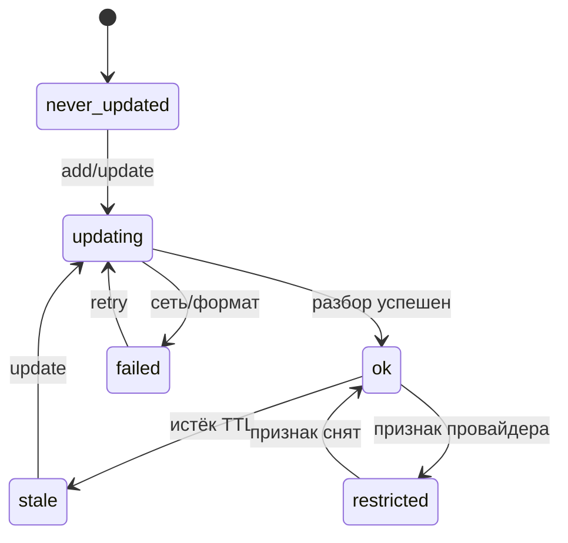
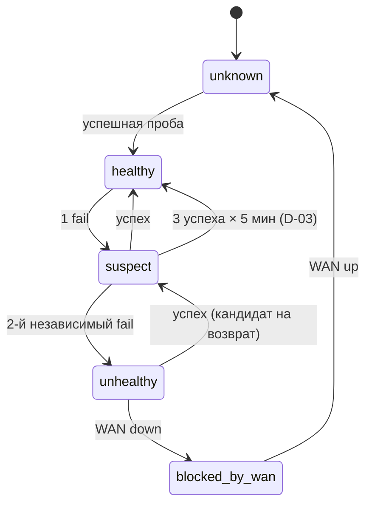

# Документ №13. Этап 2: модели данных и состояний

Дата: 22.11.2026
Основание: D-09, D-10, D-13, D-14; документы №10–№12.
Статусы: **[У]** утверждено, **[П]** предлагается, **[Т]** требует теста, **[О]** открытый вопрос.
Кодирование не выполнялось.

---

## 1. Сущности

| Сущность | Назначение | Ключ | Хранение |
|---|---|---|---|
| `Intent` | намерение пользователя (VPN вкл/выкл) | singleton | `/etc/vpnmanager/settings.json` |
| `Settings` | общие настройки (интервалы, UDP-режим, DNS-цепочка) | singleton | там же |
| `Subscription` | источник серверов | `sub_<id>` | `subscriptions.json` |
| `Server` | узел подключения | `srv_<hash>` (устойчивый) | `servers.json` |
| `Profile` | правила маршрутизации | `prf_<id>` | `profiles.json` |
| `Assignment` | сервер → профиль, устройство → режим | составной | `assignments.json` |
| `Device` | клиент LAN | MAC (нормализованный) | `devices.json` |
| `DnsPolicy` | цепочка, AAAA-режим | singleton | `dns.json` |
| `UdpPolicy` | режим UDP, allowlist | singleton | `settings.json` |
| `Transaction` | применение конфигурации | `tx_<id>` | журнал + `/tmp` |
| `JournalEvent` | событие | `seq` | кольцо Flash + `/tmp` |
| `RuntimeState` | вычисленное состояние | singleton | `/tmp/vpnmanager` (не источник истины) |
| `DeviceGroup` | группа устройств (без routing rules) | `grp_<id>` | `devices.json` |
| `Overlay` | временный DIRECT / временное отключение списков | `(target, kind)` | `devices.json` / `blocklists/sets.json` |
| `BlocklistSource` | внешний или локальный список | `src_<hash>` | `blocklists/sources.json` |
| `BlocklistVersion` | версия списка (staged/active/rejected) | `ver_<ts>_<hash8>` | `blocklists/versions/**` |
| `BlocklistEntry` | домен + происхождение | домен | версия + индекс |
| `WhitelistEntry` | домен/суффикс, исключение | домен | `blocklists/whitelist.json` |
| `SystemException` | критический домен/IP | домен/IP | `blocklists/system_exceptions.json` |
| `StatAggregate` | почасовые/дневные агрегаты | `(bucket, period)` | `/etc/vpnmanager/stats/**` |
| `AuditEntry` | изменение настройки с источником | `seq` | `/etc/vpnmanager/audit.jsonl` |

**Правило:** секреты (UUID, ключи, URL с токеном) хранятся только в `servers.json`/`subscriptions.json` с правами 0600 и никогда не попадают в журналы, отчёты и API после сохранения.

---

## 2. Файлы и раскладка

```text
/etc/vpnmanager/
  schema.json            # версия схемы, миграции
  settings.json          # intent + общие настройки
  subscriptions.json     # источники (URL с токеном)
  servers.json           # серверы + секреты (0600)
  profiles.json          # профили
  assignments.json       # назначения
  devices.json           # устройства и режимы
  dns.json               # DNS/UDP-политика
  state.json             # last-known intent/config_state (не истина!)
  blocklists/            # источники, категории, версии, whitelist, системные исключения
  stats/                 # агрегаты: hourly/ (48 ч), daily/ (30 дней), total/
  audit.jsonl            # аудит настроек (ротация, без секретов)
  last-good/             # последняя рабочая конфигурация + правила
  backup/                # архивы (0600)
  journal/events.log     # кольцо 256 КБ + events.log.1
/tmp/vpnmanager/
  runtime.json           # снимок признаков (не переживает ребут)
  logs/*.log             # подробный поток, ротация
  tx/<tx_id>.json        # журнал фаз
  xray/config.json       # сгенерированный конфиг
  dnsmasq.d/*.conf       # include DNS-политики
```

**Атомарная запись:** временный файл в том же каталоге → `fsync` → `rename` → `fsync` каталога. Права: каталог 0700, файлы с секретами 0600, остальные 0644.
**Единственный писатель:** Storage; модули не пишут файлы напрямую.
**Запрещено:** хранить истину о состоянии только в `/tmp`; считать `state.json` доказательством работы VPN.

---

## 3. Устойчивый ID сервера

```
canonical = protocol | host(lowercase) | port | transport | security | credential_fingerprint
srv_id    = "srv_" + base32(sha256(canonical))[0:16]
```

- `credential_fingerprint` — хэш UUID/пароля/ключа (не сам секрет), чтобы смена пароля давала новый ID.
- ID не зависит от имени, подписки и порядка — переупорядочивание и косметические правки его не меняют.
- Коллизия (первые 16 символов совпали при разных canonical) → добавить суффикс `-2`, зафиксировать в отчёте импорта.
- Удалённый сервер сохраняет «могилу» (tombstone) 30 дней, чтобы назначения и история не «оживали» при повторном импорте. Срок — [П].

---

## 4. Схемы (сокращённо)

### 4.1 `settings.json`

```json
{
  "schema_version": 1,
  "intent": "enabled",
  "monitor": {"interval_s": 30, "timeout_s": 8, "max_parallel": 3, "fail_threshold": 2},
  "recovery": {"success_count": 3, "success_interval_min": 5},
  "udp": {"mode": "proxy", "allowlist": []},
  "ui": {"show_advanced": false}
}
```

`monitor`/`recovery` — утверждённые значения D-02/D-03; фактические границы производительности — [Т] (W-03).

### 4.2 `servers.json` (фрагмент)

```json
{
  "schema_version": 1,
  "servers": [{
    "id": "srv_7f3a…",
    "subscription_id": "sub_1",
    "protocol": "vless",
    "host": "example.net",
    "port": 443,
    "transport": "tcp",
    "security": "reality",
    "sni": "example.net",
    "fingerprint": "chrome",
    "public_key_ref": "secret:1",
    "credential_ref": "secret:2",
    "name": "Node A",
    "order": 10,
    "enabled": true,
    "restricted": false,
    "first_seen": 1795000000000,
    "last_seen": 1795340000000
  }]
}
```

Секреты адресуются по `secret:<n>` и хранятся в защищённой секции файла; API возвращает только `has_credentials: true`.

### 4.3 `profiles.json`

```json
{
  "schema_version": 1,
  "profiles": [{
    "id": "prf_default",
    "name": "Default",
    "route_order": ["block", "direct", "proxy"],
    "lists": {"block": [], "direct": [], "proxy": []},
    "domain_strategy": "IPIfNonMatch",
    "global_proxy": true,
    "udp": "proxy",
    "revision": 3,
    "state": "applied"
  }]
}
```

### 4.4 `devices.json`

```json
{
  "schema_version": 1,
  "devices": [{
    "mac": "aa:bb:cc:dd:ee:ff",
    "aliases": ["aa:bb:cc:dd:ee:00"],
    "ip": "192.168.1.135",
    "hostname": "laptop",
    "mode": "always_direct",
    "online": false,
    "last_seen": 1795340000000,
    "source": "dhcp+neigh"
  }]
}
```

### 4.5 `state.json` (подсказка, не истина)

```json
{"schema_version":1,"intent":"enabled","config_state":"Applied","last_tx":"tx_…","updated":1795344000000}
```

При старте `state.json` **не** делает систему `ACTIVE`: состояние пересчитывается по шести признакам (D-14).

---

## 5. Машины состояний

### 5.1 Подписка



Правило: `failed`/`stale` не удаляют серверы и не меняют активный сервер.

### 5.2 Здоровье сервера



### 5.3 Профиль

`draft → saved → applied`; `saved → pending_reconnect` при активном VPN без разрыва (D-13); `invalid` — при ошибке валидации, не заменяет рабочий.

### 5.4 Транзакция

`PREPARE → VALIDATE → PREFLIGHT → STAGE → START → APPLY → TRIAL → COMMIT`, ветка `ROLLBACK`. Незавершённая при старте → recovery (документ №10 §7.3).

### 5.5 Устройство

`unknown → online ⇄ offline`; `merged` — объединение алиасов; `forgotten` — удаление записи с подтверждением.

---

## 6. Лимиты и хранение

| Объект | Лимит | Обоснование | Статус |
|---|---|---|---|
| Серверы | 512 | RAM/время старта | [П], проверить |
| Подписки | 16 | практика | [П] |
| Профили | 64 | практика | [П] |
| Устройства | 256 | DHCP-пул/типичная LAN | [П] |
| Offline-устройства | 90 дней | удобство | [П] |
| Tombstone сервера | 30 дней | целостность назначений | [П] |
| Flash-журнал | 256 КБ + 1 | D-09 | [П], W-07 |
| `/tmp` логи | 10 МБ | RAM | [П], W-07 |
| Backup | ≤ 1 МБ | состав D-10 | [П], W-08 |
| Blocklists: источники | 32 | проектное | [П], W-12 |
| Blocklists: записей суммарно | 100 000 | размер include/время reload | [Т], W-12 |
| Blocklists: версий на источник | 5 | место на Flash vs откат | [П] |
| Blocklists: размер источника | 16 МБ | RAM при парсинге | [Т], W-12 |
| Статистика: почасовые | 48 ч | решение №68 | [У] |
| Статистика: дневные | 30 дней | решение №68 | [У] |
| Аудит: записей | 20 000 + ротация | Flash | [П] |

При переполнении — отказ с понятной ошибкой, без молчаливого удаления пользовательских данных.

---

## 7. Backup и restore (D-10)

**Состав:** `settings.json`, `subscriptions.json`, `servers.json`, `profiles.json`, `assignments.json`, `devices.json`, `dns.json`, `schema.json`.
**Исключено:** GeoIP/GeoSite, журналы, `/tmp`, runtime, любые временные файлы.
**Формат:** `tar.gz` с `manifest.json`:

```json
{"schema_version":1,"created":1795344000000,"app_version":"…","files":["…"],"sha256":"…"}
```

**Правила:**
1. Архив без шифрования (D-10), права 0600, UI предупреждает о секретах.
2. Restore проверяет `schema_version` и хэши; несовместимая версия → отказ с причиной.
3. Restore не активирует конфигурацию автоматически: после импорта требуется `apply` с валидацией.
4. Перед restore создаётся автоматическая копия текущего состояния.
5. Восстановление не перезаписывает журналы и не меняет системные файлы OpenWrt.

---

## 8. Журналы (D-09)

**Flash (`/etc/vpnmanager/journal/events.log`)** — JSONL, только важные события: `intent_changed`, `state_changed` (с причиной), `failover`, `emergency`, `apply/rollback`, `guard_failed`, `storage_error`, `disabled_by_user`, `recovered_after_crash`.
Поля: `seq`, `ts`, `type`, `severity`, `actor` (`user|system|watchdog`), `data` (без секретов).
Ротация: 256 КБ → `.1`; rate limit на повторяющиеся события (например, не чаще 1/мин на тип); при переполнении — счётчик подавленных.

**`/tmp/vpnmanager/logs/`** — подробный поток с уровнями, ротация по размеру, не переживает ребут.
**Маскирование:** URL/токены/UUID/ключи/пароли — до записи, а не при чтении.

---

## 8a. Статистика (решение №68)

| Бакет | Период хранения | Агрегация |
|---|---|---|
| `hourly` | 48 часов | сырые счётчики по часам |
| `daily` | 30 дней | сумма/среднее за день |
| `total` | бессрочно (агрегат) | накопительные объёмы, без детализации |

Поля: `device_mac`, `direction` (in/out), `verdict` (direct/proxy/block), `bytes`, `packets`, `period`, `source` (nft/dns). 
**Правила:** подробный сбор отключается; при отключении данные не пишутся (а не «пишутся, но не показываются»); запись на Flash контролируется бюджетом; экспорт CSV/JSON — только по запросу; DNS BLOCK-события учитываются отдельно от сетевых блокировок и не суммируются с ними.
**Ограничение:** достоверность зависит от offload (R3-07) и от способности ядра считать пакеты; при сомнительных данных UI говорит «оценка недоступна», а не показывает число.

## 8b. Аудит настроек (решение №70)

JSONL, append-only: `seq`, `ts`, `actor` (проверенный субъект), `source` (`luci|import|automatic|recovery|api`), `object`, `field`, `old`, `new`, `result`, `undoable`, `tx_id`.
**Правила:** секреты маскируются до записи; Undo возможен только для `undoable` и только при отсутствии зависимостей; критический автоматический rollback — отдельный тип записи, не Undo. Аудит не переписывается задним числом и не удаляется пользователем через UI (только ротация).

## 9. Миграции

- `schema_version` в каждом файле; при старте — проверка и последовательные миграции.
- Миграция атомарна: копия → преобразование → проверка → замена; при ошибке — откат к копии и отказ старта с понятной ошибкой.
- Понижение версии не поддерживается: старый демон не должен читать новый файл (проверка версии).
- Backup перед миграцией создаётся автоматически.

---

## 10. Что требует проверки

| Параметр | Зависимость | Статус |
|---|---|---|
| Лимиты сущностей | RAM, время старта | [Т] |
| Размер backup | W-08 | [Т] |
| Объём журнала/ротация | W-07 | [Т] |
| Поведение `fsync`/`rename` на overlay | платформа | [Т] |
| Совместимость схемы ACL/ubus | T-05 | [Т] |
