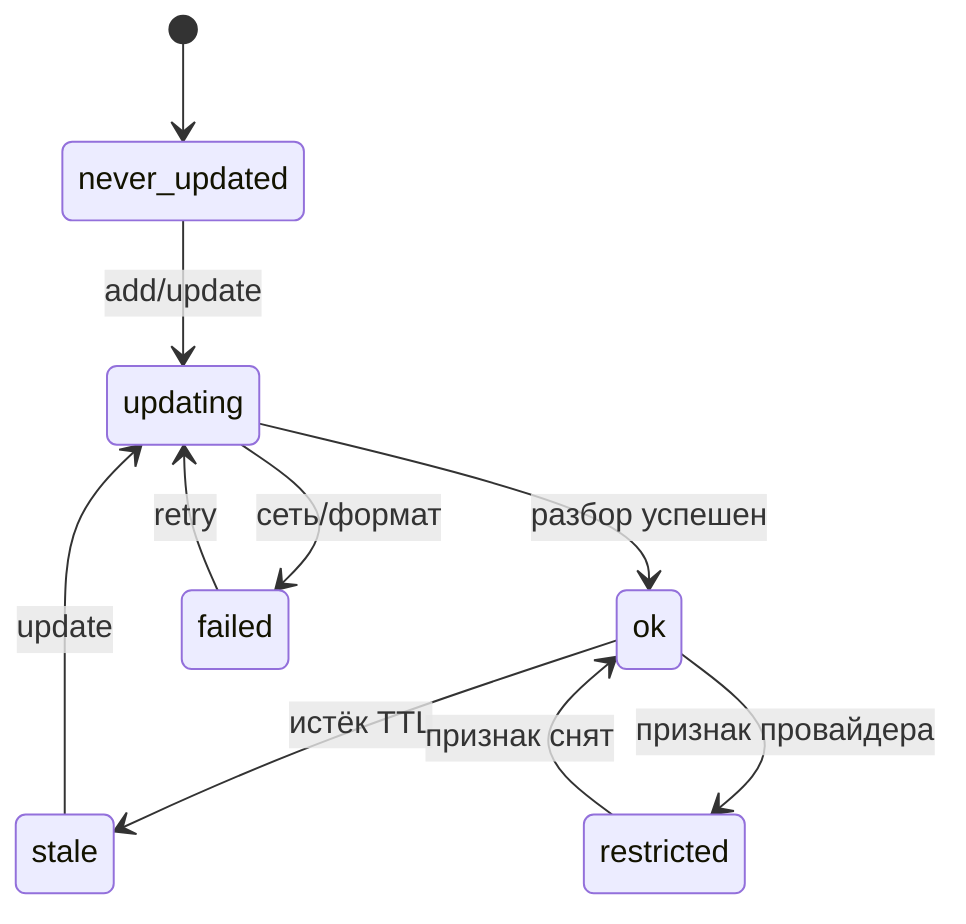

# Документ №13. Этап 2: модели данных и состояний

**Актуализация U9 (26.11.2026, ред. 2 — по итогам независимого ревью).** Документ приведён целиком к одной модели U9: удалены `DnsPolicy`, `BlocklistSource`/`Version`/`Entry`, `WhitelistEntry`, `SystemException`, `StatAggregate`, `JournalEvent`, файлы `dns.json`, `blocklists/`, `stats/`, `journal/events.log`, DNS в backup, DNS-цепочки и статистика. В `settings.json` не осталось `monitor`, `recovery` и `udp.mode`. Добавлены стратегия, ручной override, `direct_on_failure`, автообновление подписки и параметры ротации Xray-логов (§11). Уточнено правило сохранения override при обновлении подписки (§3).

Дата: 22.11.2026.
Основание: D-09, D-10, D-13, D-14; документы №10–№12.
Статусы: **[У]** утверждено, **[П]** предлагается, **[Т]** требует теста, **[О]** открытый вопрос.
Кодирование не выполнялось.

---

## 1. Сущности

| Сущность | Назначение | Ключ | Хранение |
|---|---|---|---|
| `Intent` | намерение пользователя (VPN вкл/выкл) | singleton | `/etc/vpnmanager/settings.json` |
| `Settings` | общие настройки (стратегия, override, `direct_on_failure`, автообновление, UDP allowlist, логи) | singleton | там же |
| `Subscription` | источник серверов | `sub_<id>` | `subscriptions.json` |
| `Server` | узел подключения | `srv_<hash>` — только в текущем наборе | `servers.json` |
| `Profile` | правила маршрутизации | `prf_<id>` | `profiles.json` |
| `Assignment` | сервер → профиль, устройство → режим | составной | `assignments.json` |
| `Device` | клиент LAN | MAC (нормализованный) | `devices.json` |
| `UdpPolicy` | allowlist портов и диапазонов UDP | singleton | `settings.json` |
| `Transaction` | применение конфигурации | `tx_<id>` | журнал фаз + `/tmp` |
| `RuntimeState` | вычисленное состояние | singleton | `/tmp/vpnmanager` (не источник истины) |
| `DeviceGroup` | группа устройств (без routing rules) | `grp_<id>` | `devices.json` |
| `Overlay` | временный DIRECT устройства | `(mac, kind)` | `devices.json` |
| `AuditEntry` | изменение настройки с источником | `seq` | `/etc/vpnmanager/audit.jsonl` |

**Удалённые сущности (superseded U9, сохранены как история):** `DnsPolicy` и `dns.json`; `BlocklistSource`, `BlocklistVersion`, `BlocklistEntry`, `WhitelistEntry`, `SystemException`; `StatAggregate` и `stats/`; `JournalEvent` и `journal/events.log`. Соответствующих файлов, полей и API нет (№17 §15, №22 §5).

**Правило:** секреты (UUID, ключи, URL с токеном) хранятся только в `servers.json`/`subscriptions.json` с правами 0600 и никогда не попадают в журналы, отчёты и API после сохранения.

---

## 2. Файлы и раскладка

```text
/etc/vpnmanager/
  schema.json            # версия схемы, миграции
  settings.json          # intent + общие настройки (стратегия, override, UDP allowlist, логи)
  subscriptions.json     # источники (URL с токеном)
  servers.json           # серверы + секреты (0600)
  profiles.json          # профили
  assignments.json       # назначения
  devices.json           # устройства, режимы, временный DIRECT
  audit.jsonl            # аудит изменений настроек (ротация, без секретов)
  last-good/             # последняя рабочая конфигурация + правила
  backup/                # архивы (0600)
/etc/logrotate.d/
  vpnmanager              # конфигурация ротации двух Xray-логов (файл проекта)
/tmp/vpnmanager/
  runtime.json           # снимок признаков (не переживает ребут)
  logs/access.log        # Xray access log (путь задаёт конфигурация Xray)
  logs/error.log         # Xray error log
  tx/<tx_id>.json        # журнал фаз
  xray/config.json       # сгенерированный конфиг
```

**Удалено (superseded U9):** `dns.json`, `dnsmasq.d/`, `blocklists/`, `stats/`, `journal/events.log`.

**Атомарная запись:** временный файл в том же каталоге → `fsync` → `rename` → `fsync` каталога. Права: каталог 0700, файлы с секретами 0600, остальные 0644.
**Единственный писатель:** Storage; модули не пишут файлы напрямую.
**Запрещено:** хранить истину о состоянии только в `/tmp`; считать `state.json` доказательством работы VPN.

---

## 3. Внутренний ID сервера и сохранение ручного override

**Актуализация U9.** `srv_id` — идентификатор **в текущем сохранённом наборе**, а не межверсийная идентичность.

1. `srv_id` нужен для ссылки на сервер в текущем наборе: отображение, правила интерфейса, ручной override.
2. При успешном обновлении подписки набор и его `srv_id` создаются **заново**. Постоянная идентичность сервера между версиями подписки не поддерживается.
3. `identity_fields`, `credential_fingerprint`, 90-дневная история идентичностей, «автоматическое восстановление изменённых серверов» и нечёткое сопоставление **не используются**.
4. Идентичность **устройства** (MAC) определяется отдельно и к ID сервера отношения не имеет.

### 3.1 Правило ручного override при успешном обновлении

Ручной выбор **сохраняется**, пока выбранный сервер остаётся в новой подписке; сброс в `auto` — только если сервер исчез. Для этого в рамках одного обновления выполняется минимальное точное сравнение:

1. Перед заменой набора вычисляется **нормализованная конфигурация подключения** закреплённого сервера: `protocol`, `host` (нижний регистр, без завершающей точки), `port` (с подставленным значением по умолчанию), `transport`, `security`, `sni` (нижний регистр), `path`/`host` для ws/grpc, REALITY `public_key`, `fingerprint`.
2. Те же поля вычисляются для каждого сервера нового набора. Сравнение — точное равенство нормализованных значений (после trim); хэш SHA-256 используется только как ключ сравнения.
3. **Не сравниваются:** отображаемое имя, `order`, `first_seen`/`last_seen`, `subscription_id`, `restricted`, UUID/пароль пользователя. Смена ключа доступа у того же узла не считается исчезновением сервера; смена адреса, порта, протокола, транспорта, SNI или REALITY-ключа — считается.
4. Если найдено ровно одно совпадение — `mode` остаётся `manual`, `manual_server_id` перепривязывается к новому `srv_id`, публикуется `override.preserved`. Если совпадений несколько (полностью одинаковые конфигурации), берётся первый в новом наборе: записи взаимозаменяемы, выбор детерминирован.
5. Если совпадений нет — `mode` становится `auto`, `manual_server_id` очищается, публикуется `override.reset` с причиной `server_absent`.
6. Сравнение выполняется только в памяти в ходе текущего обновления; его результат не хранится как история, не архивируется и не влияет на `srv_id` других серверов.
7. Настройки, ссылающиеся на удалённый `srv_id`, отклоняются валидацией.

**Критерий:** обновление с другим порядком серверов сохраняет override; обновление без закреплённого сервера сбрасывает его в `auto`; никакое поле не хранит fingerprint для сравнения версий.

## 4. Схемы (сокращённо)

### 4.1 `settings.json`

```json
{
  "schema_version": 1,
  "intent": "enabled",
  "strategy": "random",
  "selection_mode": "auto",
  "manual_server_id": null,
  "direct_on_failure": true,
  "subscription": {"autoupdate": {"enabled": false, "interval_hours": 24}},
  "udp": {"allowlist": []},
  "logs": {"rotate_size_mb": 5},
  "ui": {"show_advanced": false}
}
```

`strategy` — `random` | `roundRobin` | `leastPing` | `leastLoad`. `selection_mode` — `auto` | `manual`; `manual_server_id` имеет смысл только при `manual` и ссылается на `srv_id` текущего набора. `direct_on_failure` — глобальная настройка, по умолчанию `true`. `udp.allowlist` — единственный параметр UDP. Интервалы Observatory и пороги отказов в настройках приложения отсутствуют: они принадлежат Xray (`probeInterval`, `enableConcurrency`).

### 4.2 `servers.json` (фрагмент)

```json
{
  "schema_version": 1,
  "servers": [{
    "id": "srv_7f3a…",
    "subscription_id": "sub_1",
    "protocol": "vless",
    "host": "example.net",
    "port": 443,
    "transport": "tcp",
    "security": "reality",
    "sni": "example.net",
    "fingerprint": "chrome",
    "public_key_ref": "secret:1",
    "credential_ref": "secret:2",
    "name": "Node A",
    "order": 10,
    "enabled": true,
    "restricted": false,
    "first_seen": 1795000000000,
    "last_seen": 1795340000000
  }]
}
```

Секреты адресуются по `secret:<n>` и хранятся в защищённой секции файла; API возвращает только `has_credentials: true`. Поля здоровья сервера, приоритета и `last_working_server` отсутствуют.

### 4.3 `profiles.json`

```json
{
  "schema_version": 1,
  "profiles": [{
    "id": "prf_default",
    "name": "Default",
    "route_order": ["direct", "proxy"],
    "lists": {"direct": [], "proxy": []},
    "domain_strategy": "IPIfNonMatch",
    "global_proxy": true,
    "revision": 3,
    "state": "applied"
  }]
}
```

Блокирующего уровня в профиле нет: допустимы только `direct` и `proxy`. UDP-режим в профиле не задаётся — UDP определяется уровнем L2 (allowlist) модели №18.

### 4.4 `devices.json` (U9)

```json
{
  "devices": [
    {
      "id": "aa:bb:cc:dd:ee:ff",
      "label": "Телевизор",
      "mode": "always_direct",
      "temp_direct": { "expires": null },
      "group": "media",
      "profile_id": null,
      "first_seen": "2026-11-20T10:00:00Z",
      "last_seen": "2026-11-26T09:00:00Z"
    }
  ]
}
```

| Поле | Смысл | Ограничения |
|---|---|---|
| `id` | MAC-адрес | не меняется при переименовании; авто-объединение запрещено |
| `label` | пользовательская метка | приоритет над DHCP hostname |
| `mode` | `follow` или `always_direct` | меняет только пользователь |
| `temp_direct.expires` | overlay до указанного времени; `null` — бессрочно | истечение не меняет `mode` |
| `group` | группа (массовые операции) | не влияет на маршрутизацию |
| `profile_id` | профиль устройства или `null` | независим от подписки |

**Удалённые поля (superseded U9):** `proxy_fallback` (заменено глобальным `direct_on_failure`), `last_working_server` (выбор сервера выполняет Xray), `blocklist_set`, `temp_blocklist_off`, DNS-атрибуция устройства.

### 4.5 `state.json` (подсказка, не истина)

```json
{"schema_version":1,"intent":"enabled","config_state":"Applied","last_tx":"tx_…","updated":1795344000000}
```

При старте `state.json` **не** делает систему `ACTIVE`: состояние пересчитывается по шести признакам (D-14). Поля здоровья сервера и статистики в нём отсутствуют.

---

## 5. Машины состояний

### 5.1 Подписка



Правило: `failed`/`stale` не удаляют серверы и не меняют активный сервер.

### 5.2 Здоровье сервера — **не хранится (superseded U9)**

Приложение не хранит состояние доступности серверов: нет `server_health`, `suspect`/`degraded`/`unavailable`, счётчиков отказов, `last_working_server` и административного исключения как отдельной модели здоровья.

Источник доступности — штатный Xray Observatory через локальный gRPC `ObservatoryService.GetOutboundStatus` (OQ-14, вариант B, 27.11.2026). Приложение отображает то, что сообщает Xray, и не выводит собственных порогов.

Данные наблюдения — **транзиентные**: они живут в памяти с TTL и не сохраняются в `state.json`/`servers.json` как здоровье сервера. Перезапуск приложения или Xray не создаёт историю доступности; после рестарта состояние — «нет данных» до первого цикла. Состояния сервиса (`FALLBACK_DIRECT`, `FALLBACK_BLOCK`) описаны в №20 §3, относятся к сервису, а не к серверу, и публикуются как производные (№12 §4.1).

**Критерий:** в `state.json`, `servers.json` и runtime нет полей здоровья сервера; перезапуск приложения не создаёт «историю здоровья».

### 5.3 Профиль

`draft → saved → applied`; `saved → pending_reconnect` при активном VPN без разрыва (D-13); `invalid` — при ошибке валидации, не заменяет рабочий.

### 5.4 Транзакция

`PREPARE → VALIDATE → PREFLIGHT → STAGE → START → APPLY → TRIAL → COMMIT`, ветка `ROLLBACK`. Незавершённая при старте → recovery (документ №10 §7.3).

### 5.5 Устройство

`unknown → online ⇄ offline`; `merged` — объединение алиасов; `forgotten` — удаление записи с подтверждением.

---

## 6. Лимиты и хранение

| Объект | Лимит | Обоснование | Статус |
|---|---|---|---|
| Серверы | 512 | RAM/время старта | [П], проверить |
| Подписки | 16 | практика | [П] |
| Профили | 64 | практика | [П] |
| Устройства | 256 | DHCP-пул/типичная LAN | [П] |
| Offline-устройства | 90 дней | удобство | [П] |
| Tombstone сервера | 30 дней | целостность назначений | [П] |
| UDP allowlist: записей | 256 | размер правила | [П] |
| `/tmp` Xray-логи | 2 файла × порог ротации | RAM | [П], W-15 |
| Порог ротации | 1…50 MB, по умолчанию 5 | временное место для копии и сжатия | [П], W-15 |
| Архивных копий на файл | 1 | место на flash | [У] |
| Аудит: записей | 20 000 + ротация | Flash | [П] |
| Backup | ≤ 1 МБ | состав D-10 | [П], W-08 |

При переполнении — отказ с понятной ошибкой, без молчаливого удаления пользовательских данных. Диапазон порога ротации фиксируется как проектное предложение [П]; окончательные min/max и место на flash подтверждаются W-15, произвольное значение не подставляется.

---

## 7. Backup и restore (D-10)

**Состав:** `settings.json`, `subscriptions.json`, `servers.json`, `profiles.json`, `assignments.json`, `devices.json`, `schema.json`.
**Исключено:** GeoIP/GeoSite, журналы, `/tmp`, runtime, любые временные файлы, `audit.jsonl`, `last-good/`, `backup/`.
**Формат:** `tar.gz` с `manifest.json`:

```json
{"schema_version":1,"created":1795344000000,"app_version":"…","files":["…"],"sha256":"…"}
```

**Правила:**
1. Архив без шифрования (D-10), права 0600, UI предупреждает о секретах.
2. Restore проверяет `schema_version` и хэши; несовместимая версия → отказ с причиной.
3. Restore не активирует конфигурацию автоматически: после импорта требуется `apply` с валидацией.
4. Перед restore создаётся автоматическая копия текущего состояния.
5. Восстановление не перезаписывает аудит и не меняет системные файлы OpenWrt.
6. DNS-файлов и списков Blocklists в архиве нет.

---

## 8. Логи Xray и аудит настроек

### 8.1 Два Xray-лога

| Аспект | Правило |
|---|---|
| Файлы | только `access.log` и `error.log`; других логов в UI нет |
| `logLevel` | штатные значения Xray: `debug`, `info`, `warning`, `error`, `none` |
| Просмотр | 20 / 50 / 100 последних строк |
| Ротация | штатный `logrotate`, отдельный файл конфигурации проекта, суточный запуск |
| Директивы | `daily` + `minsize <порог>M`; `size` не используется, чтобы не переопределять суточный интервал |
| Порог | общий пользовательский параметр в MB, по умолчанию 5; применяется к каждому файлу независимо |
| Архив | ровно одна сжатая копия на файл; при следующей ротации заменяется |
| Режим | `copytruncate`; Xray не перезапускается |
| Ручная очистка | отсутствует |
| Ошибка ротации | фиксируется в диагностике; исходный лог не повреждается, Xray не останавливается |

**Ограничения, которые нельзя замалчивать:**
1. `daily` + `minsize` означает: ротация не чаще одного раза в сутки и только если файл превысил порог. Комбинация `daily` + `size` запрещена: `size` переопределяет временной интервал.
2. `copytruncate` копирует файл, затем усекает его. Между копированием и усечением есть короткое окно, в котором часть новых записей может быть потеряна. Нулевая потеря не обещается.
3. Для копии и сжатия нужно временное место; при нехватке места ротация завершается ошибкой, исходный лог остаётся целым.

**Где применяется маскирование.** Артефакты различаются, и правило у них не одно:

| Артефакт | Кто создаёт | Маскирование |
|---|---|---|
| `access.log`, `error.log` | процесс Xray | приложением не выполняется — оно не в цепочке записи; сырые логи считаются чувствительными |
| показ последних строк в UI | приложение | ограничение объёма; удаление секретов из сырого файла не обещается |
| аудит настроек | демон | до записи: токены, UUID, ключи, пароли, приватные параметры |
| снимок статуса и текст ошибок приложения | демон | до записи и до показа предпросмотра |
| диагностический экспорт | демон | при формировании, до предпросмотра (REQ-171) |

Маскирование IP **не удаляет доменные имена**: в `access.log` имена и адреса назначения присутствуют по определению. Поэтому включение его содержимого в экспорт регулируется отдельно (REQ-171) и по умолчанию не выполняется.

**Диагностический экспорт (U9-H).** Состав фиксирован: снимок `status` и признаков, версии Xray и прошивки, конфигурация без секретов, результат ротации, последние N строк `error.log`. `access.log` по умолчанию **не включается**: он содержит адреса и домены назначения. Экспорт выполняется только по явному действию пользователя, с предпросмотром и подтверждением; автоотправки и сетевого получателя нет. Маскирование IP **не удаляет доменные имена** — они удаляются или обобщаются отдельно (№20 §7.1, REQ-171).

### 8.2 Аудит настроек

JSONL, append-only: `seq`, `ts`, `actor` (проверенный субъект), `source` (`luci|import|automatic|recovery|api`), `object`, `field`, `old`, `new`, `result`, `undoable`, `tx_id`.
**Правила:** секреты маскируются до записи; Undo возможен только для `undoable` и только при отсутствии зависимостей; критический автоматический rollback — отдельный тип записи, не Undo. Аудит не переписывается задним числом и не удаляется пользователем через UI (только ротация).

**Аудит — не журнал событий.** Общей ленты событий приложения, event feed, `JournalEvent` и кольцевого Flash-журнала в v1 нет. Транзиентные ubus-события `state`/`intent`/`config`/`operation` служат только для обновления текущего статуса и прогресса и историей не являются.

### 8.3 Статистика — **исключена (superseded U9)**

Трафиковая статистика, агрегаты `hourly`/`daily`/`total`, экспорт CSV/JSON, аномалии и мониторинг RAM/CPU/conntrack в v1 не реализуются (№17 §15, №22 §4). Файлов `stats/`, сущности `StatAggregate` и соответствующих полей нет.

## 9. Миграции

- `schema_version` в каждом файле; при старте — проверка и последовательные миграции.
- Миграция атомарна: копия → преобразование → проверка → замена; при ошибке — откат к копии и отказ старта с понятной ошибкой.
- Понижение версии не поддерживается: старый демон не должен читать новый файл (проверка версии).
- Backup перед миграцией создаётся автоматически.
- Неизвестные поля прежних версий (включая `monitor`, `recovery`, `udp.mode`, `dns.*`, `server_health`, `last_working_server`, `identity_fields`, `credential_fingerprint`, `proxy_fallback`) не переносятся.

---

## 10. Что требует проверки

| Параметр | Зависимость | Статус |
|---|---|---|
| Лимиты сущностей | RAM, время старта | [Т] |
| Размер backup | W-08 | [Т] |
| Порог и директивы ротации, место на flash | W-15 | [Т] |
| Поведение `fsync`/`rename` на overlay | платформа | [Т] |
| Совместимость схемы ACL/ubus | T-05 | [Т] |
| Точное совпадение нормализованной конфигурации при обновлении | W-05 | [Т] |

---

## 11. Настройки U9

| Поле | Где | Тип | По умолчанию | Примечание |
|---|---|---|---|---|
| `strategy` | `settings.json` | enum | `random` | `random`, `roundRobin`, `leastPing`, `leastLoad` |
| `selection_mode` | `settings.json` | enum | `auto` | `auto` или `manual` |
| `manual_server_id` | `settings.json` | string/null | `null` | ссылка на `srv_id` текущего набора |
| `direct_on_failure` | `settings.json` | bool | `true` | при `false` — `fallbackTag` = `blackhole` |
| `subscription.autoupdate.enabled` | `settings.json` | bool | `false` | — |
| `subscription.autoupdate.interval_hours` | `settings.json` | enum | `24` | 6 / 12 / 24 |
| `logs.level` | `settings.json` | enum | штатное значение Xray | `debug`, `info`, `warning`, `error`, `none` |
| `logs.rotate_size_mb` | `settings.json` | int | `5` | 1…50 [П], W-15; общий порог для двух файлов |
| `udp.allowlist` | `settings.json` | array | пусто | порты и диапазоны; UDP вне списка — DIRECT |

**Удалённые поля (superseded):** `monitor`, `recovery`, `udp.mode`, `blocklist_set`, `temp_blocklist_off`, `server_health`, `last_working_server`, `identity_fields`, `credential_fingerprint`, `proxy_fallback`, настройки DNS (`dns.*`), `logs.manual_clear_keep_lines`, `server_priority`.

**Проверки при миграции:** неизвестные поля прежних версий не переносятся; ссылка `manual_server_id` на отсутствующий сервер сбрасывается в `auto`; значение `strategy` вне перечня заменяется на `random` с записью в аудит.
