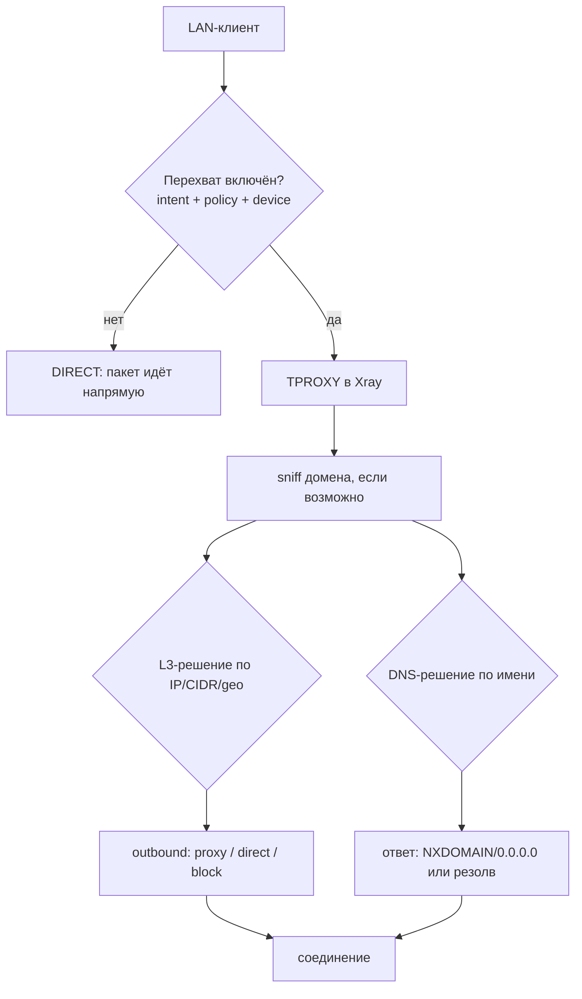

# Документ №18. Формальная модель приоритетов маршрутизации и блокировок

Дата: 22.11.2026
Основание: ТЗ v1.0 §17 (требования к анализу противоречий), §6 (приоритет профиля), §7 (failover и служебный трафик), §8 (DNS), §9 (UDP/Quick Block), §10 (устройства), §11 (Blocklists). Ссылки на «решения» даются по разделам ТЗ; номера — только номера строк реестра №16 (№16 §4).
Статус: **[П]** предлагаемая формальная модель. Она **не меняет** утверждённые решения; она делает их взаимный порядок однозначным и проверяемым. Всё, что модель не покрывает, вынесено в §9 и №21.

Назначение: одно место, где для любого пакета и любого домена можно вычислить **единственный** результат и **объяснить причину**. Модель используется Policy Manager, DNS Manager, Blocklists, Diagnostics («Why this route») и Dry Run.

---

## 1. Входные сущности

| Сущность | Что задаёт | Владелец |
|---|---|---|
| `device.mode` | `follow` \| `always_direct` | Device Manager |
| `device.profile_id` | назначенный пользовательский профиль | Device/Profile Manager |
| `device.group` | группа (сортировка, массовые операции; **не** routing) | Device Manager |
| `device.temp_direct` | overlay `always_direct` до `expires` | Device Manager |
| `device.blocklist_set` | набор категорий для устройства (lite) | Blocklists |
| `device.temp_blocklist_off` | overlay «внешние списки выключены» до `expires` | Blocklists |
| `profile.route_order` | порядок категорий правил: например `block → direct → proxy` | Profile Manager |
| `profile.rules[]` | домены, суффиксы, IP/CIDR, geo, порты → `block\|direct\|proxy` | Profile Manager |
| `blocklist.category[]` | включённые категории и источники | Blocklists |
| `whitelist[]` | домены/поддомены, постоянные и временные | Blocklists |
| `system_exceptions` | критические домены/IP (bootstrap, ресурсы VPN Manager, обновления, восстановление) | Blocklists (read-only для UI) |
| `udp.mode` | `controlled` \| `block_all` \| `all_vpn` | Policy Manager |
| `udp.allowlist` | порты и диапазоны | Policy Manager |
| `quick_block` | аварийная блокировка UDP | Policy Manager |
| `subscription.profile` | профиль подписки (если пользовательский не назначен) | Subscription Manager |
| `global_default` | поведение без профиля (PROXY/DIRECT по настройке) | Settings |

**Правило единственного ответа:** для каждой пары (пакет, устройство) и (домен, устройство) модель возвращает ровно один результат плюс `reason` — идентификатор сработавшего уровня и правила. Два разных ответа для одного входа — дефект, а не «зависит от обстоятельств».

---

## 2. Два уровня принятия решения (не путать)

| Уровень | Что решает | Чего **не** делает | Где исполняется |
|---|---|---|---|
| **DNS-уровень** | отдавать ли имя (блокировка), каким resolver-ом его разрешать | не выбирает маршрут пакета | DNS Manager (dnsmasq + Go DoH client) |
| **L3/L4-уровень** | попадает ли соединение в перехват и какой outbound выбирается (BLOCK/DIRECT/PROXY) | не «блокирует домены» сам по себе | Policy Manager (nft/TPROXY) + Xray routing |
| **Уровень устройства** | применяется ли перехват и пользовательские правила к устройству | не меняет DNS-блокировку системных исключений | Device + Policy |

**Следствие:** DNS-блокировка и L3-блокировка — **разные механизмы с разными причинами**. Статистика DNS BLOCK-ответов не равна числу предотвращённых соединений (ТЗ §11). Диагностика обязана говорить, на каком уровне и почему принято решение.

**Ограничение честности:** при ECH/DoH/DoT клиента, при QUIC и при отсутствии SNI домен на L3 может быть не виден. Тогда решение принимается по IP/CIDR/geo либо перехват не применяется — это фиксируется как «домен неизвестен», а не как «правило не сработало».

---

## 3. Порядок приоритетов на уровне устройства и L3 (First Match Wins)

Уровни проверяются сверху вниз; **первое совпадение выигрывает**, нижние уровни не рассматриваются. Числа — фиксированные приоритеты модели (не путать с nft-priority −150).

| Приоритет | Уровень | Условие срабатывания | Результат | Кто владеет | Изменяемо пользователем |
|---|---|---|---|---|---|
| **P0** | Служебный трафик проекта | пакет принадлежит failover-пробам, DNS-пробам, обновлению списков, связи с сервером | **не перехватывать** (исключение из TPROXY) | Core/Policy | нет |
| **P1** | Always DIRECT (постоянный или overlay) | `device.mode=always_direct` **или** активен `temp_direct` | **DIRECT**; обход профилей, UDP-политики, Quick Block — утверждено; обход внешних Blocklists — **вариант (а), не утверждён** (OQ-09) | Device | да (режим, таймер) |
| **P2** | Quick Block | `quick_block=on` **и** пакет UDP | **BLOCK** (кроме P0 и DNS/essential) | Policy | да (один переключатель) |
| **P3** | Временное отключение внешней блокировки | активен `temp_blocklist_off` для устройства | внешние списки **не применяются**, остальные уровни действуют | Blocklists | да (таймер) |
| **P4** | Пользовательский BLOCK | правило профиля `block` совпало (домен/IP/geo/порт) | **BLOCK** | Profile | да |
| **P5** | Whitelist | домен в whitelist (постоянный/временный) | снимает **только** блокировку от внешних списков → переход к P7/P8 | Blocklists | да |
| **P6** | Внешние Blocklists | домен/IP в активной категории и наборе устройства | **BLOCK** | Blocklists | да (категории/источники) |
| **P7** | Пользовательский DIRECT | правило профиля `direct` совпало | **DIRECT** | Profile | да |
| **P8** | Пользовательский PROXY | правило профиля `proxy` совпало | **PROXY** | Profile | да |
| **P9** | Значение по умолчанию | ничего не совпало | `global_default` (PROXY или DIRECT по настройке профиля/подписки) | Settings | да |

Дополнительные правила модели:

1. **P0 непереопределяем.** Ни профиль, ни Blocklists, ни Quick Block не могут завернуть служебный трафик в туннель — иначе петля.
2. **P1 сильнее всего пользовательского** (ТЗ §10, дословно «обходит все пользовательские правила проекта»): Always DIRECT обходит профили и UDP-политику, и это утверждено. **Обход внешних Blocklists — открытый вопрос OQ-09**, а не утверждённая часть модели: ТЗ §17 прямо выносит его на решение владельца. В документах и UI до ответа нельзя утверждать ни «обходит», ни «не обходит». P0 остаётся выше в любом варианте: служебные пробы не перехватываются.
3. **P2 (Quick Block) слабее P1**: устройство с Always DIRECT сохраняет доступ (ТЗ §9).
4. **P3 меняет только источник блокировки**, а не режим устройства и не пользовательские BLOCK (ТЗ §11).
5. **P4 сильнее P5 и P6**: whitelist не отменяет пользовательский BLOCK (ТЗ §11).
6. **P5 не «разрешает всё»**: после снятия внешней блокировки решение продолжается с P7/P8/P9.
7. **P6 применяется только если категория включена** и (для индивидуальных наборов) входит в набор устройства.
8. **P7–P9 не блокируют**, а направляют.
9. **Системные исключения (P0-semantic)** — отдельный список: они снимают блокировку **внешних** списков для критических доменов (bootstrap, ресурсы проекта, обновления, восстановление). Они не отменяют пользовательский BLOCK, но пользовательский BLOCK не может заблокировать системный домен, необходимый для работы проекта: такая попытка отклоняется на этапе валидации с объяснением. Это ограничение зафиксировано как OQ-05 (граница между «нельзя сломать проект» и «пользователь вправе блокировать всё»).

### 3.1 Порядок внутри профиля

Внутри уровня P4/P7/P8 действует порядок, заданный профилем (ТЗ §6 и B-01 старого проекта):

1. Категории правил проверяются в порядке `route_order` профиля (по умолчанию `block → direct → proxy`).
2. Внутри категории — порядок, заданный пользователем; **первое совпадение выигрывает**.
3. Более специфичное правило (точный домен) **не** автоматически сильнее общего суффикса: порядок задаёт пользователь. UI обязан показать, какое правило сработает, до сохранения (Dry Run).
4. Порядок категорий не влияет на P0–P3 и P5–P6.

### 3.2 Примеры (проверка модели)

| № | Ситуация | Результат | Причина |
|---|---|---|---|
| 1 | Устройство `always_direct`, домен в активном внешнем списке | DIRECT **при варианте (а)**; BLOCK при варианте (б) | P1 (вариант а) / P6 (вариант б) — **ждёт OQ-09** |
| 2 | Устройство `follow`, домен в списке, домен в whitelist | DEFAULT (P7/P8/P9) | P5 снял P6 |
| 3 | Устройство `follow`, домен в whitelist и в пользовательском BLOCK профиля | BLOCK | P4 выше P5 |
| 4 | Quick Block вкл, устройство `always_direct` | DIRECT | P1 выше P2 |
| 5 | Quick Block вкл, UDP/443 (QUIC) у обычного устройства | BLOCK | P2 (UDP) |
| 6 | Временное отключение списков, домен в списке | DEFAULT | P3 |
| 7 | Пользовательский BLOCK домена, профиль назначен подписке | BLOCK | P4 (профиль подписки действует) |
| 8 | Ничего не совпало, профиль не назначен | поведение без профиля | P9 |
| 9 | Пакет — health-check самого демона | не перехватывается | P0 |
| 10 | Домен в системном исключении и в пользовательском BLOCK | BLOCK отклоняется при сохранении правила (валидация) | §3 п. 9, OQ-05 |

---

## 4. Always DIRECT: точная семантика

| Аспект | Значение |
|---|---|
| Что обходит (утверждено) | профили (P4/P7/P8), whitelist-логику, UDP-политику, Quick Block — по ТЗ §10/§9 |
| Что обходит (не утверждено) | внешние Blocklists (P6) — **вариант (а), требует OQ-09**; до решения поведение в UI не обещается |
| Что **не** обходит | P0 (служебный трафик проекта), системные DNS-исключения, ограничения WAN/провайдера, системные ограничения OpenWrt |
| DNS | устройство использует Domestic chain; Remote DNS через VPN для него бессмысленен и не применяется |
| Статистика | трафик учитывается как DIRECT, отдельной меткой `always_direct` |
| Предупреждение | обязательно и постоянное на карточке устройства и в его диагностике |
| Временный DIRECT | тот же результат P1, но с `expires`; по истечении overlay снимается автоматически, событие в аудите |
| Что не является Always DIRECT | профиль с правилом `direct`, Quick Block, отключение Blocklists |

**Открытый вопрос (OQ-04):** бессрочный временный DIRECT по поведению неотличим от постоянного режима, хотя ТЗ называет его overlay, а не третьим режимом. Модель трактует его как overlay с `expires=null`, снимаемый вручную или при смене режима; подтверждение — за владельцем.

---

## 5. DNS-уровень: порядок и совместимость с L3

| Приоритет | Условие | Результат | Примечание |
|---|---|---|---|
| **D0** | домен/IP в системных исключениях | резолв по Domestic chain, блокировка запрещена | защита bootstrap, ресурсов проекта, обновлений |
| **D1** | домен в whitelist | резолв, внешние списки не применяются | не отменяет L3-P4 |
| **D2** | активный внешний список + набор устройства | блокировка (NXDOMAIN или 0.0.0.0 — [П]) | причина и источник фиксируются |
| **D3** | пользовательский BLOCK домена в профиле | блокировка на DNS **и** на L3 (согласованно) | иначе соединение по IP пройдёт |
| **D4** | пользовательский DIRECT/PROXY или default | резолв: DIRECT → Domestic; PROXY → Remote через VPN с цепочкой fallback | ТЗ §8 |
| **D5** | Remote DNS недоступен | Remote → Yandex DoH → ISP DNS, постоянное предупреждение (DNS leak принят) | ТЗ §8 |

Правила согласованности:

1. **D3 и P4 обязаны совпадать.** Если пользователь блокирует домен, блокируются и DNS, и L3-путь. Расхождение — дефект (проверяется Dry Run).
2. **D2 и P6 могут расходиться по механизму**, но не по результату для имени: DNS уже не отдаст адрес. L3-блокировка для внешних списков — только при включённых nft-наборах (REQ-084, meas), иначе остаётся DNS-уровень. Диагностика обязана показывать, какой уровень реально сработал.
3. **DNS-кеш, DoH/DoT клиента, мультиплексирование** снижают точность привязки к устройству; модель не обещает точность, а помечает результат как «предположительно устройство X» (OQ-07).
4. **AAAA-политика** в v1 не является механизмом защиты: IPv6-перехват не реализуется (ТЗ §5). AAAA-ответы не фильтруются «для безопасности» — это было бы скрытым изменением поведения (см. №22).
5. **DNS-блокировка не влияет на IP-литералы**: клиент, обращающийся по IP, обходит D2. Это ограничение фиксируется в UI.

---

## 6. UDP-уровень

| Режим | Разрешённый UDP | Прочий UDP | DIRECT-устройства | BLOCK |
|---|---|---|---|---|
| `controlled` | только порты/диапазоны из allowlist → через Xray | **блокируется**, без DIRECT bypass | как обычно (P1) | BLOCK |
| `block_all` | DNS + явно определённый essential system traffic | блокируется | как обычно | BLOCK |
| `all_vpn` | весь UDP PROXY-трафика через Xray | проходит по правилам (PROXY) | как обычно | BLOCK |
| `quick_block=on` | DNS + essential (только если разрешено настройкой) | блокируется | **не применяется** (P1) | BLOCK |

Правила: QUIC UDP/443 подчиняется режиму (ТЗ §9); если сервер не подтвердил UDP — селекторы отключены, режим сохранён, автоматического DIRECT нет; Always DIRECT обходит UDP-политику (ТЗ §9); при `controlled` и `block_all` блокировка UDP выполняется в своей таблице, не через изменение fw4.

**Открытый вопрос (OQ-06):** ТЗ помещает Quick Block в раздел UDP, но название и «аварийность» допускают трактовку «блокировать весь клиентский трафик». Модель v1 реализует **UDP-трактовку** (по расположению в ТЗ §9) и требует подтверждения; до подтверждения UI не обещает блокировку TCP.

---

## 7. Особые случаи и защита от петель

| Случай | Правило |
|---|---|
| Health-check демона, DNS-пробы, загрузка списков, обращение к серверу подписки | P0: не перехватываются, идут напрямую (ТЗ §7) |
| Трафик самого роутера | не входит в клиентскую политику v1; отдельная таблица не создаётся; router traffic — только отображение (ТЗ §15 Routing) |
| Соединение к самому VPN-серверу (по IP/SNI) | исключено из перехвата, иначе петля |
| DNS-запрос к локальному dnsmasq | разрешён всегда, включая `block_all` |
| Локальные адреса (LAN, loopback, link-local) | не перехватываются |
| Повторное применение правил | идемпотентно: `nft -c` + replace, без дублирования цепочек |
| Системные исключения | минимальный документированный список; UI не удаляет (ТЗ §11) |

---

## 8. Анализ пересечений и предупреждения (Dry Run)

Для каждой пары (устройство, домен/IP) Dry Run вычисляет:

1. `dns_verdict` (D0–D5) и `l3_verdict` (P0–P9) с указанием правила-победителя.
2. Признаки проблем:

| Код | Признак | Что показывает UI |
|---|---|---|
| `SHADOWED` | правило никогда не срабатывает: выше него стоит более общее | «Правило X перекрыто правилом Y» |
| `CONTRADICTION` | DNS-решение и L3-решение расходятся (кроме допустимого D2/P6) | «Домен заблокирован в DNS, но IP доступен» |
| `DIRECT_VIA_LIST` | домен в списке, но устройство в Always DIRECT | «Блокировка не применяется к устройству X» |
| `WHITELIST_OVERRIDE` | whitelist снимает блокировку внешнего списка | «Разрешён whitelist, источник Y» |
| `SYSTEM_PROTECTED` | попытка заблокировать системный домен | «Заблокировать нельзя: критический домен» |
| `PRECISION_LOW` | решение по имени невозможно (ECH/DoH/QUIC/нет SNI) | «Решение принято по IP; точность ограничена» |
| `UDP_UNSUPPORTED` | сервер не подтвердил UDP | «UDP-селекторы отключены, настройки сохранены» |

3. Отчёт Dry Run **не меняет** состояние и использует тот же валидатор, что apply (ТЗ §13).
4. Массовое изменение (импорт списка, массовая операция с устройствами) обязано показать сводку по этим кодам до применения.

---

## 9. Что модель не определяет (и не должна выдумывать)

| Вопрос | Статус | Где решается |
|---|---|---|
| Форма ответа DNS при блокировке: NXDOMAIN или 0.0.0.0 | [П] предпочтителен NXDOMAIN; влияет на кеш клиента | OQ-08 |
| Может ли пользовательский BLOCK заблокировать системный домен | [О] | OQ-05 |
| Применяется ли Always DIRECT к внешним Blocklists (P1 vs P6) | [О] | OQ-09 |
| Quick Block: только UDP или весь трафик | [О] | OQ-06 |
| Точность привязки DNS-запроса к устройству при DoH/DoT/кеше | [Т] | OQ-07, W-11 |
| Сетевые (nft) блокировки по спискам | meas | REQ-084, W-12 |
| Бессрочный временный DIRECT как overlay | [О] | OQ-04 |
| Порядок «точный домен vs суффикс» внутри категории | [П] пользовательский порядок | REQ-022, Dry Run |

---

## 10. Критерии приёмки модели

1. Для любого входа модель даёт один результат и одну причину; два разных результата — дефект.
2. Все 10 примеров §3.2 воспроизводятся автоматическим тестом расчёта (без сети).
3. Always DIRECT обходит профиль, UDP и Quick Block, но не P0; поведение с внешними Blocklists фиксируется после ответа OQ-09 (сейчас — вариант а в примерах).
4. Whitelist не отменяет пользовательский BLOCK; пользовательский BLOCK блокирует и DNS, и L3.
5. Quick Block не меняет сохранённый режим и allowlist; после выключения конфигурация побитово совпадает.
6. Dry Run показывает `SHADOWED`/`CONTRADICTION` до применения и не имеет побочных эффектов.
7. Диагностика для любого устройства объясняет решение ссылкой на уровень и правило.
8. Ни одно утверждение модели не требует IPv6-политики.
