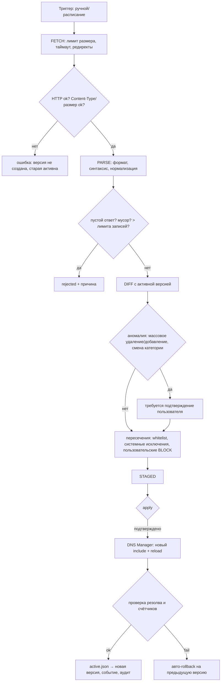
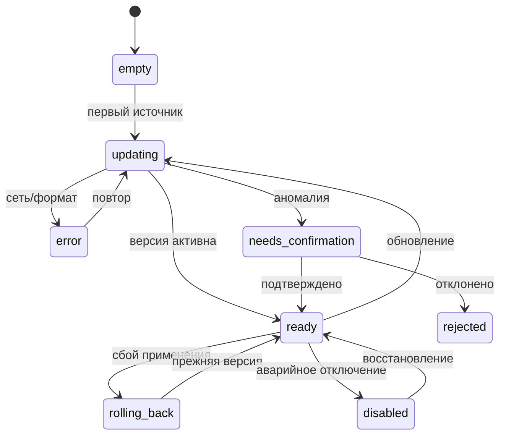

# Документ №19. Blocklists: архитектура подсистемы (ИСТОРИЧЕСКИЙ, не нормативный)

> **Статус: исторический материал. Нормативным источником не является.**
>
> Решением владельца U9 (26.11.2026) собственная подсистема Blocklists исключена из проекта полностью и не сохраняется как отложенная функция: нет AdBlock и списков рекламы/трекеров, нет Malware/Phishing, нет загрузки/обновления/дедупликации/валидации списков, нет whitelist, нет `temp_blocklist_off`, нет DNS-фильтрации, нет индивидуальных наборов по устройствам и группам, нет статистики, истории и Quick Block. Пользователь при необходимости ставит специализированные пакеты OpenWrt (Adblock, AdGuard Home) самостоятельно; VPN Manager не является DNS-фильтром и не управляет этими пакетами.
>
> Заменяющая архитектура: №18 (модель маршрутизации L1–L4, без DNS-уровня и без блокирующих уровней), №20 (состояния без Blocklists), №22 §5 (исключено принципиально), №17 (требования REQ-070…REQ-087 помечены superseded). Все разделы ниже описывают прежнее состояние U8 и приводятся только для истории; ссылаться на них как на действующее требование запрещено.


Дата: 22.11.2026
Основание: ТЗ v1.0 §11 (Blocklists, решения по строкам реестра №16), §12 (статистика/аудит), §15 (панель внутри Routing).
Статус: архитектура **[П]** (предложение агента в рамках утверждённых решений). Реализация не начиналась.
Место в системе: подсистема **внутри** вкладки Routing; не восьмая вкладка; не владелец nftables и не конкурирующая система маршрутизации (ТЗ §11).

---

## 1. Границы и место

| Аспект | Решение |
|---|---|
| Вкладка | отдельная панель внутри Routing (обзор, категории, источники, обновления, статистика, история, rollback, конфликты, false positives, Whitelist, системные исключения, настройки, аварийное отключение) |
| Владелец nftables | **Policy Manager**. Blocklists только формирует решение (`block` для домена/IP), применяет его владелец |
| Владелец DNS | **DNS Manager**. Blocklists отдаёт список доменов для блокировки; DNS Manager генерирует include |
| Что делает сама | хранит источники, версии, записи, whitelist, настройки; валидирует, сравнивает, предлагает применение |
| Чего не делает | не пишет напрямую в nft/dnsmasq, не меняет маршрутизацию «в обход» модели приоритетов (№18), не блокирует трафик собственными правилами |
| Связь с профилями | пользовательские BLOCK/DIRECT/PROXY остаются в профилях; внешние списки — отдельная сущность, их результат подчинён модели приоритетов |

**Принцип:** Blocklists — это **источник данных и решений**, а не исполнитель. Любое исполнение идёт через владельца ресурса.

---

## 2. Модель данных (расширение документа №13)

```text
/etc/vpnmanager/blocklists/
  settings.json          # включённость, лимиты, пороги аномалий, аварийное состояние
  sources.json           # источники: URL/файл, категория, метаданные, доверие
  categories.json        # категории и их активность, привязка к наборам
  sets.json              # наборы для устройств/групп, набор по умолчанию
  whitelist.json         # домены/поддомены, постоянные и временные
  system_exceptions.json # критические домены/IP (только чтение через UI)
  versions/
    <src_id>/<ver_id>.domains   # нормализованные записи версии
    <src_id>/<ver_id>.meta.json # размер, число записей, хэш, время, статус
  active.json            # какие версии активны (атомарный указатель)
  history/diff.jsonl     # компактный diff-журнал (append-only, ротация)
```

| Сущность | Ключ | Поля (существенные) |
|---|---|---|
| `Source` | `src_<hash(url\|path)>` | `name`, `category`, `kind` (`url|file`), `url_ref`/`path`, `author`, `description`, `trust` (`trusted|normal|limited`), `enabled`, `format`, `etag`/`last_modified`, `last_ok_ts`, `last_error`, `records_count`, `delta` |
| `Category` | `cat_<slug>` | `name`, `enabled`, `sources[]`, `description` |
| `Version` | `ver_<ts>_<hash8>` | `source_id`, `created`, `records`, `bytes`, `sha256`, `status` (`staged|active|rejected|superseded`), `origin_url_status` |
| `Record` | домен (нормализованный) | `sources[]` (происхождение), `category`, `first_seen`, `last_seen`, `blocked_hits` |
| `WhitelistEntry` | домен/суффикс | `permanent` \| `expires`, `created_by`, `reason` |
| `Set` | `set_<id>` | `device/group`, `categories[]`, `enabled` |
| `DiffEntry` | `(ver_id, domain)` | `op` (`add|remove|category_change`), `ts`, `source` |

**Происхождение записи** (ТЗ §11): одна запись домена хранит **все** источники, которые её содержат. Дубликаты не создаются; удаление источника удаляет только его вклад.

**Нормализация:** нижний регистр, IDN → punycode (собственная таблица или отказ от не-ASCII), снятие `.` в конце, отбрасывание комментариев (`#`, `!`, `//`), поддержка `hosts`-формата (`0.0.0.0 domain`), wildcard-суффиксов (`*.example.com` → суффикс), отбрасывание IP без домена (в v1 IP-записи хранятся отдельно и **не применяются** без nft-наборов — см. §8).

---

## 3. Источники и форматы

| Формат | Распознавание | Что берём |
|---|---|---|
| plain domains | одна запись в строке | домен |
| hosts | `IP domain [domain…]` | домены (IP игнорируется) |
| Adblock-подобный | `\|\|domain^` | домен как суффикс; правила с `@@` (exception) → whitelist-кандидат, **не** применяются автоматически |
| CSV/JSON | по расширению/структуре | колонка/поле домена; остальные поля — метаданные |

Поддержка «распространённых текстовых форматов» (ТЗ §11) реализуется **без** зависимости от внешних парсеров и без `jq`: парсер в Go, потоковый, с лимитом строк и защитой от гигантских токенов.

**Ограничение честности:** правила с `@@`, regex, `$third-party`, косметические (`##`) и прочие расширения Adblock **не** исполняются. Источник, содержащий их, не отвергается, но UI показывает, сколько строк не поддержано.

---

## 4. Конвейер обновления



**Проверки (ТЗ §11):** HTTP-статус, Content-Type/размер, кодировка, формат, синтаксис строк, доля нераспознанных строк (порог), пустой ответ, число записей (мин/макс), резкое изменение объёма (%), массовое удаление доменов (%), смена категории источника. Пороги — настройки со значениями по умолчанию **[П]**, окончательные — после измерений (W-12).

**Аномалия — не блокировка навсегда:** версия остаётся `staged` с пометкой `requires_confirmation`; автоматического применения нет; пользователь видит сводку и решает.

---

## 5. Применение, версии и откат

| Шаг | Действие | Откат |
|---|---|---|
| 1 | `staged` версия записана отдельными файлами | удалить файлы версии |
| 2 | DNS Manager строит новый include из активного набора (union категорий + наборы устройств) | оставить прежний include |
| 3 | `dnsmasq --test` / проверка конфигурации, reload (без restart — ТЗ §8) | reload с прежним include |
| 4 | Проверка: резолв контрольного домена из списка, счётчик попаданий, отсутствие ошибок dnsmasq | авто-rollback |
| 5 | `active.json` переключён атомарно; событие `blocklists.applied`; аудит | вернуть указатель, reload |

**Гарантии:**
1. Активная версия всегда одна; смешение версий невозможно (указатель).
2. Предыдущая рабочая версия **не удаляется** при применении (ТЗ §11) — минимум одна предыдущая.
3. Автоматический rollback при технической ошибке (dnsmasq не поднялся, include невалиден, проверка не прошла).
4. Ручной rollback после «плохого результата» — через Dry Run с показом diff и последствий.
5. Применение идёт только через Transaction Manager (документ №10 §7) — Blocklists не «вклинивается» между фазами.

**Стоимость применения:** генерация include на 100 тыс. доменов — измерить (W-12). До измерения лимиты консервативные, а UI предупреждает о тяжёлой операции.

---

## 6. Whitelist, системные исключения, индивидуальные наборы

| Механизм | Действие | Ограничение |
|---|---|---|
| Whitelist (постоянный/временный) | снимает блокировку **обычных** внешних списков (реклама, трекеры) для домена и его поддоменов | **не отменяет** `Malware`, `Phishing`, системные ограничения и пользовательский BLOCK профиля; не меняет маршрутизацию |
| Системные исключения | защита bootstrap, ресурсов VPN Manager, обновлений, восстановления; приоритет над пользовательским BLOCK (OQ-05 закрыт) | нельзя удалить через UI; список минимальный, версионированный, документированный |
| Набор по умолчанию | категории для всех устройств | — |
| Набор устройства/группы | **не включается до успешной проверки точности DNS↔устройство** (OQ-07 закрыт 24.11.2026, вариант Б); до этого доступен только общий набор | точность привязки DNS↔устройство не гарантирована; угадывать устройство и применять чужой набор запрещено; для Always DIRECT — то же ограничение; возврат только после успешного **W-14** (W-11 — проверка identity, к этой точности не относится) |
| **Пользовательский BLOCK профиля (P4/D3)** | индивидуальное правило профиля устройства (не глобальное и не «набор Blocklists»); L3-часть (P4) от W-14 **не зависит** | DNS-часть (D3) требует привязки запроса к устройству и **не включается до успешного W-14** (следствие OQ-07, вариант Б); результат на L3 — BLOCK (№18 §5 п. 1a) |
| Временное отключение для устройства (`temp_blocklist_off`, P3) | **обычные** внешние списки не применяются к устройству до `expires`; `Malware`/`Phishing` (при активной категории) и системные ограничения действуют; P4 не отключается; Quick Block (P2) не затрагивается | не меняет режим устройства; автовосстановление по таймеру |

**Порядок для домена и устройства** — единый для DNS и L3 (№18 §3, §5): **P0 (служебный трафик) → S1/D0 (системные исключения) → S2 (`Malware`, при активной категории) → S3 (`Phishing`, при активной категории) → P4/D3 (пользовательский BLOCK) → P1 (Always DIRECT для обычных категорий) → P3 (`temp_blocklist_off` — модификатор D2) → P5/D1 (whitelist) → P6/D2 (обычные внешние списки) → P7–P9/D4 (DIRECT/PROXY/default) → D5.** Whitelist не может отменить пользовательский BLOCK, S1–S3; `temp_blocklist_off` действует только на P6/D2 и не снимает P4, S1–S3; User BLOCK проверяется **до** Always DIRECT, поэтому Always DIRECT его не отменяет (R-01). **Quick Block (P2) в этот порядок не входит:** это отдельная UDP-проверка L3/L4 — DNS-ответ она не меняет, TCP не блокирует и DNS-категорией не является (№18 §5 п. 0a, §6).

### 6.1 Always DIRECT и внешние списки — **утверждено 24.11.2026 (OQ-09 закрыт)**

Владелец выбрал уточнённый вариант «обход обычных категорий с сохранением защиты от угроз». Утверждённое поведение:

| Категория | Поведение при `always_direct` | Поведение при `follow` |
|---|---|---|
| Реклама, трекеры и прочие **обычные** категории | **не применяются** ни на DNS, ни на L3 | применяются по P6/D2 |
| **`Malware`** (вредоносное ПО) | блокируется (S2) — **при активной категории**; Always DIRECT это не отменяет | блокируется (S2) — при активной категории |
| **`Phishing`** | блокируется (S3) — **при активной категории**; Always DIRECT это не отменяет | блокируется (S3) — при активной категории |
| Системные исключения (S1) | действуют | действуют |
| **Пользовательский BLOCK профиля** (P4) | **блокируется** (P4 проверяется до P1) | блокируется (P4) |

**Защищённые категории** — только `Malware` и `Phishing`. Реклама, трекеры и пользовательские категории защищёнными не являются; расширение защищённого списка требует отдельного решения пользователя.

**Включённость категории `Malware`/`Phishing` (не определено).** Утверждено только то, что S2/S3 не отменяются Always DIRECT, whitelist и `temp_blocklist_off`. Действует ли защита при выключенной пользователем категории — решения владельца нет; документация не утверждает ни безусловную активность, ни зависимость от переключателя (№18 §3.0, №21 §8.1). Сценарии №23 26/27/49/53/54 до решения не считаются окончательными. Поэтому в U8 утверждения о безусловной блокировке заменены на «блокируется при активной категории» (этот раздел, №18 §5/§5.1/§11); UI и Dry Run используют ту же оговорку.

**Whitelist и временное отключение** действуют только на обычные категории: ни whitelist, ни `temp_blocklist_off` не снимают `Malware`, `Phishing` и системные ограничения.

**User BLOCK и Always DIRECT (R-01, 24.11.2026).** Always DIRECT обходит обычные категории, но **не отменяет пользовательский BLOCK**: блокирующие правила (P0, S1–S3, P4) проверяются раньше Always DIRECT, поэтому устройство не получает терминального DIRECT до их проверки. Итог одинаков на DNS и L3 (№18 §5, §5.1); Dry Run показывает `BLOCK` с причиной P4/D3.

**UI (утверждено):** при включении Always DIRECT — явное предупреждение с объяснением, что обычные Blocklists обходятся, а `Malware` и `Phishing` блокируются; краткое постоянное пояснение в карточке устройства (№18 §11, №11 §7).

**Dry Run** отражает утверждённую модель: обычный домен → `DIRECT_VIA_LIST`; `Malware`/`Phishing` → `PROTECTED_BLOCK_KEPT`; пользовательский BLOCK → `BLOCK` с причиной P4 (№18 §8, R-01). Состояние `OQ-09_PENDING` больше не применяется: вопрос закрыт.

### 6.2 Форма DNS-ответа и инвалидация кеша — **утверждено 24.11.2026 (OQ-08 закрыт, вариант А)**

| Аспект | Утверждённое правило |
|---|---|
| Форма ответа | при блокировке DNS Manager возвращает `NXDOMAIN`; `0.0.0.0` **не используется** |
| Настройка формата | настраиваемый пользователем формат ответа **не входит в v1** |
| TTL отрицательного ответа | **значение не определено** (R-07): остаётся параметром, требующим определения по результатам проверки кеширования клиентами; придумывать число в документации запрещено; до определения — открытое ограничение (№21 §8) |
| Инвалидация кеша | при изменении Blocklists очищаются **только** DNS-записи, связанные с изменённой политикой; весь DNS-кеш без необходимости не очищается |
| Установленные соединения | принудительно **не закрываются**; уже установленные соединения могут не отражать новое решение |
| Согласование | совпадает с моделью D2/S2/S3 в №18 §5 и требованием №17 REQ-049; L3-наборы (REQ-084, meas) не меняют правило |

**Исторические варианты** (а/б/в) прежней редакции этого раздела не действуют; их описание сохранено в отчётах ревью №24/№25/№27 и в исследовании №29.

**Источник блокировки в диагностике** обязателен: домен, категория, источник, версия, набор, устройство, уровень (DNS/L3), время.

---

## 7. Пользовательские BLOCK/DIRECT/PROXY и блокировка DoH/DoT

1. Пользовательские правила живут в профилях и **не** переносятся в Blocklists (отдельное хранение — ТЗ §11).
2. Blocklists не может «перебить» пользовательский DIRECT: внешние списки применяются только к доменам, для которых модель дошла до P6. Если устройство/профиль явно направил домен в DIRECT, блокировки нет — и это видно в Dry Run как `DIRECT_VIA_LIST`. Исключение — защищённый контур: домен `Malware`/`Phishing` блокируется несмотря на DIRECT (S2/S3), и это видно как `PROTECTED_BLOCK_KEPT`.
3. Блокировка клиентского DoH/DoT (ТЗ §8) — часть Policy Manager, не Blocklists: перехват 53, блок 853, известные DoH endpoints. **Абсолютная блокировка DoH поверх 443 не обещается.**
4. Списки не используются как механизм обхода системных ограничений и не могут отключить системные исключения.

---

## 8. Статистика и производительность

| Показатель | Источник | Периоды | Ограничение |
|---|---|---|---|
| DNS-блокировки | dnsmasq/журнал DNS Manager, агрегирование | сейчас / сутки / 7 / 30 дней | **не** равно числу предотвращённых соединений |
| Блокировки по устройству | привязка DNS↔устройство | то же | точность ограничена (кеш, DoH/DoT) |
| Категория/источник | метаданные записи | то же | — |
| Топ доменов | агрегат | то же | лимит top-N |
| Сетевые (L3) блокировки | nft-счётчики | — | **только** при включённых наборах (REQ-084, meas) |

Правила хранения: почасовые 48 ч, дневные 30 дней, старше — агрегирование (ТЗ §12); запись на Flash ограничена и учитывает бюджет (D-09); подробный сбор отключается; автоудаление списков ради памяти **запрещено** (ТЗ §11).

**Ресурсные риски (не подтверждены):** объединённый набор доменов влияет на размер include и время reload dnsmasq; nft-наборы влияют на RAM ядра. Ни одно число не считается известным до W-12.

---

## 9. API и UI-поверхность (сводно)

| Объект ubus | Методы (существенные) | Права |
|---|---|---|
| `vpnmanager.blocklists` | `status`, `categories.list/set`, `sources.list/add/update/remove`, `versions.list`, `diff`, `apply`, `rollback`, `dry_run`, `whitelist.add/remove`, `system_exceptions.list`, `sets.get/set`, `stats`, `export`, `emergency_disable` | чтение — все; изменения — control; rollback/restore/emergency — admin |

События: `blocklists.staged`, `blocklists.applied`, `blocklists.rolled_back`, `blocklists.anomaly`, `blocklists.source_failed`, `blocklists.disabled`.

UI (внутри Routing): панель с 13 разделами (ТЗ §11); аварийное отключение — одно состояние, видимое на Overview; полное отключение требует подтверждения; список источников показывает метаданные, динамику и ошибки; конфликты и false positives — из Dry Run и диагностики.

---

## 10. Состояния подсистемы



Правило: `disabled` — это **состояние подсистемы**, а не удаление данных; восстановление возвращает прежний набор версий и настроек.

---

## 11. Безопасность

| Риск | Мера |
|---|---|
| Подмена источника (DNS/HTTP) | HTTPS, проверка редиректов, ETag/Last-Modified, размер, хэш; цифровая подпись не обещается |
| Гигантский/вредный ответ | лимит байт и строк, таймаут, потоковый парсинг, отказ от рекурсивных структур |
| Блокировка критических доменов | системные исключения + валидация попытки (OQ-05 закрыт: попытка отклоняется, приоритет у системного списка) |
| Утечка источников | URL может содержать персональный токен → хранится как `url_ref`, не пишется в журнал/диагностику |
| Отравление статистики | счётчики только из доверенных компонентов, без клиентских данных |
| DoS через частые обновления | throttle, расписание, запрет параллельных обновлений одного источника |

---

## 12. Критерии приёмки и зависимости

| Критерий | Проверка |
|---|---|
| Восьмой вкладки нет, панель внутри Routing | обход UI |
| Blocklists не пишет в nft/dnsmasq напрямую | ревью: вызовы только через Policy/DNS Manager |
| Битый, пустой, гигантский ответ не применяется | набор тестов валидатора |
| Аномалия требует подтверждения | тест с искусственным массовым удалением |
| Авто-rollback при технической ошибке | тест: сделать include невалидным |
| Ручной rollback через Dry Run | тест: применить «плохую» версию и вернуть |
| Whitelist не отменяет пользовательский BLOCK | тест модели приоритетов |
| Always DIRECT обходит только обычные категории; `Malware`/`Phishing` остаются заблокированными | тест №25–27 (№23) |
| Блокировка возвращает `NXDOMAIN`; `0.0.0.0` не используется; TTL ограничен | тест DNS-ответа (№23, сценарий 34) |
| Изменение списка не чистит весь DNS-кеш и не рвёт соединения | тест инвалидации (№23, сценарий 35) |
| Индивидуальные наборы недоступны до успешного W-14 | тест API/UI: функция отсутствует или отклоняется с объяснением |
| Whitelist и временное отключение не снимают `Malware`/`Phishing` и системные ограничения | тесты №28–31 (№23) |
| DNS и L3 дают согласованный результат | тест №32 (№23) |
| User BLOCK не отменяется Always DIRECT; DNS и L3 совпадают | тесты №51 и №55 (№23) |
| Системные исключения не удаляются и имеют приоритет над пользовательским BLOCK | тест API (`VM_ERR_FORBIDDEN`) и валидация правила |
| Временное отключение восстанавливается по таймеру | тест с коротким таймером |
| Статистика различает DNS и L3 | тест UI/экспорта |
| Лимиты и время применения известны | W-12 |

**Зависимости:** DNS Manager (include/reload), Transaction Manager (фазы), Policy Manager (nft-наборы — meas), Journal/Audit, Analytics, API/ACL, UI Routing.

**Не подтверждено:** лимиты записей и источников, время reload, влияние на Flash и RAM, точность привязки к устройству, поведение dnsmasq с большим include. Все эти числа — проектные ориентиры до W-12.
