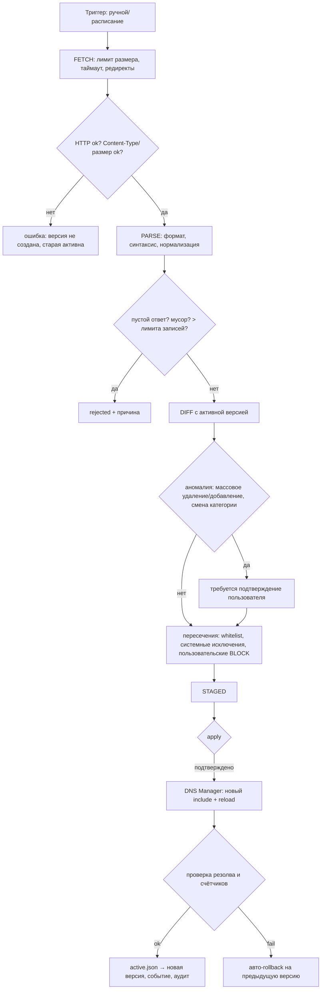
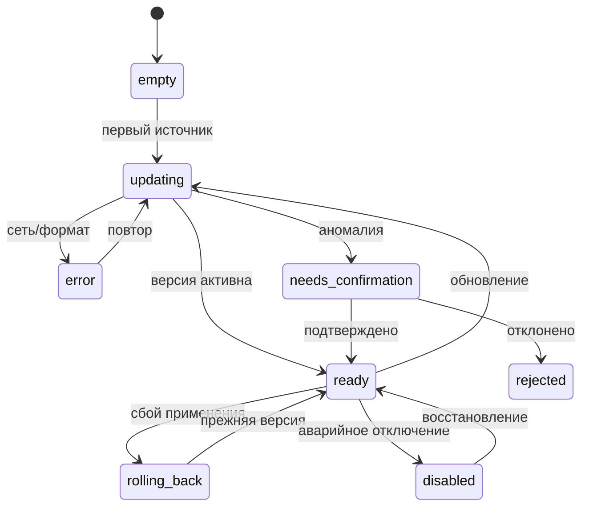

# Документ №19. Blocklists: архитектура подсистемы

Дата: 22.11.2026
Основание: ТЗ v1.0 §11 (решения №58–66), §12 (статистика/аудит), §15 (панель внутри Routing).
Статус: архитектура **[П]** (предложение агента в рамках утверждённых решений). Реализация не начиналась.
Место в системе: подсистема **внутри** вкладки Routing; не восьмая вкладка; не владелец nftables и не конкурирующая система маршрутизации (решение №58).

---

## 1. Границы и место

| Аспект | Решение |
|---|---|
| Вкладка | отдельная панель внутри Routing (обзор, категории, источники, обновления, статистика, история, rollback, конфликты, false positives, Whitelist, системные исключения, настройки, аварийное отключение) |
| Владелец nftables | **Policy Manager**. Blocklists только формирует решение (`block` для домена/IP), применяет его владелец |
| Владелец DNS | **DNS Manager**. Blocklists отдаёт список доменов для блокировки; DNS Manager генерирует include |
| Что делает сама | хранит источники, версии, записи, whitelist, настройки; валидирует, сравнивает, предлагает применение |
| Чего не делает | не пишет напрямую в nft/dnsmasq, не меняет маршрутизацию «в обход» модели приоритетов (№18), не блокирует трафик собственными правилами |
| Связь с профилями | пользовательские BLOCK/DIRECT/PROXY остаются в профилях; внешние списки — отдельная сущность, их результат подчинён модели приоритетов |

**Принцип:** Blocklists — это **источник данных и решений**, а не исполнитель. Любое исполнение идёт через владельца ресурса.

---

## 2. Модель данных (расширение документа №13)

```text
/etc/vpnmanager/blocklists/
  settings.json          # включённость, лимиты, пороги аномалий, аварийное состояние
  sources.json           # источники: URL/файл, категория, метаданные, доверие
  categories.json        # категории и их активность, привязка к наборам
  sets.json              # наборы для устройств/групп, набор по умолчанию
  whitelist.json         # домены/поддомены, постоянные и временные
  system_exceptions.json # критические домены/IP (только чтение через UI)
  versions/
    <src_id>/<ver_id>.domains   # нормализованные записи версии
    <src_id>/<ver_id>.meta.json # размер, число записей, хэш, время, статус
  active.json            # какие версии активны (атомарный указатель)
  history/diff.jsonl     # компактный diff-журнал (append-only, ротация)
```

| Сущность | Ключ | Поля (существенные) |
|---|---|---|
| `Source` | `src_<hash(url\|path)>` | `name`, `category`, `kind` (`url|file`), `url_ref`/`path`, `author`, `description`, `trust` (`trusted|normal|limited`), `enabled`, `format`, `etag`/`last_modified`, `last_ok_ts`, `last_error`, `records_count`, `delta` |
| `Category` | `cat_<slug>` | `name`, `enabled`, `sources[]`, `description` |
| `Version` | `ver_<ts>_<hash8>` | `source_id`, `created`, `records`, `bytes`, `sha256`, `status` (`staged|active|rejected|superseded`), `origin_url_status` |
| `Record` | домен (нормализованный) | `sources[]` (происхождение), `category`, `first_seen`, `last_seen`, `blocked_hits` |
| `WhitelistEntry` | домен/суффикс | `permanent` \| `expires`, `created_by`, `reason` |
| `Set` | `set_<id>` | `device/group`, `categories[]`, `enabled` |
| `DiffEntry` | `(ver_id, domain)` | `op` (`add|remove|category_change`), `ts`, `source` |

**Происхождение записи** (решение №59): одна запись домена хранит **все** источники, которые её содержат. Дубликаты не создаются; удаление источника удаляет только его вклад.

**Нормализация:** нижний регистр, IDN → punycode (собственная таблица или отказ от не-ASCII), снятие `.` в конце, отбрасывание комментариев (`#`, `!`, `//`), поддержка `hosts`-формата (`0.0.0.0 domain`), wildcard-суффиксов (`*.example.com` → суффикс), отбрасывание IP без домена (в v1 IP-записи хранятся отдельно и **не применяются** без nft-наборов — см. §8).

---

## 3. Источники и форматы

| Формат | Распознавание | Что берём |
|---|---|---|
| plain domains | одна запись в строке | домен |
| hosts | `IP domain [domain…]` | домены (IP игнорируется) |
| Adblock-подобный | `\|\|domain^` | домен как суффикс; правила с `@@` (exception) → whitelist-кандидат, **не** применяются автоматически |
| CSV/JSON | по расширению/структуре | колонка/поле домена; остальные поля — метаданные |

Поддержка «распространённых текстовых форматов» (ТЗ §11) реализуется **без** зависимости от внешних парсеров и без `jq`: парсер в Go, потоковый, с лимитом строк и защитой от гигантских токенов.

**Ограничение честности:** правила с `@@`, regex, `$third-party`, косметические (`##`) и прочие расширения Adblock **не** исполняются. Источник, содержащий их, не отвергается, но UI показывает, сколько строк не поддержано.

---

## 4. Конвейер обновления



**Проверки (решение №60):** HTTP-статус, Content-Type/размер, кодировка, формат, синтаксис строк, доля нераспознанных строк (порог), пустой ответ, число записей (мин/макс), резкое изменение объёма (%), массовое удаление доменов (%), смена категории источника. Пороги — настройки со значениями по умолчанию **[П]**, окончательные — после измерений (W-12).

**Аномалия — не блокировка навсегда:** версия остаётся `staged` с пометкой `requires_confirmation`; автоматического применения нет; пользователь видит сводку и решает.

---

## 5. Применение, версии и откат

| Шаг | Действие | Откат |
|---|---|---|
| 1 | `staged` версия записана отдельными файлами | удалить файлы версии |
| 2 | DNS Manager строит новый include из активного набора (union категорий + наборы устройств) | оставить прежний include |
| 3 | `dnsmasq --test` / проверка конфигурации, reload (без restart — решение №42) | reload с прежним include |
| 4 | Проверка: резолв контрольного домена из списка, счётчик попаданий, отсутствие ошибок dnsmasq | авто-rollback |
| 5 | `active.json` переключён атомарно; событие `blocklists.applied`; аудит | вернуть указатель, reload |

**Гарантии:**
1. Активная версия всегда одна; смешение версий невозможно (указатель).
2. Предыдущая рабочая версия **не удаляется** при применении (решение №61) — минимум одна предыдущая.
3. Автоматический rollback при технической ошибке (dnsmasq не поднялся, include невалиден, проверка не прошла).
4. Ручной rollback после «плохого результата» — через Dry Run с показом diff и последствий.
5. Применение идёт только через Transaction Manager (документ №10 §7) — Blocklists не «вклинивается» между фазами.

**Стоимость применения:** генерация include на 100 тыс. доменов — измерить (W-12). До измерения лимиты консервативные, а UI предупреждает о тяжёлой операции.

---

## 6. Whitelist, системные исключения, индивидуальные наборы

| Механизм | Действие | Ограничение |
|---|---|---|
| Whitelist (постоянный/временный) | снимает блокировку **внешних списков** для домена и его поддоменов | не отменяет пользовательский BLOCK профиля и не меняет маршрутизацию |
| Системные исключения | защита bootstrap, ресурсов VPN Manager, обновлений, восстановления | нельзя удалить через UI; список минимальный, версионированный, документированный |
| Набор по умолчанию | категории для всех устройств | — |
| Набор устройства/группы | подмножество категорий | точность привязки DNS↔устройство ограничена (№18 §5.3) |
| Временное отключение для устройства | внешние списки не применяются к устройству до `expires` | не меняет режим устройства; автовосстановление по таймеру |

**Порядок для домена и устройства** — по модели №18 (D0–D5): системные исключения → whitelist → внешние списки → пользовательский BLOCK (L3) → default.

**Источник блокировки в диагностике** обязателен: домен, категория, источник, версия, набор, устройство, уровень (DNS/L3), время.

---

## 7. Пользовательские BLOCK/DIRECT/PROXY и блокировка DoH/DoT

1. Пользовательские правила живут в профилях и **не** переносятся в Blocklists (отдельное хранение — решение №59).
2. Blocklists не может «перебить» пользовательский DIRECT: внешние списки применяются только к доменам, для которых модель дошла до P6. Если устройство/профиль явно направил домен в DIRECT, блокировки нет — и это видно в Dry Run как `DIRECT_VIA_LIST`.
3. Блокировка клиентского DoH/DoT (решение №43) — часть Policy Manager, не Blocklists: перехват 53, блок 853, известные DoH endpoints. **Абсолютная блокировка DoH поверх 443 не обещается.**
4. Списки не используются как механизм обхода системных ограничений и не могут отключить системные исключения.

---

## 8. Статистика и производительность

| Показатель | Источник | Периоды | Ограничение |
|---|---|---|---|
| DNS-блокировки | dnsmasq/журнал DNS Manager, агрегирование | сейчас / сутки / 7 / 30 дней | **не** равно числу предотвращённых соединений |
| Блокировки по устройству | привязка DNS↔устройство | то же | точность ограничена (кеш, DoH/DoT) |
| Категория/источник | метаданные записи | то же | — |
| Топ доменов | агрегат | то же | лимит top-N |
| Сетевые (L3) блокировки | nft-счётчики | — | **только** при включённых наборах (REQ-084, meas) |

Правила хранения: почасовые 48 ч, дневные 30 дней, старше — агрегирование (решение №68); запись на Flash ограничена и учитывает бюджет (D-09); подробный сбор отключается; автоудаление списков ради памяти **запрещено** (решение №66).

**Ресурсные риски (не подтверждены):** объединённый набор доменов влияет на размер include и время reload dnsmasq; nft-наборы влияют на RAM ядра. Ни одно число не считается известным до W-12.

---

## 9. API и UI-поверхность (сводно)

| Объект ubus | Методы (существенные) | Права |
|---|---|---|
| `vpnmanager.blocklists` | `status`, `categories.list/set`, `sources.list/add/update/remove`, `versions.list`, `diff`, `apply`, `rollback`, `dry_run`, `whitelist.add/remove`, `system_exceptions.list`, `sets.get/set`, `stats`, `export`, `emergency_disable` | чтение — все; изменения — control; rollback/restore/emergency — admin |

События: `blocklists.staged`, `blocklists.applied`, `blocklists.rolled_back`, `blocklists.anomaly`, `blocklists.source_failed`, `blocklists.disabled`.

UI (внутри Routing): панель с 13 разделами (решение №66); аварийное отключение — одно состояние, видимое на Overview; полное отключение требует подтверждения; список источников показывает метаданные, динамику и ошибки; конфликты и false positives — из Dry Run и диагностики.

---

## 10. Состояния подсистемы



Правило: `disabled` — это **состояние подсистемы**, а не удаление данных; восстановление возвращает прежний набор версий и настроек.

---

## 11. Безопасность

| Риск | Мера |
|---|---|
| Подмена источника (DNS/HTTP) | HTTPS, проверка редиректов, ETag/Last-Modified, размер, хэш; цифровая подпись не обещается |
| Гигантский/вредный ответ | лимит байт и строк, таймаут, потоковый парсинг, отказ от рекурсивных структур |
| Блокировка критических доменов | системные исключения + валидация попытки (OQ-05) |
| Утечка источников | URL может содержать персональный токен → хранится как `url_ref`, не пишется в журнал/диагностику |
| Отравление статистики | счётчики только из доверенных компонентов, без клиентских данных |
| DoS через частые обновления | throttle, расписание, запрет параллельных обновлений одного источника |

---

## 12. Критерии приёмки и зависимости

| Критерий | Проверка |
|---|---|
| Восьмой вкладки нет, панель внутри Routing | обход UI |
| Blocklists не пишет в nft/dnsmasq напрямую | ревью: вызовы только через Policy/DNS Manager |
| Битый, пустой, гигантский ответ не применяется | набор тестов валидатора |
| Аномалия требует подтверждения | тест с искусственным массовым удалением |
| Авто-rollback при технической ошибке | тест: сделать include невалидным |
| Ручной rollback через Dry Run | тест: применить «плохую» версию и вернуть |
| Whitelist не отменяет пользовательский BLOCK | тест модели приоритетов |
| Системные исключения не удаляются | тест API (`VM_ERR_FORBIDDEN`) |
| Временное отключение восстанавливается по таймеру | тест с коротким таймером |
| Статистика различает DNS и L3 | тест UI/экспорта |
| Лимиты и время применения известны | W-12 |

**Зависимости:** DNS Manager (include/reload), Transaction Manager (фазы), Policy Manager (nft-наборы — meas), Journal/Audit, Analytics, API/ACL, UI Routing.

**Не подтверждено:** лимиты записей и источников, время reload, влияние на Flash и RAM, точность привязки к устройству, поведение dnsmasq с большим include. Все эти числа — проектные ориентиры до W-12.
