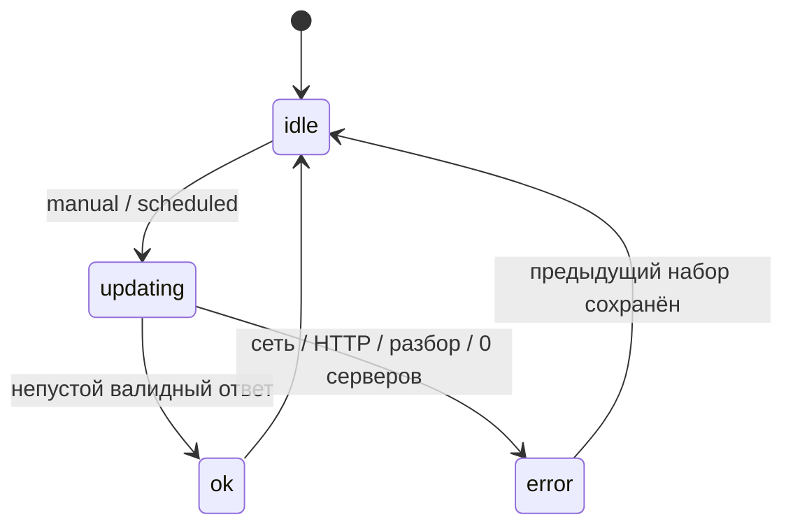

# Документ №20. Схемы состояний: VPN-сервис, подписка, устройства, обслуживание (U9)

Дата: 26.11.2026 (редакция U9).
Основание: ТЗ v1.0 §7 (состояния VPN), §13 (надёжность, Maintenance Mode); решения владельца U9 (26.11.2026); D-14 и шесть признаков (№10 §5.2) сохраняются.
Статус: **[У]** сводная модель. Предыдущая редакция U8 (failover-состояния сервера, `last_working_server`, DNS-состояния, Blocklists) заменена: этих сущностей в U9 нет.

**Что удалено из модели:** `server_health` и его переходы (1/2/3 отказа), `SWITCHING`, `PROXY_FALLBACK_DIRECT` с per-device настройкой, «три успешные проверки × 5 минут», `last_working_server`, DNS-состояния и DNS-fallback, состояния Blocklists, состояние «здоровье сервера» как хранимая сущность. Источник доступности серверов — штатный Xray Observatory; приложение его не дублирует.

---

## 1. Три независимые оси (не смешивать)

| Ось | Что описывает | Где хранится | Кто меняет |
|---|---|---|---|
| **Намерение** (`intent`) | хочет пользователь VPN или нет | Flash (`settings.json`) | только пользователь через API |
| **Конфигурация** (`config_state`) | сохранено / применено / ожидает / невалидно | Flash | Transaction Manager |
| **Фактическое состояние** (`runtime_state`) | что реально происходит сейчас | вычисляется, `/tmp` — только подсказка | Core по признакам |

**Инвариант:** `runtime_state` никогда не выводится из записанного флага. `state.json` со `config_state=Applied` не делает систему `ACTIVE` (D-14, ТЗ §7).

Отдельно от трёх осей существуют:

- **режим выбора сервера** — `auto` (выбранная стратегия) или `manual` (закреплён один сервер);
- **состояние операции подписки** — `idle` / `updating` / `ok` / `error` (с сохранением предыдущего набора);
- **настройка автообновления** — выключено (по умолчанию) либо 6 / 12 / 24 часа.

Эти сущности не являются состояниями VPN-сервиса и не меняют `runtime_state` сами по себе.

---

## 2. Фактические состояния VPN-сервиса

| Состояние | Значение | Условие (по приоритету, первое совпадение) |
|---|---|---|
| `APPLYING` / `ROLLING_BACK` | идёт транзакция | активная фаза apply/rollback |
| `MAINTENANCE` | явный режим обслуживания | `maintenance=on` (не отменяет политику) |
| `DISABLED_BY_USER` | штатное выключение | `intent=disabled` **и** процесса нет **и** правил нет |
| `STOPPING` | выключение в процессе | `intent=disabled`, но процесс/правила ещё есть (до таймаута) |
| `WAN_DOWN` | нет внешнего канала | нет default route / L3 / link |
| `EMERGENCY_DIRECT` | аварийное снятие перехвата | явный latch аварийного режима при инфраструктурном отказе (не отказ серверов); включается отдельным аварийным действием и **не** является автоматическим следствием отказа запуска Xray или неудачного отката на last-good (§8.2, REQ-169) |
| `FALLBACK_DIRECT` | все подходящие серверы недоступны, `direct_on_failure=true` | Observatory не даёт ни одного доступного outbound; VPN-предназначенный клиентский трафик идёт DIRECT. **Модельное состояние:** напрямую не наблюдается; ожидаемое состояние вычисляется по данным Observatory (§3.1) |
| `FALLBACK_BLOCK` | все подходящие серверы недоступны, `direct_on_failure=false` | то же, но `fallbackTag` — `blackhole`; выхода в DIRECT нет. **Модельное состояние:** напрямую не наблюдается; ожидаемое состояние вычисляется по данным Observatory (§3.1) |
| `STARTING` | запуск | процесса нет при `intent=enabled` (в пределах таймаута) |
| `DEGRADED` | частичный отказ | подпричина ниже |
| `ACTIVE` | всё подтверждено | шесть признаков свежие и положительные |
| `UNKNOWN` | недостаточно признаков | признаки устарели/недоступны |

Подпричины `DEGRADED`: `ENGINE_DOWN`, `POLICY_NOT_APPLIED`, `TRAFFIC_UNVERIFIED`, `CONFIG_STALE`, `STALE_SIGNALS`, `RESIDUAL`, `COLD_START`. Подпричины «сервер недоступен» больше нет: доступность outbound — предмет Observatory, а не собственной машины состояний.

**Инварианты:**

1. `ACTIVE` невозможен без свежего traffic proof (S6) и подтверждённой политики (S4).
2. `DISABLED_BY_USER` не является ошибкой, не запускает recovery и не создаёт `DEGRADED`.
3. Любое состояние, при котором трафик идёт напрямую при `intent=enabled`, обязано иметь предупреждение и событие.
4. Шесть признаков (S1–S6) и их TTL — №10 §5.2; здесь они не переопределяются.
5. Приложение **не хранит** состояние доступности сервера. `healthy`/`suspect`/`degraded`/`unavailable`, счётчики отказов и «последний рабочий сервер» отсутствуют как сущности.

---

## 3. `FALLBACK_DIRECT` и `FALLBACK_BLOCK`

| Аспект | `FALLBACK_DIRECT` | `FALLBACK_BLOCK` |
|---|---|---|
| Условие | `direct_on_failure=true` и ни одного доступного сервера | `direct_on_failure=false` и ни одного доступного сервера |
| Что происходит | трафик, предназначенный VPN, идёт DIRECT (`fallbackTag` = DIRECT) | трафик не выходит DIRECT (`fallbackTag` = blackhole), безопасный отказ |
| Что не меняется | Always DIRECT остаётся DIRECT; UDP по умолчанию DIRECT остаётся DIRECT; системный трафик роутера не затрагивается; `intent`, конфигурация, профили, стратегия не меняются | то же |
| Предупреждение | постоянное, видно на всех вкладках, не скрывается | постоянное; формулировка «VPN недоступен, трафик заблокирован» |
| Выход | Xray Observatory снова даёт доступные outbound → трафик возвращается в балансировщик | то же |
| Кто определяет | Xray (`fallbackTag`, результаты Observatory) | Xray |
| Как приложение узнаёт | вычисляется по данным локального gRPC `ObservatoryService.GetOutboundStatus` (OQ-14, вариант B, закрыт 27.11.2026) и публикуется как производное с пометкой `source=derived`; факт применения `fallbackTag` не наблюдается (§3.1) | то же: вычисляется и публикуется как производное, а не как наблюдение (§3.1) |

**Чего в модели нет:**

1. Собственного счётчика отказов и порогов «2 отказа → DEGRADED, 3 → переключение».
2. Собственной последовательной процедуры failover и приоритетного списка серверов.
3. Понятия `last_working_server` и правила выбора сервера при выходе из fallback: выбор выполняет Xray по выбранной стратегии.
4. Порога «три последовательные успешные проверки с интервалом 5 минут + проверки VPN/DNS/маршрутизации»: возврат определяет Observatory, следующая пауза — `probeInterval`.
5. Per-device настройки `proxy_fallback`: `direct_on_failure` — глобальная настройка подписки/конфигурации.

**Что утверждено и сохраняется:** при `direct_on_failure=true` трафик, предназначенный VPN, при полной недоступности серверов может идти DIRECT, и это сопровождается постоянным предупреждением и событием; при `false` выход в DIRECT недопустим и используется штатный `blackhole`. Молчаливого перехода PROXY→DIRECT без предупреждения быть не может.

Границы этой гарантии (что именно блокируется и что нет) заданы в №18 §7.3.1; наблюдаемость состояния приложением — OQ-14 (§3.1).

### 3.1 Наблюдаемость `FALLBACK_*` (OQ-14, вариант B — закрыт 27.11.2026)

`FALLBACK_DIRECT`/`FALLBACK_BLOCK` — фактическое поведение Xray, а не измеряемое приложением состояние. В U9 нет штатного канала, через который демон узнаёт «все серверы недоступны»: собственная проба удалена вместе с failover, а `fallbackTag` — внутренняя логика Xray.

**Пять уровней, которые нельзя смешивать:**

| Уровень | Что это | Кто определяет | Доступно приложению |
|---|---|---|---|
| 1. Модельное состояние | правило «нет живых outbound среди серверов подписки → трафик идёт в `fallbackTag`» | архитектура U9 и конфигурация Xray | да, как описание (№18 §7.3) |
| 2. Фактическое состояние Xray | какой outbound реально выбран для конкретного потока | Xray в момент соединения | **нет**: API не сообщает выбранный outbound |
| 3. Наблюдаемое состояние | `alive`, `delay`, `last_try_time`, `last_seen_time` по каждому outbound | gRPC `ObservatoryService.GetOutboundStatus` | **да** (OQ-14, вариант B) |
| 4. Вычисленное состояние | «среди outbound подписки нет живых» → ожидается срабатывание `fallbackTag` | демон по данным уровня 3 | да, только с пометкой «производное» |
| 5. Опубликованное состояние | поля `status` (`servers`, `fallback`, `observability`), баннеры Dashboard | демон приложения | да, с разделением «наблюдение / производное» |

Отсюда: `FALLBACK_*` в таблицах и диаграммах — это уровень 1, а публикуемое состояние — уровень 4. Приложение вычисляет ожидаемое состояние по уровню 3, но факт уровня 2 не наблюдает. Поэтому публикуются наблюдение (`alive`, `delay`, свежесть) и отдельно производное `fallback` с явной пометкой; формулировка «Xray применил `fallbackTag`» запрещена.

**Решение OQ-14 (27.11.2026, вариант B).** Источник — gRPC `ObservatoryService.GetOutboundStatus`; listener только на `127.0.0.1`; в `api.services` входит только `ObservatoryService`; `metrics`, `/debug/vars` и отдельный HTTP-listener не используются; доступ из LAN/WAN запрещён. Технические детали и поля ответа — №21 §4.3, REQ-168.

| Вариант | Что даёт | Ограничение |
|---|---|---|
| gRPC `ObservatoryService.GetOutboundStatus` | статус каждого outbound: `alive`, `delay`, `last_error_reason` | требует включить Xray API с `api.listen` на loopback; отдельный inbound не нужен (уточнено в U9-H2) |
| `metrics`-слушатель, `/debug/vars` | тот же статус в секции `observatory` | требует локального HTTP-слушателя |
| Собственная проба демона | не требует интерфейса Xray | противоречит U9: возврат собственного health-механизма и лишний трафик |

**Выбран вариант B.** Ни один из вариантов не сообщает, какой outbound выбран прямо сейчас: доступность — наблюдение, факт fallback — вычисление. Варианты `metrics`/`/debug/vars` и собственная проба отклонены: первый создаёт неаутентифицированный HTTP-интерфейс, второй возвращает собственный health-механизм.

**Правила публикации после OQ-14:**

1. `servers` — наблюдение: `alive`, `delay`, `last_try_time`/`last_seen_time` и признак свежести. Поле `fallback` — производное: `{active: bool, mode: direct|block, source: "derived", basis: "no_alive_outbound"}`. Оно не выдаётся за прямое наблюдение фактического выбора Xray.
2. Dashboard разделяет три независимые вещи: статус процесса Xray (S2), результаты Observatory (S3 — только при доступном API) и состояние сервиса по признакам (S1–S6). Ошибка чтения API — `observability=error`, а не отказ Xray и не отказ VPN.
3. Пустой список статусов — валидный ответ API, а не ошибка: он означает «результатов ещё нет» либо «селектор ни с чем не совпал». Публикуется «Неизвестно»/`observability=no_data`, а не `unavailable`.
4. При отсутствии свежих данных `alive` не переписывается в `healthy` или `unavailable`; показывается время последней проверки.
5. Список серверов показывает то, что сообщает API (REQ-124), и не приписывает приложению знание выбранного сервера или факта fallback.

```mermaid
stateDiagram-v2
    [*] --> DISABLED_BY_USER: intent=disabled
    DISABLED_BY_USER --> STARTING: enable
    STARTING --> ACTIVE: S2..S6 ok
    STARTING --> DEGRADED: timeout
    STARTING --> UNKNOWN: признаки недоступны
    %% пунктир — модельный переход; вход/выход вычисляется по данным Observatory (OQ-14 B), а не наблюдается напрямую
    ACTIVE -.-> FALLBACK_DIRECT: нет доступных outbound, direct_on_failure=true
    ACTIVE -.-> FALLBACK_BLOCK: нет доступных outbound, direct_on_failure=false
    FALLBACK_DIRECT -.-> ACTIVE: Observatory снова даёт доступные outbound
    FALLBACK_BLOCK -.-> ACTIVE: Observatory снова даёт доступные outbound
    ACTIVE --> APPLYING: new config / смена стратегии / ручной override
    APPLYING --> ACTIVE: trial ok
    APPLYING --> ROLLING_BACK: trial fail
    ROLLING_BACK --> ACTIVE: last-good
    ROLLING_BACK --> DEGRADED: last-good failed (ENGINE_DOWN, политика сохранена)
    ACTIVE --> WAN_DOWN: WAN lost
    WAN_DOWN --> ACTIVE: WAN up
    ACTIVE --> MAINTENANCE: user enters
    MAINTENANCE --> ACTIVE: exit + checks ok
    MAINTENANCE --> DEGRADED: exit checks fail
    ACTIVE --> STOPPING: disable
    STOPPING --> DISABLED_BY_USER: process+policy gone
    STOPPING --> DEGRADED: timeout (RESIDUAL)
    DEGRADED --> DISABLED_BY_USER: disable
```

**Замечание о `WAN_DOWN`.** При пропаже WAN серверы не считаются виновными: состояние `WAN_DOWN` имеет приоритет над `FALLBACK_*`, а доступность outbound не пересчитывается приложением.

---

## 4. Ручной выбор сервера и стратегия

| Аспект | Правило |
|---|---|
| Режим `auto` | действует выбранная стратегия (`random`, `roundRobin`, `leastPing`, `leastLoad`); по умолчанию `random` |
| Ручной override | один сервер закреплён; балансировщик ограничен им; другие серверы приложение не перебирает |
| Недоступность закреплённого сервера | срабатывает `fallbackTag` (`DIRECT` или `blackhole` по `direct_on_failure`); перебора остальных серверов нет |
| Возврат в `auto` | восстанавливается выбранная стратегия; это изменение конфигурации, проходит через `APPLYING` |
| Успешное обновление подписки | override сохраняется, если выбранный сервер найден в новом наборе (точное совпадение нормализованной конфигурации); иначе сбрасывается в `auto` |
| Отображение | в UI видно, активен автоматический выбор или закреплён конкретный сервер |
| Хранение | режим и идентификатор закреплённого сервера — часть настроек, не часть `runtime_state` |

Ручной override — это **не** приоритетный список и **не** отдельная стратегия. Упорядоченный список приоритетов серверов в U9 отсутствует.

**Выбор сервера при холодном старте.** До завершения первого цикла Observatory `random`/`roundRobin` считают непроверенные outbound доступными; `leastPing`/`leastLoad` без пригодных результатов не работают как `random`. Это ограничение отображается как `DEGRADED/COLD_START` только в диагностике и не является ошибкой сервиса.

---

## 5. Операция подписки и автообновление

| Состояние операции | Значение |
|---|---|
| `idle` | операция не выполняется |
| `updating` | идёт получение и проверка ответа |
| `ok` | непустой ответ применён атомарно; предыдущий набор заменён |
| `error` | сеть/HTTP/разбор/пустой результат; **предыдущий набор сохранён целиком** |

Правила:

1. Успешный непустой ответ атомарно заменяет набор серверов; внутренние ID создаются заново.
2. Ошибка и пустой результат (0 серверов) не меняют сохранённый набор.
3. После ошибки собственного цикла повторов нет: следующая попытка — плановый запуск или действие пользователя.
4. Успешное обновление сохраняет ручной override, если выбранный сервер найден в новом наборе по точному совпадению нормализованной конфигурации подключения (№13 §3.1); если сервер исчез — `mode` становится `auto`, публикуется `override.reset`.
5. Автообновление выключено по умолчанию; при включении доступны интервалы 6 / 12 / 24 часа, значение по умолчанию — 24 часа; первый **плановый** запуск выполняется по выбранному интервалу, немедленный первый запрос не утверждён; далее — по штатному расписанию OpenWrt (`crond`). Ручная загрузка доступна всегда.
6. Расписание не показывается в UI. Сложное сопоставление серверов между версиями подписки, `identity_fields`, `credential_fingerprint` и восстановление по истории не используются.



---

## 6. Устройства и временный overlay

| Поле | Значение | Переход |
|---|---|---|
| `mode` | `follow` \| `always_direct` | меняет только пользователь |
| `temp_direct` | overlay до `expires` | включается пользователем; снимается таймером, вручную или при смене `mode` |
| `expires = null` | бессрочный overlay | снимается только вручную или при смене `mode`; не превращается в третий режим |

Правила:

1. `mode` не меняется при истечении `temp_direct`.
2. Overlay не влияет на стратегию, `direct_on_failure` и состояние сервиса.
3. Группы не являются routing-сущностями и на маршрутизацию не влияют.
4. DNS-атрибуции устройства нет: все устройства используют штатный DNS роутера.

---

## 7. Журналы и диагностика

Состояний журналов нет. Действуют настройки и результаты:

| Сущность | Значение |
|---|---|
| `logLevel` | `debug`, `info`, `warning`, `error`, `none` — штатные значения Xray; при первоначальной настройке используется штатное значение Xray по умолчанию |
| Отображение | только `access.log` и `error.log`; 20 / 50 / 100 последних строк |
| Ротация | штатный `logrotate`, отдельная конфигурация для двух Xray-файлов, суточный запуск |
| Директивы | `daily` + `minsize <порог>M`; `size` не используется, чтобы не переопределять суточный интервал |
| Порог | общий пользовательский параметр в MB, по умолчанию 5 MB, диапазон 1…50 MB [П]; применяется к каждому файлу независимо |
| Архив | ровно одна сжатая копия на файл; при следующей ротации заменяется |
| Режим | `copytruncate`; Xray не перезапускается |
| Ручная очистка | отсутствует; отдельной кнопки удаления логов нет |
| Ошибка ротации | фиксируется в диагностике; не превращается в критическую ошибку Xray; исходный лог не повреждается, Xray не останавливается |

Диагностика может показать время последнего запуска ротации и результат, но это не состояние сервиса. Системные логи OpenWrt (`logread`), лента событий приложения и прочие логи в UI v1 не выводятся.

### 7.1 Приватность логов и диагностического экспорта

| Артефакт | Что содержит | Правило |
|---|---|---|
| `access.log` | адреса и домены назначения, время, объём; при sniffing — извлечённые имена | просмотр последних строк в UI; в экспорт по умолчанию **не включается** |
| `error.log` | ошибки Xray, адреса серверов, причины отказа | просмотр в UI; в экспорт включаются последние N строк |
| Диагностический экспорт | снимок статуса и признаков, версия Xray и прошивки, конфигурация без секретов, результат ротации, последние строки `error.log` | только по явному действию пользователя, с предпросмотром и подтверждением |
| Backup | конфигурация, включая секреты | отдельный артефакт с предупреждением; к диагностике не относится |

**Правила:**

1. Автоматической отправки нет: ни расписания, ни сетевого получателя, ни «отправить разработчику».
2. **Приложение не находится в цепочке записи** `access.log`/`error.log`: их пишет процесс Xray. Поэтому «маскирование до записи» относится только к артефактам, которые создаёт сам демон — аудит настроек, снимок статуса, текст ошибок приложения, поля экспорта. Сырые Xray-логи считаются чувствительными независимо от содержимого и приложением не переписываются.
3. Маскирование при **отображении** и при **экспорте** — разные операции: показ ограничен объёмом последних строк, экспорт — составом (REQ-171).
4. Маскирование IP-адресов **не удаляет доменные имена**. Если в экспорт попадают имена (из `access.log` или из текста ошибки), они удаляются или обобщаются отдельной операцией; нельзя считать «IP замаскирован» достаточной защитой.
5. Пользователь видит состав экспорта до подтверждения и может отказаться.
6. Экспорт не содержит `access.log` целиком и не превращается в скрытый журнал посещений. Полная анонимизация не обещается.

### 7.2 Состояния наблюдаемости и диагностики (OQ-14)

Диагностика различает следующие состояния; они не взаимозаменяемы:

| Состояние | Условие | Что показывается |
|---|---|---|
| `strategy_selected` | стратегия сохранена и применена в конфигурации | выбранная стратегия и режим `auto`/`manual` |
| `results_received` | API вернул непустой список, и в нём есть хотя бы одна свежая запись (это же условие даёт `observability.state=ok`, §7.2 п.3); свежесть остальных записей не предполагается | `alive`, `delay`, время проверки; устаревшие строки помечены отдельно |
| `no_data` | API вернул пустой список | «Результатов ещё нет» (не «недоступен») |
| `no_candidate` | среди **свежих** записей нет ни одного `alive` outbound подписки; устаревшие и отсутствующие записи в вердикт не входят (§7.2 п.5) | «Нет живых серверов» (наблюдение); не доказывает недоступность всех серверов, если часть данных устарела или отсутствует |
| `fallback_expected` | `no_candidate` → ожидается срабатывание `fallbackTag` | «VPN-трафик, вероятно, идёт DIRECT/заблокирован» с пометкой «производное» |
| `stale` | в списке нет ни одной свежей записи: для каждой `now − last_try_time > TTL` (формула §7.2 с учётом режима и `N`) | «Данные устарели» + время |
| `api_error` | ошибка вызова gRPC при работающем Xray: `Unimplemented` (сервис не зарегистрирован), `DeadlineExceeded`/таймаут запроса | «Нет связи с интерфейсом наблюдаемости»; процесс Xray показывается отдельно |

Состояние `fallback_expected` не означает, что Xray действительно применил `fallbackTag`: выбранный outbound API не сообщает. Собственная проба и собственный failover для этих состояний не создаются.

**Три разных отказа (U9-H2, отчёт №39).** Их нельзя смешивать:

1. **Ошибка создания listener при старте Xray.** `net.ResolveTCPAddr` или `internet.ListenSystem` возвращают ошибку, `commander.Start` возвращает её, а `core.Instance.Start` прерывает запуск на первой ошибке feature. Xray **не запускается**; приложение получает ошибку запуска движка, состояние — `DEGRADED/ENGINE_DOWN`, откат на last-good по инвариантам §8.1. Это не `api_error` при работающем Xray.
2. **Listener работает, но `ObservatoryService` не зарегистрирован** (например, опечатка в `api.services`). Xray работает, вызов `GetOutboundStatus` возвращает `Unimplemented`; публикуется `observability=error` с `error_code=unimplemented`. Отказ процесса Xray не объявляется.
3. **Ошибка вызова RPC при работающем Xray** (таймаут, `DeadlineExceeded`). Публикуется `observability=error`; состояние процесса берётся из S2, а не из текста ошибки. `connection refused` сам по себе не классифицируется: сначала проверяется, запущен ли процесс; если нет — это `ENGINE_DOWN`.

**Свежесть данных (U9-H2).** Свежесть считается по `last_try_time` (время последней попытки), а не по `last_seen_time` (время последнего успеха). Запись свежая, если `now − last_try_time ≤ TTL`, где `TTL = T_cycle + grace`. Оценка интервала между двумя обновлениями одной и той же записи: при `enableConcurrency: true` — `T_cycle ≤ probeInterval + 2 × max_probe_time`; при `false` — `T_cycle ≤ N × (probeInterval + max_probe_time)`, где `N` — число outbound, фактически попавших в выборку `HandlerSelector.Select` после префиксного сопоставления `subjectSelector` (а не число литеральных элементов массива), `max_probe_time` — расчётная верхняя граница времени одной пробы (не поле конфигурации): в v26.9.9 `http.Client.Timeout` — константа 5 с, она ограничивает весь запрос вместе с TLS-handshake, поэтому `TLSHandshakeTimeout` не прибавляется (№18 §7.2.1). `grace` — утверждённое проектное значение **2 с**: до 1 с покрывает усечение секундного `last_try_time`, остаток — начальный запас на накладные расходы выполнения и планировщика. Это проектное значение, а не измеренная характеристика целевой сборки (§8.2, сценарий 135). Запись с `last_try_time = 0` относится к `no_data`, а не к `stale`. Числа из формулы не подставляются как утверждённые: `probeInterval` берётся из конфигурации, `N` — из состава selector.

**Почему множитель 2 (U9-H3).** В конкурентном режиме все пробы цикла запускаются одновременно, Observer ждёт завершения последней, затем выполняет `Sleep(probeInterval)`. Один и тот же outbound в цикле k может завершиться первым, а в цикле k+1 — последним, поэтому расстояние между двумя его обновлениями не превосходит `probeInterval + 2 × max_probe_time`. Прежняя оценка `probeInterval + max_probe_time` была нижней границей, а не верхней, и не могла служить основанием TTL. В последовательном режиме пауза выполняется после каждой пробы, включая последнюю, поэтому цикл равен сумме длительностей и `N` пауз. Обе оценки — верхние границы для настроенных параметров, а не измеренные значения.

**`max_probe_time` (уточнено пост-ревью U9-H3).** Это **расчётное обозначение** верхней границы времени одной пробы, а не настройка конфигурации Xray. В проверенной версии v26.9.9 (`app/observatory/observer.go`) клиент пробы создаётся с `http.Client.Timeout` = 5 с и `TLSHandshakeTimeout` = 5 с; полей конфигурации для управления этими значениями нет. `Client.Timeout` охватывает весь запрос, включая TLS-handshake, поэтому два значения по 5 с не складываются; редиректы не выполняются (`ErrUseLastResponse`). Граница 5 с — свойство исходника проверенной версии, а не гарантия целевой сборки: фактическое время одной пробы на ней подтверждается отдельно `[Т]`. Численное значение в документации не назначается.

**Строгость оценок и `grace` (уточнено пост-ревью U9-H3).** Формулы `T_cycle` — расчётные верхние оценки при принятых timeout-предпосылках, а не строгие гарантии реального времени. Исходники не задают конечной верхней границы накладных расходов планировщика: задержки запуска goroutine, `Select` и смежных операций добавляют время к оценке. Кроме того, `last_try_time` хранится как Unix timestamp в секундах, поэтому усечение способно занизить вычисленный возраст записи примерно до одной секунды. Отсюда требования к `grace`: он должен покрывать (1) погрешность секундного timestamp — не менее одной секунды, (2) накладные расходы целевой сборки, (3) иной подтверждённый запас, необходимый для безопасного определения свежести. Утверждённое значение — **2 с** (`grace = 2s`): из них до 1 с покрывает timestamp-погрешность, остаток — запас на накладные расходы. Формулы с этим значением остаются расчётными верхними оценками, а не строгими гарантиями реального времени; измерениями целевой сборки значение не подтверждено. Если измеренные на AX3000T накладные расходы сверх timestamp-погрешности превысят оставшийся запас, значение не меняется агентом: владельцу готовится отдельное предложение с результатами измерения (REQ-168, сценарий 135).

**Эффективный `probeInterval` (уточнено пост-ревью U9-H3).** В v26.9.9 при нулевом `ProbeInterval` Observer использует `sleepTime = 10s` (`app/observatory/observer.go`, `background()`); при заданном значении берётся оно. Поэтому расчёт TTL обязан использовать эффективный интервал из конфигурации, а не предполагать, что значение по умолчанию равно 300 с. U9 задаёт `probeInterval: "300s"` явно (REQ-131): отсутствие явного значения считается несоответствием конфигурации, а не поводом принять 10 с за расчётный интервал.

**Смешанная свежесть (U9-H3).** Свежесть оценивается **по каждой записи отдельно**, по её собственному `last_try_time`; агрегированного «свежего списка» не существует. Правила:

1. Запись отсутствует или `last_try_time = 0` → `no_data` для этого outbound, а не `stale`. Значение `0` в нормальной работе v26.9.9 не возникает (поле пишется при каждой пробе) и трактуется как защитная проверка некорректного/неинициализированного состояния.
2. `now − last_try_time ≤ TTL` → запись свежая (`fresh: true`); иначе — устаревшая (`fresh: false`), независимо от `alive`.
3. `observability.state = ok` — в списке есть хотя бы одна свежая запись; `stale` — список непустой, но свежих записей нет; `no_data` — список пуст; `error` — вызов API не удался.
4. Список не объявляется свежим целиком из-за одной свежей записи и не объявляется устаревшим целиком, если часть записей свежая: устаревшие строки помечаются по отдельности, сводка показывает, что часть данных устарела.
5. Доступность (`no_candidate`, `fallback_expected`) вычисляется **только по свежим записям**. Устаревшая запись не считается ни `alive`, ни мёртвой — она исключается из вердикта. Если свежих записей нет, вердикт доступности не публикуется.
6. `delay = 99999999` — сентинел «задержка не измерена», а не измерение: в UI не показывается как задержка и не участвует в сравнении.
7. Новых внешних статусов не вводится: смешанное состояние выражается существующими полями (`state` и `fresh` в каждой записи). Отдельный агрегат «частично устарело» менял бы утверждённую семантику интерфейса и без решения владельца не вводится.

---

## 8. Загрузка, восстановление и деградация при старте

1. **Старт системы.** `intent` читается из `settings.json`. При `disabled` сервис не запускается: `DISABLED_BY_USER`. При `enabled` — `STARTING`.
2. **Проверка конфигурации.** Невалидная конфигурация не применяется: сервис остаётся `DISABLED_BY_USER` (если VPN не был включён) либо `DEGRADED/CONFIG_STALE` с указанием причины.
3. **Старт Xray.** `xray -test`, затем запуск через procd. Неудача запуска → `DEGRADED/ENGINE_DOWN`; политика не удаляется; попытка отката на last-good описана в §8.2 и не объявляется успешной только по факту восстановления файла.
4. **Первые результаты Observatory.** До первого цикла сервис остаётся `ACTIVE` с диагностической пометкой `COLD_START`; собственной блокировки трафика до проверки нет. Через API это видно как пустой список (`observability=no_data`), что не равно ошибке API. Для `leastPing`/`leastLoad` пригодных результатов в этом окне нет, поэтому применяется `fallbackTag`: при `direct_on_failure=true` VPN-предназначенный трафик до первого цикла идёт DIRECT. Это известное следствие конфигурации, а не подтверждённая защищённая работа VPN (№18 §7.2, сценарий 116).
5. **Восстановление после сбоя демона.** procd перезапускает демон; правила и конфигурация сохраняются; состояние пересчитывается по признакам.
6. **После перезагрузки** VPN не включается сам, если пользователь его выключил; `temp_direct` с истёкшим `expires` не восстанавливается.
7. **Все серверы недоступны** → `FALLBACK_DIRECT` или `FALLBACK_BLOCK` по `direct_on_failure` (§3). Это модельный переход: приложение не пересчитывает доступность самостоятельно — ожидаемое состояние вычисляется по свежим данным Observatory (OQ-14 B), а факт применения `fallbackTag` не наблюдается (§3.1).

### 8.1 Инварианты рестарта и восстановления

1. **Один экземпляр (U9-H3).** Одновременно работает только один управляемый экземпляр Xray; старый процесс останавливается до запуска нового; параллельный запуск двух экземпляров недопустим. Xray запускается procd как единственный instance и не дублирует правила. **Основание:** listener Xray ставит `SO_REUSEPORT` (подтверждено v26.9.9: `transport/internet/system_listener.go` вызывает `setReusePort`, `transport/internet/sockopt_linux.go` устанавливает `SO_REUSEPORT`), поэтому занятость порта не является надёжной защитой от второго экземпляра: при том же эффективном UID второй процесс может успешно занять тот же `127.0.0.1:<порт>`, и ядро распределит входящие gRPC-соединения между процессами. Проверка «порт свободен» сама по себе не доказывает отсутствие гонки, а наличие второго listener с `SO_REUSEPORT` не является безопасным способом совместного использования порта. **Контракт блокировки утверждён владельцем 27.11.2026 (решение №4):** единственный launcher открывает `/var/run/vpn-manager/xray.lock` и берёт `flock(LOCK_EX | LOCK_NB)`; запуск разрешён только после успешного захвата; при конфликте второй экземпляр не стартует, работающий не завершается; дескриптор с блокировкой не помечается `FD_CLOEXEC` и переживает `execve`, поэтому блокировка удерживается всё время жизни Xray; ядро освобождает её после закрытия последнего дескриптора. PID-файл — только диагностика: он не является блокировкой и не доказывает жизнь процесса. procd управляет одним instance, но сам факт одного instance singleton не гарантирует. Сохранение FD через exec, удержание блокировки Go-процессом, права `/var/run/vpn-manager` и отсутствие обходных путей запуска проверяются технически [`[Т]`], сценарии 137, 142–146, 150–152.
2. **Идемпотентность правил.** Правила принадлежат одной таблице и цепочкам проекта; повторное применение заменяет их, а не добавляет вторые. Проверка — счётчики правил до и после [Т].
3. **Рестарт Xray не снимает политику.** При мёртвом listener пакеты отбрасываются (fail-closed), а не уходят DIRECT [Т], сценарий 107.
4. **Last-good.** Последняя применённая конфигурация хранится на Flash; демон читает её при старте, а не собирает заново из частичных данных. Файл last-good — это сохранённая конфигурация, а не подтверждение работающего движка (§8.2).
5. **`intent` — единственный источник решения** «включено/выключено». Рестарт не меняет `intent` и не включает VPN, выключенный пользователем.
6. **Прерванная операция** помечается `interrupted`; побочных применений и «догадок» о завершении нет.
7. **`EMERGENCY_DIRECT` — только явный latch** при инфраструктурном отказе, включаемый отдельным аварийным действием. Падение Xray, отказ запуска и неудачный откат на last-good сами по себе DIRECT не дают: состояние остаётся `DEGRADED/ENGINE_DOWN`, политика перехвата сохраняется (§8.2, REQ-169).
8. Сохранность трафика в окне рестарта **не гарантируется** и не заявляется без сценария 107.

### 8.2 Отказ запуска Xray и неудачный откат на last-good (U9-H3)

Разделяются восемь сущностей, которые нельзя смешивать:

| № | Что | Чем подтверждается |
|---|---|---|
| 1 | Last-good-конфигурация на Flash | файл last-good, `config_state` |
| 2 | Попытка запуска новой конфигурации | транзакция apply, `xray -test`, запуск через procd |
| 3 | Ошибка запуска процесса Xray | отсутствие процесса, код завершения и лог Xray, наблюдение procd |
| 4 | Попытка восстановления last-good | повторное применение файла last-good и повторный запуск |
| 5 | Повторный отказ при той же внешней причине | тот же занятый `api.listen` → та же ошибка |
| 6 | Состояние `ENGINE_DOWN` | S2: процесса нет при `intent=enabled` |
| 7 | Поведение procd | respawn по настройкам init-скрипта; число и интервал попыток не назначаются произвольно |
| 8 | Сохранение сетевой политики | правила, `ip rule`, route остаются; незапланированного DIRECT нет |

**Инварианты:**

1. Последняя действующая защитная политика не удаляется из-за того, что Xray не запустился.
2. VPN-предназначенный трафик не переключается в DIRECT молча: при `direct_on_failure=false` сохраняется отказ (мёртвый listener либо `blackhole`), при `true` переход в DIRECT возможен только как следствие конфигурации `fallbackTag`, а не как действие демона при откате.
3. Last-good не обязан восстановиться: если он использует тот же занятый `api.listen`, повторная попытка даёт ту же ошибку. Успехом отката считается только подтверждённый запуск, а не запись файла.
4. Запись last-good на диске не является подтверждением работающего движка: `config_state=Applied` не делает сервис `ACTIVE`.
5. Отсутствие процесса Xray обнаруживается способом, подтверждённым архитектурой (S2: procd/ubus и проверка процесса), а не текстом ошибки API.
6. Пока процесса нет, отказ не публикуется как `api_error`: `observability` не является ошибкой вызова API при отсутствующем движке.
7. Повторные попытки ограничены утверждённой конфигурацией `respawn 3600 5 5`: `threshold = 3600` с, `timeout = 5` с, `retry = 5`. При серии быстрых отказов (меньше 3600 с работы) допускается до пяти повторных запусков с задержкой 5 с; шестой быстрый отказ прекращает автоматический respawn (событие `instance.fail`), сервис остаётся остановленным, состояние — `DEGRADED/ENGINE_DOWN`, политика сохранена, DIRECT не включается, причина и факт исчерпания лимита видимы, дальнейшее восстановление — только явным действием. Непрерывная работа не менее 3600 с сбрасывает счётчик. `retry = 0` (неограниченные повторы) не используется. Это ограниченный цикл, а не бесконечная серия apply/rollback. Доставка приложению причины исходного отказа и факта `instance.fail` штатными средствами target-сборки — техническая проверка `[Т]`; автоматическое получение исходной ошибки `commander.Start` не утверждается.

**Ограничения `api.listen` (U9-H3).** Допустим только явный IPv4 loopback listener `127.0.0.1:<port>`: это внутренний gRPC-канал для локального доступа к Xray API, а не API приложения. Генератор обязан отклонять пустое значение, `localhost`, IPv6 (`[::1]`), `0.0.0.0`, LAN/WAN-адрес, unix socket (`/path`, `@name`), некорректный порт и список сервисов, отличный от ровно одного `ObservatoryService` (№21 §4.2 п.1, п.9; REQ-168). Дополнительные inbound, HTTP API, dokodemo-door и отдельная маршрутизация для `api` не создаются.

**Дедлайн gRPC (решение владельца №1, 27.11.2026).** Каждый вызов `GetOutboundStatus` выполняется с дедлайном **2 с** на весь RPC, с автоматическими повторами одного вызова не повторяется. Истечение дедлайна даёт `deadline_exceeded`, не означает остановку процесса Xray и не смешивается с `engine_down`: состояние процесса определяется отдельно от успешности gRPC API (№12 §4.1, REQ-168, сценарии 141–142).

**Как приложение узнаёт причину.** Возврат ошибки `commander.Start` внутри процесса Xray и завершение внешнего процесса — разные события. Когда Xray запускается как отдельный процесс через procd, приложение не получает исходную ошибку `commander.Start` автоматически: ему доступны состояние процесса, код завершения и логи. Точный механизм передачи причины запуска приложению (разбор лога, код возврата, отдельный канал) не определён и остаётся техническим параметром `[Т]`; утверждать, что ошибка `Start` доставляется приложению, нельзя.

---

## 9. Адаптивное обновление UI (после измерений)

Интервалы обновления статуса остаются **[Т]**: 2–5 с при открытом окне операции, 5 с на главной, 5–10 с на списках, 30–60 с в фоне. Значения подтверждаются измерением (W-13), а не назначаются окончательно.

---

## 10. Сводная таблица переходов (проверочная)

| Из | Событие | В | Условие/примечание |
|---|---|---|---|
| `DISABLED_BY_USER` | включение пользователем | `STARTING` | `intent=enabled` |
| `STARTING` | признаки в норме | `ACTIVE` | S2–S6 |
| `STARTING` | таймаут | `DEGRADED` | `ENGINE_DOWN` / `POLICY_NOT_APPLIED` |
| `ACTIVE` | нет доступных outbound, `direct_on_failure=true` | `FALLBACK_DIRECT` | вычисляется по данным Observatory (OQ-14 B); факт выбора Xray не наблюдается |
| `ACTIVE` | нет доступных outbound, `direct_on_failure=false` | `FALLBACK_BLOCK` | то же |
| `FALLBACK_DIRECT` | доступные outbound появились | `ACTIVE` | следующая пауза `probeInterval`; вычисляется, не наблюдается напрямую |
| `FALLBACK_BLOCK` | доступные outbound появились | `ACTIVE` | то же |
| `ACTIVE` | смена стратегии / ручной override / новая конфигурация | `APPLYING` | транзакция |
| `APPLYING` | trial ok | `ACTIVE` | — |
| `APPLYING` | trial fail | `ROLLING_BACK` | — |
| `ROLLING_BACK` | last-good применён | `ACTIVE` | — |
| `ROLLING_BACK` | last-good не применён | `DEGRADED` | `ENGINE_DOWN`; политика перехвата сохранена; причина неудачного отката зафиксирована; DIRECT автоматически не включается, last-good не объявляется восстановленным (§8.2, REQ-169) |
| `ACTIVE` | WAN потерян | `WAN_DOWN` | серверы не виноваты |
| `WAN_DOWN` | WAN восстановлен | `ACTIVE` | повторная проверка признаков |
| `ACTIVE` | обслуживание | `MAINTENANCE` | политика не отменяется |
| `MAINTENANCE` | выход, проверки ok | `ACTIVE` | — |
| `MAINTENANCE` | выход, проверки fail | `DEGRADED` | — |
| `ACTIVE` | выключение пользователем | `STOPPING` | `intent=disabled` |
| `STOPPING` | процесс и правила сняты | `DISABLED_BY_USER` | — |
| `STOPPING` | таймаут | `DEGRADED` | `RESIDUAL` |
| любой | недостаточно признаков | `UNKNOWN` | не приравнивается к отказу |

---

## 11. Что не определено

1. Точная задержка обнаружения отказа сервера: зависит от положения отказа относительно цикла Observatory, времени HTTP-пробы (таймаут 5 с) и паузы 300 с; мгновенный failover не обещается.
2. Поведение уже открытых соединений при переходе в `fallbackTag` и после восстановления серверов — техническая проверка [Т].
3. Поведение `leastPing`/`leastLoad` до первых пригодных результатов наблюдения — [Т]. Для `leastLoad` подпись уточнена (OQ-15, вариант A): при стандартном Observatory выбор опирается на доступные данные задержки (№21 §4.4).
4. Точная периодичность циклов — [Т]: 300 с описаны как пауза после набора проверок; верхняя оценка интервала обновления одной записи — `probeInterval + 2 × max_probe_time` (concurrent) и `N × (probeInterval + max_probe_time)` (sequential), §7.2.
5. Параметры UI-обновления — измеряются.
6. Наблюдаемость `FALLBACK_*` и доступности серверов — OQ-14, вариант B: источник gRPC `ObservatoryService` на loopback; факт выбора outbound и срабатывания `fallbackTag` API не сообщает (§3.1).
7. Полнота перехвата и маршрут собственных подключений роутера — [Т], №23 §4.2.

**Открытых архитектурных вопросов нет:** OQ-14 и OQ-15 закрыты 27.11.2026 (варианты B и A, №21 §4.3–§4.4). Остаются технические проверки [Т] (gRPC на целевой сборке, loopback-доступ, поля ответа) и прежние ограничения; спорные пункты U8 закрыты удалением функции либо переведены в технические проверки.
