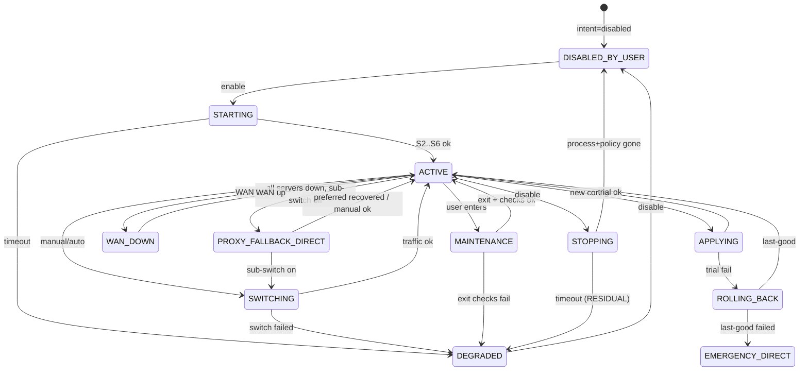
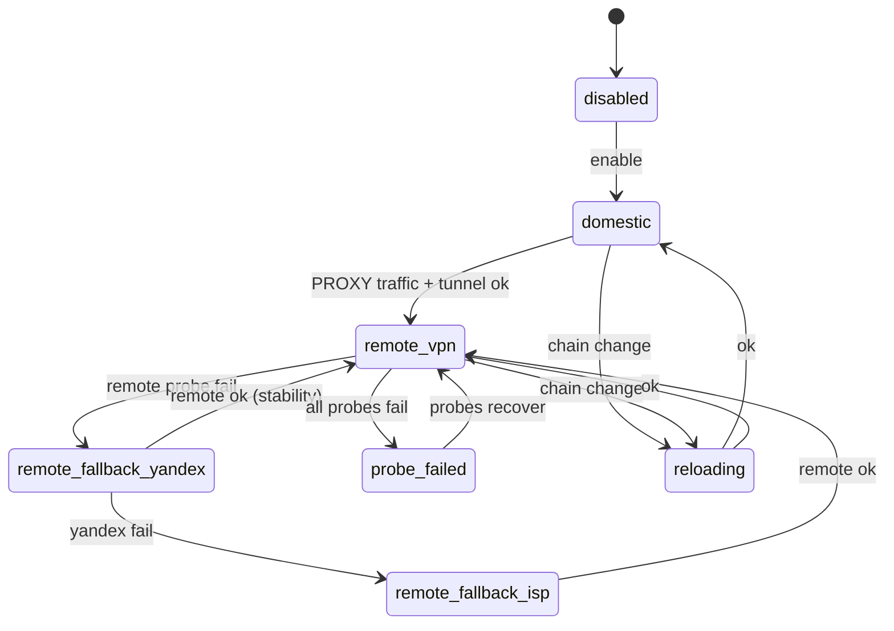
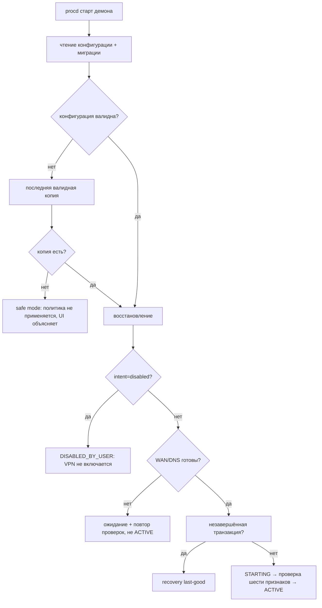

# Документ №20. Схемы состояний: VPN, failover, DNS, Blocklists, Maintenance

Дата: 22.11.2026
Основание: ТЗ v1.0 §7 (состояния VPN), §13 (надёжность, Maintenance Mode, общий статус), §16 §18.7; решения №27–35, №38–39, №72–76.
Статус: **[П]** сводная модель. VPN-часть — развитие документа №10 §5 (D-14) без изменения утверждённого; добавлены состояния, которых в прежней модели не было (`PROXY_FALLBACK_DIRECT`, `MAINTENANCE`, DNS и Blocklists).

---

## 1. Три независимые оси (не смешивать)

| Ось | Что описывает | Где хранится | Кто меняет |
|---|---|---|---|
| **Намерение** (`intent`) | хочет пользователь VPN или нет | Flash (`settings.json`) | только пользователь через API |
| **Конфигурация** (`config_state`) | сохранено/применено/ожидает/невалидно | Flash | Transaction Manager |
| **Фактическое состояние** (`runtime_state`) | что реально происходит сейчас | вычисляется, `/tmp` — только подсказка | Core по признакам |

**Инвариант:** `runtime_state` никогда не выводится из записанного флага. Файл `state.json` со `config_state=Applied` не делает систему `ACTIVE` (D-14, решение №35).

---

## 2. Фактические состояния VPN

| Состояние | Значение | Условие (по приоритету, первое совпадение) |
|---|---|---|
| `APPLYING` / `ROLLING_BACK` | идёт транзакция | активная фаза apply/rollback |
| `MAINTENANCE` | явный режим обслуживания | `maintenance=on` (не отменяет политику) |
| `DISABLED_BY_USER` | штатное выключение | `intent=disabled` **и** процесса нет **и** правил нет |
| `STOPPING` | выключение в процессе | `intent=disabled`, но процесс/правила ещё есть (до таймаута) |
| `WAN_DOWN` | нет внешнего канала | нет default route / L3 / link |
| `EMERGENCY_DIRECT` | аварийное снятие перехвата | latch после неудачного восстановления |
| `PROXY_FALLBACK_DIRECT` | все серверы недоступны, авто-переключение подписок выкл | решение №33 |
| `SWITCHING` | смена сервера | идёт переключение |
| `STARTING` | запуск | процесса нет при `intent=enabled` (в пределах таймаута) |
| `DEGRADED` | частичный отказ | подпричина ниже |
| `ACTIVE` | всё подтверждено | все шесть признаков свежие и положительные |
| `UNKNOWN` | недостаточно признаков | признаки устарели/недоступны |

Подпричины `DEGRADED`: `ENGINE_DOWN`, `POLICY_NOT_APPLIED`, `SERVER_UNREACHABLE`, `DNS_FAIL`, `TRAFFIC_UNVERIFIED`, `CONFIG_STALE`, `STALE_SIGNALS`, `RESIDUAL`, `PROXY_FALLBACK_DIRECT`.

### 2.1 `PROXY_FALLBACK_DIRECT` — новое состояние (решение №33)

| Аспект | Правило |
|---|---|
| Когда | все серверы активной подписки недоступны **и** автопереключение подписок выключено (по умолчанию) |
| Что происходит | PROXY-трафик временно идёт DIRECT; BLOCK остаётся BLOCK; DIRECT остаётся DIRECT |
| Предупреждение | **постоянное**, не исчезает само, не скрывается; видно на всех вкладках |
| Отличие от `EMERGENCY_DIRECT` | emergency — отказ инфраструктуры (нет политики/движка); fallback — осознанная деградация при живом движке |
| Отличие от старого дефекта B-07 | там PROXY→DIRECT происходил **молча**; здесь — обязательное событие, состояние и баннер |
| Выход | восстановление preferred-сервера (3 × 5 мин) или ручной выбор; при включении авто-переключения подписок — попытка другой подписки |
| Что не меняется | `intent`, предпочтения, конфигурация, профили |

**Инварианты:**
1. `ACTIVE` невозможен без свежего traffic proof (S6) и подтверждённой политики (S4).
2. `DISABLED_BY_USER` не является ошибкой, не запускает recovery, не создаёт `DEGRADED`.
3. Любое состояние, при котором трафик идёт напрямую при `intent=enabled`, обязано иметь предупреждение и событие.
4. Шесть признаков (S1–S6) и их TTL — документ №10 §5.2; здесь они не переопределяются.

---

## 3. Failover-состояния сервера

| Состояние | Переход | Условие |
|---|---|---|
| `unknown` | → `healthy` | успешная проба через конкретный outbound |
| `healthy` | → `suspect` | 1 независимый fail |
| `suspect` | → `healthy` | успех |
| `suspect` | → `unhealthy` | 2-й независимый fail (решение №29) |
| `unhealthy` | → `suspect` | успех (кандидат на возврат) |
| `suspect`/`unhealthy` | → `healthy` | 3 успеха × 5 мин (порог стабильности) |
| любой | → `blocked_by_wan` | WAN down: сервер не виноват |
| `blocked_by_wan` | → `unknown` | WAN up, требуется перепроверка |

**Правила:** preferred не меняется при переключениях; пробы независимы (не один и тот же таймаут); контрольный трафик исключён из перехвата (P0); сервисные проверки Telegram/YouTube — диагностика, не критерий.

---

## 4. DNS-состояния

| Состояние | Значение | Условие |
|---|---|---|
| `disabled` | DNS-политика проекта не применяется | `intent=disabled` или DNS Manager выключен |
| `domestic` | DIRECT/Domestic chain | нет PROXY-трафика или профиль без Remote |
| `remote_vpn` | Remote DNS через VPN | есть PROXY-трафик, туннель жив |
| `remote_fallback_yandex` | Remote недоступен → Yandex DoH напрямую | проба Remote провалилась; **постоянное предупреждение о DNS leak** |
| `remote_fallback_isp` | Yandex недоступен → ISP DNS | вторая ступень fallback; предупреждение усиливается |
| `probe_failed` | DNS-пробы не проходят | `DEGRADED/DNS_FAIL`, трафик не переводится в DIRECT |
| `reloading` | идёт reload dnsmasq | короткое состояние, таймаут с откатом |

**Инварианты:** fallback DNS не меняет маршрутизацию трафика (решение №38); DIRECT всегда на Domestic chain; предупреждение при прямом Remote fallback нельзя отключить без устранения причины (решение №39); после fallback обязательна проверка фактического DNS path (решение №42).

---

## 5. Maintenance Mode

| Аспект | Правило |
|---|---|
| Что это | явный пользовательский режим, а не аварийное состояние |
| Что сохраняется | конфигурация, политика, правила, туннель (если был) |
| Что ограничивается | обычные изменяющие операции (apply, import, массовые операции) → `VM_ERR_CONFLICT` с объяснением |
| Что разрешено | чтение, диагностика, backup, выход из режима |
| Что **не** делает | не отключает VPN, не очищает правила, не снимает перехват |
| Выход | проверка daemon / Xray / DNS / policy; при неудаче → `DEGRADED` с причиной, режим не «притворяется» успешным |
| Отображение | `MAINTENANCE` в общем статусе; отдельный баннер, чтобы не путать с ошибкой |

---

## 6. Устройства и временные overlay

| Состояние/поле | Значение | Переход |
|---|---|---|
| `online` / `offline` | присутствие в сети | по источникам (neigh, DHCP, Wi-Fi, FDB), TTL |
| `mode` | `follow` \| `always_direct` | пользователь |
| `temp_direct` | overlay до `expires` (5/15/30/60 мин или `null`) | по таймеру → автоснятие, событие |
| `temp_blocklist_off` | overlay до `expires` | по таймеру → автовосстановление |
| `merged` | запись объединяет алиасы MAC | ручное объединение |
| `forgotten` | удалена с подтверждением | только если нет зависимостей |

**Инварианты:** overlay не меняет `mode`; по истечении восстанавливается ровно прежнее поведение; бессрочный overlay снимается вручную (OQ-04); сущность с назначениями/правилами/историей не удаляется.

---

## 7. Blocklists

Состояния и переходы — документ №19 §10 (`empty`, `updating`, `ready`, `needs_confirmation`, `rejected`, `rolling_back`, `disabled`). Здесь фиксируется только связь с общей моделью: `disabled` ≠ удаление; `needs_confirmation` блокирует применение, но не ломает активную версию; `rolling_back` использует ту же транзакцию, что apply.

---

## 8. Журнал и статистика

| Аспект | Правило |
|---|---|
| RAM-журнал | подробные события, 30 дней, ротация по размеру |
| Flash-журнал | важные события, до 90 дней, кольцо + rate limit, без секретов |
| Статистика | почасовые 48 ч, дневные 30 дней, старше — агрегирование |
| Сбой записи | предупреждение, работа продолжается; политика не меняется |
| Переполнение | контролируемая ротация/отказ, **не** удаление пользовательских данных |

---

## 9. Загрузка, восстановление и деградация при старте

**Инварианты старта:** намерение пользователя восстанавливается; выключенный VPN не включается; незавершённая транзакция не остаётся «висеть»; VPN не объявляется активным до готовности зависимостей; PROXY не уходит в DIRECT незаметно.

---

## 10. Адаптивное обновление UI (после измерений)

| Что | Интервал | Статус |
|---|---|---|
| Критический статус (emergency, fallback, maintenance) | 2–5 с | [Т] W-13 |
| Состояния компонентов | ~5 с | [Т] |
| Ресурсы (RAM/CPU/conntrack/Flash) | 5–10 с | [Т] |
| Вторичная статистика | 30–60 с | [Т] |

Интервалы — проектное допущение; окончательные значения после измерений на AX3000T. UI не опрашивает чаще, чем нужно для отображения; при скрытой вкладке опрос прекращается.

---

## 11. Сводная таблица переходов (проверочная)

| Из | В | Триггер | Побочные эффекты |
|---|---|---|---|
| `DISABLED_BY_USER` | `STARTING` | `vpn.enable` | intent=enabled (persist) |
| `STARTING` | `ACTIVE` | 6 признаков ok | событие `state=active` |
| `ACTIVE` | `SWITCHING` | ручной выбор / failover | preferred не меняется (кроме ручного) |
| `ACTIVE` | `PROXY_FALLBACK_DIRECT` | все серверы down + подписки off | баннер, событие |
| `ACTIVE` | `APPLYING` | `config.apply` | транзакция |
| `APPLYING` | `ROLLING_BACK` | trial/валидация fail | откат |
| `ACTIVE` | `EMERGENCY_DIRECT` | latch | перехват снят |
| `ACTIVE` | `WAN_DOWN` | нет default route | сервер не виноват |
| `ACTIVE` | `MAINTENANCE` | пользователь | операции ограничены |
| `ACTIVE` | `STOPPING` | `vpn.disable` | политика снимается, потом процесс |
| `STOPPING` | `DISABLED_BY_USER` | правила и процесс сняты | журнал `disabled_by_user` |
| `DEGRADED` | `DISABLED_BY_USER` | пользователь | без recovery |
| `EMERGENCY_DIRECT` | `STARTING` | ручное восстановление | проверка last-good |

---

## 12. Что не определено

| Пункт | Статус |
|---|---|
| Длительность таймаутов фаз и trial | [Т] W-04 |
| Значения TTL признаков | [П], уточняются измерениями |
| Порог возврата из `PROXY_FALLBACK_DIRECT` | [П] 3 × 5 мин (D-03) |
| Quick Block: UDP или весь трафик | [О] OQ-06 |
| Бессрочный overlay как режим | [О] OQ-04 |
| Интервалы UI | [Т] W-13 |
