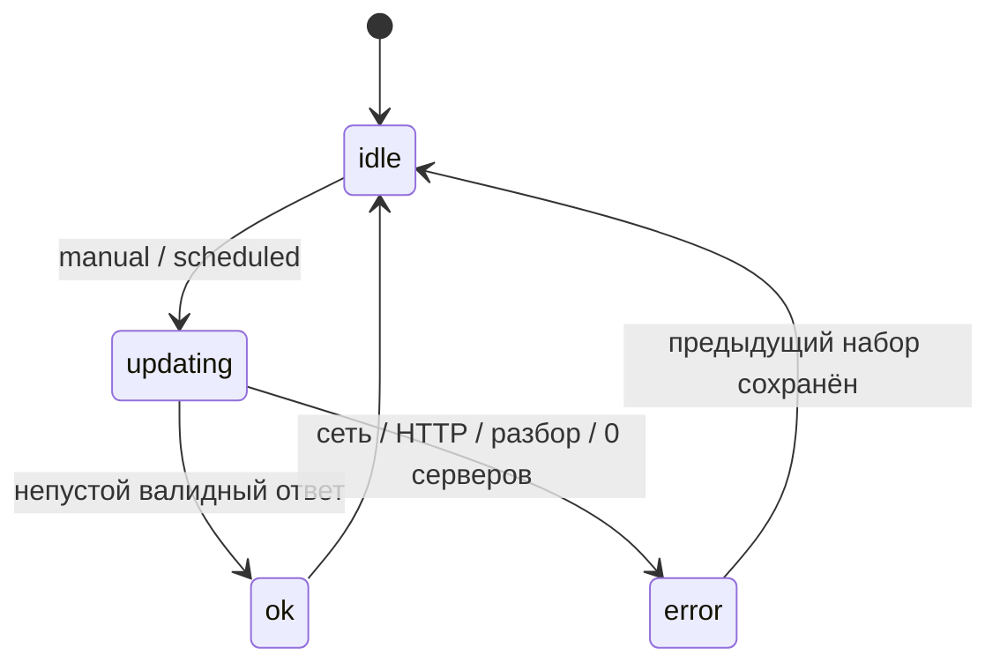

# Документ №20. Схемы состояний: VPN-сервис, подписка, устройства, обслуживание (U9)

Дата: 26.11.2026 (редакция U9).
Основание: ТЗ v1.0 §7 (состояния VPN), §13 (надёжность, Maintenance Mode); решения владельца U9 (26.11.2026); D-14 и шесть признаков (№10 §5.2) сохраняются.
Статус: **[У]** сводная модель. Предыдущая редакция U8 (failover-состояния сервера, `last_working_server`, DNS-состояния, Blocklists) заменена: этих сущностей в U9 нет.

**Что удалено из модели:** `server_health` и его переходы (1/2/3 отказа), `SWITCHING`, `PROXY_FALLBACK_DIRECT` с per-device настройкой, «три успешные проверки × 5 минут», `last_working_server`, DNS-состояния и DNS-fallback, состояния Blocklists, состояние «здоровье сервера» как хранимая сущность. Источник доступности серверов — штатный Xray Observatory; приложение его не дублирует.

---

## 1. Три независимые оси (не смешивать)

| Ось | Что описывает | Где хранится | Кто меняет |
|---|---|---|---|
| **Намерение** (`intent`) | хочет пользователь VPN или нет | Flash (`settings.json`) | только пользователь через API |
| **Конфигурация** (`config_state`) | сохранено / применено / ожидает / невалидно | Flash | Transaction Manager |
| **Фактическое состояние** (`runtime_state`) | что реально происходит сейчас | вычисляется, `/tmp` — только подсказка | Core по признакам |

**Инвариант:** `runtime_state` никогда не выводится из записанного флага. `state.json` со `config_state=Applied` не делает систему `ACTIVE` (D-14, ТЗ §7).

Отдельно от трёх осей существуют:

- **режим выбора сервера** — `auto` (выбранная стратегия) или `manual` (закреплён один сервер);
- **состояние операции подписки** — `idle` / `updating` / `ok` / `error` (с сохранением предыдущего набора);
- **настройка автообновления** — выключено (по умолчанию) либо 6 / 12 / 24 часа.

Эти сущности не являются состояниями VPN-сервиса и не меняют `runtime_state` сами по себе.

---

## 2. Фактические состояния VPN-сервиса

| Состояние | Значение | Условие (по приоритету, первое совпадение) |
|---|---|---|
| `APPLYING` / `ROLLING_BACK` | идёт транзакция | активная фаза apply/rollback |
| `MAINTENANCE` | явный режим обслуживания | `maintenance=on` (не отменяет политику) |
| `DISABLED_BY_USER` | штатное выключение | `intent=disabled` **и** процесса нет **и** правил нет |
| `STOPPING` | выключение в процессе | `intent=disabled`, но процесс/правила ещё есть (до таймаута) |
| `WAN_DOWN` | нет внешнего канала | нет default route / L3 / link |
| `EMERGENCY_DIRECT` | аварийное снятие перехвата | latch после неудачного восстановления (инфраструктурный отказ, не отказ серверов) |
| `FALLBACK_DIRECT` | все подходящие серверы недоступны, `direct_on_failure=true` | Observatory не даёт ни одного доступного outbound; VPN-предназначенный клиентский трафик идёт DIRECT. **Модельное состояние:** приложением до OQ-14 не наблюдается (§3.1) |
| `FALLBACK_BLOCK` | все подходящие серверы недоступны, `direct_on_failure=false` | то же, но `fallbackTag` — `blackhole`; выхода в DIRECT нет. **Модельное состояние:** приложением до OQ-14 не наблюдается (§3.1) |
| `STARTING` | запуск | процесса нет при `intent=enabled` (в пределах таймаута) |
| `DEGRADED` | частичный отказ | подпричина ниже |
| `ACTIVE` | всё подтверждено | шесть признаков свежие и положительные |
| `UNKNOWN` | недостаточно признаков | признаки устарели/недоступны |

Подпричины `DEGRADED`: `ENGINE_DOWN`, `POLICY_NOT_APPLIED`, `TRAFFIC_UNVERIFIED`, `CONFIG_STALE`, `STALE_SIGNALS`, `RESIDUAL`, `COLD_START`. Подпричины «сервер недоступен» больше нет: доступность outbound — предмет Observatory, а не собственной машины состояний.

**Инварианты:**

1. `ACTIVE` невозможен без свежего traffic proof (S6) и подтверждённой политики (S4).
2. `DISABLED_BY_USER` не является ошибкой, не запускает recovery и не создаёт `DEGRADED`.
3. Любое состояние, при котором трафик идёт напрямую при `intent=enabled`, обязано иметь предупреждение и событие.
4. Шесть признаков (S1–S6) и их TTL — №10 §5.2; здесь они не переопределяются.
5. Приложение **не хранит** состояние доступности сервера. `healthy`/`suspect`/`degraded`/`unavailable`, счётчики отказов и «последний рабочий сервер» отсутствуют как сущности.

---

## 3. `FALLBACK_DIRECT` и `FALLBACK_BLOCK`

| Аспект | `FALLBACK_DIRECT` | `FALLBACK_BLOCK` |
|---|---|---|
| Условие | `direct_on_failure=true` и ни одного доступного сервера | `direct_on_failure=false` и ни одного доступного сервера |
| Что происходит | трафик, предназначенный VPN, идёт DIRECT (`fallbackTag` = DIRECT) | трафик не выходит DIRECT (`fallbackTag` = blackhole), безопасный отказ |
| Что не меняется | Always DIRECT остаётся DIRECT; UDP по умолчанию DIRECT остаётся DIRECT; системный трафик роутера не затрагивается; `intent`, конфигурация, профили, стратегия не меняются | то же |
| Предупреждение | постоянное, видно на всех вкладках, не скрывается | постоянное; формулировка «VPN недоступен, трафик заблокирован» |
| Выход | Xray Observatory снова даёт доступные outbound → трафик возвращается в балансировщик | то же |
| Кто определяет | Xray (`fallbackTag`, результаты Observatory) | Xray |
| Как приложение узнаёт | не определено: OQ-14 (локальный интерфейс чтения состояния Xray). До решения состояние `FALLBACK_*` не вычисляется и не публикуется (§3.1) | то же: не определено до OQ-14; вычисление и публикация не выполняются (§3.1) |

**Чего в модели нет:**

1. Собственного счётчика отказов и порогов «2 отказа → DEGRADED, 3 → переключение».
2. Собственной последовательной процедуры failover и приоритетного списка серверов.
3. Понятия `last_working_server` и правила выбора сервера при выходе из fallback: выбор выполняет Xray по выбранной стратегии.
4. Порога «три последовательные успешные проверки с интервалом 5 минут + проверки VPN/DNS/маршрутизации»: возврат определяет Observatory, следующая пауза — `probeInterval`.
5. Per-device настройки `proxy_fallback`: `direct_on_failure` — глобальная настройка подписки/конфигурации.

**Что утверждено и сохраняется:** при `direct_on_failure=true` трафик, предназначенный VPN, при полной недоступности серверов может идти DIRECT, и это сопровождается постоянным предупреждением и событием; при `false` выход в DIRECT недопустим и используется штатный `blackhole`. Молчаливого перехода PROXY→DIRECT без предупреждения быть не может.

Границы этой гарантии (что именно блокируется и что нет) заданы в №18 §7.3.1; наблюдаемость состояния приложением — OQ-14 (§3.1).

### 3.1 Наблюдаемость `FALLBACK_*` (OQ-14)

`FALLBACK_DIRECT`/`FALLBACK_BLOCK` — фактическое поведение Xray, а не измеряемое приложением состояние. В U9 нет штатного канала, через который демон узнаёт «все серверы недоступны»: собственная проба удалена вместе с failover, а `fallbackTag` — внутренняя логика Xray.

**Четыре уровня, которые нельзя смешивать:**

| Уровень | Что это | Кто определяет | Доступно приложению до OQ-14 |
|---|---|---|---|
| 1. Модельное состояние | правило «нет живых outbound среди серверов подписки → трафик идёт в `fallbackTag`» | архитектура U9 и конфигурация Xray | да, как описание (№18 §7.3) |
| 2. Фактическое состояние Xray | какой outbound реально выбран для конкретного потока | Xray в момент соединения | **нет** |
| 3. Наблюдаемое состояние | «среди outbound подписки нет живых» по результатам Observatory | Xray Observatory через локальный интерфейс | **нет** (OQ-14) |
| 4. Опубликованное состояние | поля `status`, события `service.fallback_*`, баннеры Dashboard | демон приложения | только после решения OQ-14 |

Отсюда: `FALLBACK_*` в таблицах и диаграммах — это уровень 1. Ни уровень 2, ни уровень 3 приложению сейчас не доступны, поэтому уровень 4 не заполняется: UI не показывает ни факт fallback, ни недоступность отдельных серверов.

Проверено по исходнику v26.9.9: доступность outbound можно прочитать только через локальный интерфейс самого Xray.

| Вариант | Что даёт | Ограничение |
|---|---|---|
| gRPC `ObservatoryService.GetOutboundStatus` | статус каждого outbound: `alive`, `delay`, `last_error_reason` | требует включить Xray API и локальный inbound на loopback |
| `metrics`-слушатель, `/debug/vars` | тот же статус в секции `observatory` | требует локального HTTP-слушателя |
| Собственная проба демона | не требует интерфейса Xray | противоречит U9: возврат собственного health-механизма и лишний трафик |

Ни один вариант не сообщает «какой outbound выбран прямо сейчас»: факт fallback выводится как «среди outbound подписки нет живых». Оба первых варианта создают локальный слушатель и поэтому **не вводятся молча** — это отдельное решение владельца (OQ-14).

**До решения OQ-14 действует ограничение:**

1. Приложение не публикует `FALLBACK_*` в `status` и не отправляет `service.fallback_*`.
2. Dashboard показывает только подтверждённое признаками: процесс (S2), конфигурация (S3), политика (S4), реальный трафик (S6). Отсутствие подтверждения трафика — `DEGRADED/TRAFFIC_UNVERIFIED` с предупреждением «VPN не пропускает трафик», без утверждения о доступности серверов.
3. Список серверов не показывает «доступен/недоступен» и ping (REQ-124) до появления разрешённого источника данных.
4. Формулировки UI не приписывают приложению знание, которого у него нет.

```mermaid
stateDiagram-v2
    [*] --> DISABLED_BY_USER: intent=disabled
    DISABLED_BY_USER --> STARTING: enable
    STARTING --> ACTIVE: S2..S6 ok
    STARTING --> DEGRADED: timeout
    STARTING --> UNKNOWN: признаки недоступны
    %% пунктир — модельный переход (уровень 1); приложением не наблюдается до OQ-14
    ACTIVE -.-> FALLBACK_DIRECT: нет доступных outbound, direct_on_failure=true
    ACTIVE -.-> FALLBACK_BLOCK: нет доступных outbound, direct_on_failure=false
    FALLBACK_DIRECT -.-> ACTIVE: Observatory снова даёт доступные outbound
    FALLBACK_BLOCK -.-> ACTIVE: Observatory снова даёт доступные outbound
    ACTIVE --> APPLYING: new config / смена стратегии / ручной override
    APPLYING --> ACTIVE: trial ok
    APPLYING --> ROLLING_BACK: trial fail
    ROLLING_BACK --> ACTIVE: last-good
    ROLLING_BACK --> EMERGENCY_DIRECT: last-good failed
    ACTIVE --> WAN_DOWN: WAN lost
    WAN_DOWN --> ACTIVE: WAN up
    ACTIVE --> MAINTENANCE: user enters
    MAINTENANCE --> ACTIVE: exit + checks ok
    MAINTENANCE --> DEGRADED: exit checks fail
    ACTIVE --> STOPPING: disable
    STOPPING --> DISABLED_BY_USER: process+policy gone
    STOPPING --> DEGRADED: timeout (RESIDUAL)
    DEGRADED --> DISABLED_BY_USER: disable
```

**Замечание о `WAN_DOWN`.** При пропаже WAN серверы не считаются виновными: состояние `WAN_DOWN` имеет приоритет над `FALLBACK_*`, а доступность outbound не пересчитывается приложением.

---

## 4. Ручной выбор сервера и стратегия

| Аспект | Правило |
|---|---|
| Режим `auto` | действует выбранная стратегия (`random`, `roundRobin`, `leastPing`, `leastLoad`); по умолчанию `random` |
| Ручной override | один сервер закреплён; балансировщик ограничен им; другие серверы приложение не перебирает |
| Недоступность закреплённого сервера | срабатывает `fallbackTag` (`DIRECT` или `blackhole` по `direct_on_failure`); перебора остальных серверов нет |
| Возврат в `auto` | восстанавливается выбранная стратегия; это изменение конфигурации, проходит через `APPLYING` |
| Успешное обновление подписки | override сохраняется, если выбранный сервер найден в новом наборе (точное совпадение нормализованной конфигурации); иначе сбрасывается в `auto` |
| Отображение | в UI видно, активен автоматический выбор или закреплён конкретный сервер |
| Хранение | режим и идентификатор закреплённого сервера — часть настроек, не часть `runtime_state` |

Ручной override — это **не** приоритетный список и **не** отдельная стратегия. Упорядоченный список приоритетов серверов в U9 отсутствует.

**Выбор сервера при холодном старте.** До завершения первого цикла Observatory `random`/`roundRobin` считают непроверенные outbound доступными; `leastPing`/`leastLoad` без пригодных результатов не работают как `random`. Это ограничение отображается как `DEGRADED/COLD_START` только в диагностике и не является ошибкой сервиса.

---

## 5. Операция подписки и автообновление

| Состояние операции | Значение |
|---|---|
| `idle` | операция не выполняется |
| `updating` | идёт получение и проверка ответа |
| `ok` | непустой ответ применён атомарно; предыдущий набор заменён |
| `error` | сеть/HTTP/разбор/пустой результат; **предыдущий набор сохранён целиком** |

Правила:

1. Успешный непустой ответ атомарно заменяет набор серверов; внутренние ID создаются заново.
2. Ошибка и пустой результат (0 серверов) не меняют сохранённый набор.
3. После ошибки собственного цикла повторов нет: следующая попытка — плановый запуск или действие пользователя.
4. Успешное обновление сохраняет ручной override, если выбранный сервер найден в новом наборе по точному совпадению нормализованной конфигурации подключения (№13 §3.1); если сервер исчез — `mode` становится `auto`, публикуется `override.reset`.
5. Автообновление выключено по умолчанию; при включении доступны интервалы 6 / 12 / 24 часа, значение по умолчанию — 24 часа; первый **плановый** запуск выполняется по выбранному интервалу, немедленный первый запрос не утверждён; далее — по штатному расписанию OpenWrt (`crond`). Ручная загрузка доступна всегда.
6. Расписание не показывается в UI. Сложное сопоставление серверов между версиями подписки, `identity_fields`, `credential_fingerprint` и восстановление по истории не используются.



---

## 6. Устройства и временный overlay

| Поле | Значение | Переход |
|---|---|---|
| `mode` | `follow` \| `always_direct` | меняет только пользователь |
| `temp_direct` | overlay до `expires` | включается пользователем; снимается таймером, вручную или при смене `mode` |
| `expires = null` | бессрочный overlay | снимается только вручную или при смене `mode`; не превращается в третий режим |

Правила:

1. `mode` не меняется при истечении `temp_direct`.
2. Overlay не влияет на стратегию, `direct_on_failure` и состояние сервиса.
3. Группы не являются routing-сущностями и на маршрутизацию не влияют.
4. DNS-атрибуции устройства нет: все устройства используют штатный DNS роутера.

---

## 7. Журналы и диагностика

Состояний журналов нет. Действуют настройки и результаты:

| Сущность | Значение |
|---|---|
| `logLevel` | `debug`, `info`, `warning`, `error`, `none` — штатные значения Xray; при первоначальной настройке используется штатное значение Xray по умолчанию |
| Отображение | только `access.log` и `error.log`; 20 / 50 / 100 последних строк |
| Ротация | штатный `logrotate`, отдельная конфигурация для двух Xray-файлов, суточный запуск |
| Директивы | `daily` + `minsize <порог>M`; `size` не используется, чтобы не переопределять суточный интервал |
| Порог | общий пользовательский параметр в MB, по умолчанию 5 MB, диапазон 1…50 MB [П]; применяется к каждому файлу независимо |
| Архив | ровно одна сжатая копия на файл; при следующей ротации заменяется |
| Режим | `copytruncate`; Xray не перезапускается |
| Ручная очистка | отсутствует; отдельной кнопки удаления логов нет |
| Ошибка ротации | фиксируется в диагностике; не превращается в критическую ошибку Xray; исходный лог не повреждается, Xray не останавливается |

Диагностика может показать время последнего запуска ротации и результат, но это не состояние сервиса. Системные логи OpenWrt (`logread`), лента событий приложения и прочие логи в UI v1 не выводятся.

### 7.1 Приватность логов и диагностического экспорта

| Артефакт | Что содержит | Правило |
|---|---|---|
| `access.log` | адреса и домены назначения, время, объём; при sniffing — извлечённые имена | просмотр последних строк в UI; в экспорт по умолчанию **не включается** |
| `error.log` | ошибки Xray, адреса серверов, причины отказа | просмотр в UI; в экспорт включаются последние N строк |
| Диагностический экспорт | снимок статуса и признаков, версия Xray и прошивки, конфигурация без секретов, результат ротации, последние строки `error.log` | только по явному действию пользователя, с предпросмотром и подтверждением |
| Backup | конфигурация, включая секреты | отдельный артефакт с предупреждением; к диагностике не относится |

**Правила:**

1. Автоматической отправки нет: ни расписания, ни сетевого получателя, ни «отправить разработчику».
2. **Приложение не находится в цепочке записи** `access.log`/`error.log`: их пишет процесс Xray. Поэтому «маскирование до записи» относится только к артефактам, которые создаёт сам демон — аудит настроек, снимок статуса, текст ошибок приложения, поля экспорта. Сырые Xray-логи считаются чувствительными независимо от содержимого и приложением не переписываются.
3. Маскирование при **отображении** и при **экспорте** — разные операции: показ ограничен объёмом последних строк, экспорт — составом (REQ-171).
4. Маскирование IP-адресов **не удаляет доменные имена**. Если в экспорт попадают имена (из `access.log` или из текста ошибки), они удаляются или обобщаются отдельной операцией; нельзя считать «IP замаскирован» достаточной защитой.
5. Пользователь видит состав экспорта до подтверждения и может отказаться.
6. Экспорт не содержит `access.log` целиком и не превращается в скрытый журнал посещений. Полная анонимизация не обещается.

---

## 8. Загрузка, восстановление и деградация при старте

1. **Старт системы.** `intent` читается из `settings.json`. При `disabled` сервис не запускается: `DISABLED_BY_USER`. При `enabled` — `STARTING`.
2. **Проверка конфигурации.** Невалидная конфигурация не применяется: сервис остаётся `DISABLED_BY_USER` (если VPN не был включён) либо `DEGRADED/CONFIG_STALE` с указанием причины.
3. **Старт Xray.** `xray -test`, затем запуск через procd. Неудача → `DEGRADED/ENGINE_DOWN`; политика не удаляется.
4. **Первые результаты Observatory.** До первого цикла сервис остаётся `ACTIVE` с диагностической пометкой `COLD_START`; собственной блокировки трафика до проверки нет. Для `leastPing`/`leastLoad` пригодных результатов в этом окне нет, поэтому применяется `fallbackTag`: при `direct_on_failure=true` VPN-предназначенный трафик до первого цикла идёт DIRECT. Это известное следствие конфигурации, а не подтверждённая защищённая работа VPN (№18 §7.2, сценарий 116).
5. **Восстановление после сбоя демона.** procd перезапускает демон; правила и конфигурация сохраняются; состояние пересчитывается по признакам.
6. **После перезагрузки** VPN не включается сам, если пользователь его выключил; `temp_direct` с истёкшим `expires` не восстанавливается.
7. **Все серверы недоступны** → `FALLBACK_DIRECT` или `FALLBACK_BLOCK` по `direct_on_failure` (§3). Это модельный переход: приложение не пересчитывает доступность самостоятельно и до OQ-14 его не наблюдает (§3.1).

### 8.1 Инварианты рестарта и восстановления

1. **Один экземпляр.** Xray запускается procd как единственный instance; повторный запуск не создаёт второй процесс и не дублирует правила.
2. **Идемпотентность правил.** Правила принадлежат одной таблице и цепочкам проекта; повторное применение заменяет их, а не добавляет вторые. Проверка — счётчики правил до и после [Т].
3. **Рестарт Xray не снимает политику.** При мёртвом listener пакеты отбрасываются (fail-closed), а не уходят DIRECT [Т], сценарий 107.
4. **Last-good.** Последняя применённая конфигурация хранится на Flash; демон читает её при старте, а не собирает заново из частичных данных.
5. **`intent` — единственный источник решения** «включено/выключено». Рестарт не меняет `intent` и не включает VPN, выключенный пользователем.
6. **Прерванная операция** помечается `interrupted`; побочных применений и «догадок» о завершении нет.
7. **`EMERGENCY_DIRECT` — только явный latch** при инфраструктурном отказе. Падение Xray само по себе не даёт DIRECT.
8. Сохранность трафика в окне рестарта **не гарантируется** и не заявляется без сценария 107.

---

## 9. Адаптивное обновление UI (после измерений)

Интервалы обновления статуса остаются **[Т]**: 2–5 с при открытом окне операции, 5 с на главной, 5–10 с на списках, 30–60 с в фоне. Значения подтверждаются измерением (W-13), а не назначаются окончательно.

---

## 10. Сводная таблица переходов (проверочная)

| Из | Событие | В | Условие/примечание |
|---|---|---|---|
| `DISABLED_BY_USER` | включение пользователем | `STARTING` | `intent=enabled` |
| `STARTING` | признаки в норме | `ACTIVE` | S2–S6 |
| `STARTING` | таймаут | `DEGRADED` | `ENGINE_DOWN` / `POLICY_NOT_APPLIED` |
| `ACTIVE` | нет доступных outbound, `direct_on_failure=true` | `FALLBACK_DIRECT` | Observatory; модельный переход, приложением не наблюдается (OQ-14) |
| `ACTIVE` | нет доступных outbound, `direct_on_failure=false` | `FALLBACK_BLOCK` | Observatory; модельный переход, приложением не наблюдается (OQ-14) |
| `FALLBACK_DIRECT` | доступные outbound появились | `ACTIVE` | следующая пауза `probeInterval`; переход не наблюдается до OQ-14 |
| `FALLBACK_BLOCK` | доступные outbound появились | `ACTIVE` | то же; переход не наблюдается до OQ-14 |
| `ACTIVE` | смена стратегии / ручной override / новая конфигурация | `APPLYING` | транзакция |
| `APPLYING` | trial ok | `ACTIVE` | — |
| `APPLYING` | trial fail | `ROLLING_BACK` | — |
| `ROLLING_BACK` | last-good применён | `ACTIVE` | — |
| `ROLLING_BACK` | last-good не применён | `EMERGENCY_DIRECT` | latch, предупреждение |
| `ACTIVE` | WAN потерян | `WAN_DOWN` | серверы не виноваты |
| `WAN_DOWN` | WAN восстановлен | `ACTIVE` | повторная проверка признаков |
| `ACTIVE` | обслуживание | `MAINTENANCE` | политика не отменяется |
| `MAINTENANCE` | выход, проверки ok | `ACTIVE` | — |
| `MAINTENANCE` | выход, проверки fail | `DEGRADED` | — |
| `ACTIVE` | выключение пользователем | `STOPPING` | `intent=disabled` |
| `STOPPING` | процесс и правила сняты | `DISABLED_BY_USER` | — |
| `STOPPING` | таймаут | `DEGRADED` | `RESIDUAL` |
| любой | недостаточно признаков | `UNKNOWN` | не приравнивается к отказу |

---

## 11. Что не определено

1. Точная задержка обнаружения отказа сервера: зависит от положения отказа относительно цикла Observatory, времени HTTP-пробы (таймаут 5 с) и паузы 300 с; мгновенный failover не обещается.
2. Поведение уже открытых соединений при переходе в `fallbackTag` и после восстановления серверов — техническая проверка [Т].
3. Поведение `leastPing`/`leastLoad` до первых пригодных результатов наблюдения — [Т]; для `leastLoad` дополнительно не подтверждено, что подпись «по стабильности» соответствует фактическому выбору при обычной `observatory` (OQ-15).
4. Точная периодичность циклов при `enableConcurrency: true` — [Т]; 300 с описаны как пауза после набора проверок.
5. Параметры UI-обновления — измеряются.
6. Наблюдаемость `FALLBACK_*` и доступности серверов приложением — OQ-14 (открытый вопрос владельцу).
7. Полнота перехвата и маршрут собственных подключений роутера — [Т], №23 §4.2.

**Открытые вопросы владельцу:** OQ-14 (наблюдаемость состояния Xray) и OQ-15 (подпись/механизм `leastLoad`). Остальные спорные пункты U8 закрыты удалением функции (Blocklists, DNS-fallback) либо переведены в технические проверки.
