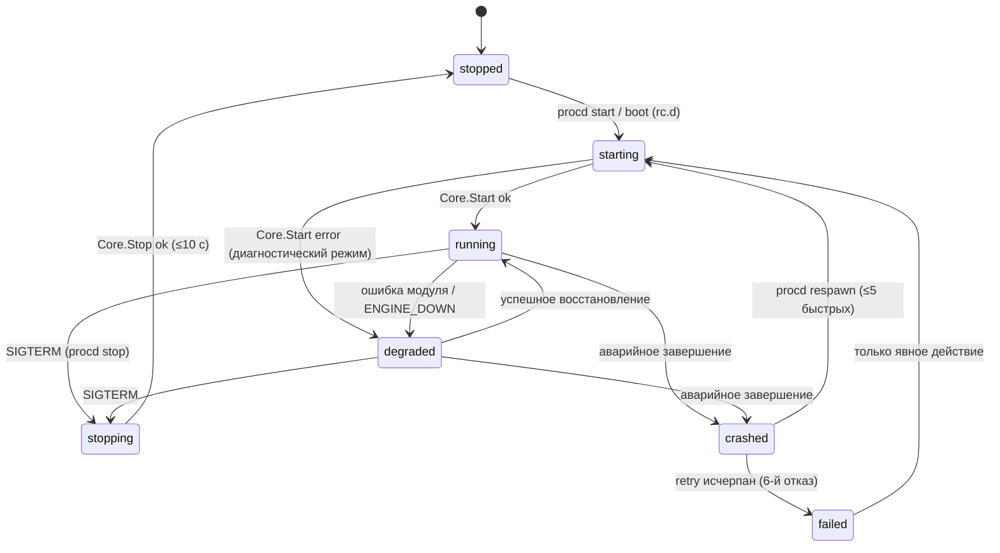

# Документ №52. План runtime-интеграции U9 с OpenWrt

Дата: 28.11.2026
Основание: задание №56; документы №10–№14, №17, №18, №20–№23, №44, №45; отчёты №48–№51.
Исходный HEAD: `9e36742b38983f0a573b853497632b784795fb58` (опубликованный результат задания №55).

Статусы: **[У]** утверждено владельцем; **[П]** предложение, требует утверждения; **[Т]** требует технической проверки (не выполнялась); **[О]** открытый вопрос к владельцу.

**Границы документа.** Это проектирование. Ни одна строка кода, init-скрипта, ACL, конфигурации UCI или Storage в рамках №56 не изменена; к роутеру подключения не было; Xray, IPK/APK и пакеты не устанавливались и не собирались. Любое утверждение о поведении на устройстве помечено `[Т]` и не выдаётся за проверенное.

---

## 1. Цель и границы

### 1.1. Цель

Определить проверяемый путь от принятого Go-каркаса (этап 1, задания №52–№54) к работающему runtime U9 на Xiaomi AX3000T с OpenWrt 25.12.6: транспорт ubus/rpcd, идентичность вызывающего (W-11), жизненный цикл под procd, singleton Xray, границы постоянного и временного хранения, интеграцию Xray/ Observatory, сборку пакета и последовательность последующих заданий.

### 1.2. Что входит

1. Выбор и обоснование транспорта ubus для Go-демона.
2. Отображение реестра №12 §6 на реальные ubus-объекты и ACL-группы.
3. Модель идентичности вызывающего и блокирующий тест W-11.
4. Схема procd lifecycle и разделение трёх понятий «включено».
5. Механика singleton `vpnmand` и `xray`.
6. Карта путей конфигурации и Storage с разрешением расхождений.
7. Границы Xray Manager, Observatory/gRPC и честной наблюдаемости.
8. Схема сборки и упаковки для `mediatek/filogic`, `aarch64_cortex-a53`.
9. Перечень технических проверок с разделением «host/mock» и «только устройство».
10. Дорожная карта последующих заданий с критериями приёмки.

### 1.3. Что не входит

- Реализация транспорта, ACL enforcement, singleton, launcher, генератора конфигурации Xray.
- Установка Xray, сборка APK/IPK, любые изменения роутера.
- Возврат исключённых функций U8/beta v1: DNS Manager, Blocklists, Quick Block, собственный failover/failback, IPv6 Guard, индивидуальная DNS-атрибуция, пользовательская лента событий, мониторинг ресурсов.
- Открытие TCP/UDP-порта приложения, HTTP API, собственный REST, произвольный shell-мост, новый пользовательский Unix-сокет как IPC.

### 1.4. Ограничения, действующие при чтении документа

Любой пункт `[П]` **не является** согласованным решением. Пункт `[Т]` не позволяет заявлять гарантию. Пункт `[О]` блокирует соответствующую реализацию до ответа владельца.

---

## 2. Текущее состояние репозитория и устройства

### 2.1. Репозиторий

| Параметр | Значение |
|---|---|
| Ветка | `main` = `origin/main` = `9e36742b38983f0a573b853497632b784795fb58` |
| Локальная историческая ветка | `architecture` = `fb0baad5dd4fa44a3dba270670b99a7a15379aec` (не опубликована) |
| Рабочее дерево | чистое на начало задания №56 |
| Go-модуль | `github.com/vvidomina/vpn-manager-openwrt`, `go 1.22`, **внешних зависимостей нет** |
| Каркас | `cmd/vpnmand` (foreground, флаги `-config`, `-state-dir`, `-log-level`, `-version`), `internal/{api,config,core,devices,logging,policy,profiles,state,storage,subscriptions,txn}`, `luci/`, `files/` |
| Известный дефект ACL | `luci/acl.d/luci-app-vpnmanager.json` объявляет `operation` **методом объекта `vpnmanager`** и в `read`, и в `write`; по №12 §6 `vpnmanager.operation` — отдельный объект с методами `status`/`cancel`. Не исправлено: №56 запрещает менять ACL (см. C-7, §4.4) |

### 2.2. Устройство

| Параметр | Значение |
|---|---|
| Модель / прошивка | Xiaomi Mi Router AX3000T, OpenWrt 25.12.6 r33311, `mediatek/filogic`, `aarch64_cortex-a53`, Linux 6.12.112 |
| Пакетный менеджер | APK, apk-tools 3.0.5, 182 установленных пакета |
| Состояние после задания №55 | beta v1 и старые VPN-компоненты удалены; `xray-core` отсутствует; `/etc/config` без `xray`, `forkop`, `bridger`, `v2raya`, `zapret.tmp`; crontab пуст; `/root` пуст; `/overlay` ≈ 55 724 kB свободно |
| Сохранено намеренно | `network.wan.type='bridge'`, три DNS-записи (`/mask.icloud.com/`, `/mask-h2.icloud.com/`, `/use-application-dns.net/`), `inet fw4`, штатные правила |
| U9 / Xray / IPK | **не установлены** |
| Runtime-проверки U9 | **не выполнялись**: ubus-объект, procd-цикл, `flock`, gRPC, nft, DNS |

Следствия: (1) все технические утверждения этого плана о поведении на устройстве — `[Т]`; (2) версия Xray для будущей установки не унаследована от beta v1 (`26.10.21-r1` был удалён и не является утверждённой версией U9); (3) любые работы на устройстве требуют отдельного окна и разрешения (№23, №45).

---

## 3. Архитектура ubus/rpcd

### 3.1. Роли участников `[У]`

| Участник | Роль | Что не делает |
|---|---|---|
| `ubusd` | брокер: регистрация объектов, маршрутизация invoke, ACL по `/usr/share/acl.d/`, доставка событий | не проверяет права приложения |
| `rpcd` | объект `session` (login/access/get/set), ACL rpcd, прокси для `uci`/`file` | не реализует методы `vpnmanager.*` |
| `uhttpd` + `uhttpd-mod-ubus` | HTTP JSON-RPC шлюз `/ubus`: `list`, `call`, инъекция `ubus_rpc_session`, проверка `session.access` до вызова | не хранит состояние приложения |
| `vpnmand` | **владелец** всех объектов `vpnmanager*`, единственная реализация методов реестра №12 §6, повторная проверка прав, публикация событий | не открывает порт, не имеет HTTP, не принимает shell-команд, не регистрирует объекты вне реестра |
| LuCI JS | клиент: `rpc.declare({object, method})` → `POST /ubus` | не пишет UCI, не подписывается на ubus-события (см. §5.5) |

Поток вызова: `браузер → uhttpd-mod-ubus (JSON-RPC) → session.access (проверка ACL) → ubusd (ACL + invoke) → vpnmand (повторная проверка) → Core`.

### 3.2. Требования к транспорту

1. Только ubus через rpcd/ubusd; сетевых слушателей приложения нет (D-05).
2. Несколько объектов: `vpnmanager`, `vpnmanager.config`, `vpnmanager.servers`, `vpnmanager.subscriptions`, `vpnmanager.profiles`, `vpnmanager.devices`, `vpnmanager.policy`, `vpnmanager.maintenance`, `vpnmanager.audit`, `vpnmanager.logs`, `vpnmanager.diagnostics`, `vpnmanager.backup`, `vpnmanager.operation` (№12 §2).
3. Типизация аргументов через blobmsg-политики (`UBUS_METHOD`/`UBUS_METHOD_MAP` в C; эквивалент в Go обязателен), чтобы неверный тип давал `UBUS_STATUS_INVALID_ARGUMENT`, а не панику.
4. Ограничения §12 §1: тело ≤ 256 КБ, список ≤ 1000, строка ≤ 4 КБ — проверяются в демоне, а не в ACL.
5. Длительные операции: обработчик не блокирует цикл событий; используется отложенный ответ (`ubus_defer_request`/`ubus_complete_deferred_request`) и `op_id`.
6. События: `ubus_send_event` с типом `vpnmanager.event`; конверт из №12 §5 внутри `data`.
7. Отключение/переподключение: при потере соединения с `ubusd` демон не завершает VPN-работу и не снимает политику; он переподключается и заново регистрирует объекты; пропущенные события не воспроизводятся, подписчики получают `resync_required` (§5.4).

### 3.3. Границы

Транспорт — **адаптер**: он делает разбор blobmsg, проверку схемы, вызов `api.Service`, сериализацию ответа и публикацию события. Бизнес-логика остаётся в Core и модулях; транспорт не владеет ни одним системным ресурсом.

---

## 4. Варианты транспортной реализации

### 4.1. Сравнение

| Критерий | A. cgo + libubus в процессе демона | B. Минимальный C-адаптер над libubus | C. rpcd/ucode-адаптер | D. Чистый Go-клиент/сервер ubus |
|---|---|---|---|---|
| Совместимость с 25.12.6 | полная: `libubus`/`libubox` — штатные пакеты базовой системы | полная, тот же ABI | полная (rpcd умеет ucode-плагины) | протокол ubusd не является стабильным публичным API; серверная часть (регистрация объектов, peer-атрибуты) в Go не реализована |
| Зависимости | `libubus`, `libubox`, `libblobmsg-json`, CGO, SDK-тулчейн | то же + один файл C | `rpcd`, `ucode`, `ucode-mod-ubus` | внешняя Go-библиотека (запрещена в №56, не проверена) |
| Сложность поддержки | средняя: правила cgo, единый поток uloop, владение blob | ниже A: весь cgo изолирован в одном файле | высокая: второй процесс, дублирование схемы, IPC | высокая: собственная реализация TLV-протокола |
| Безопасность | ACL — ubusd/rpcd; демон видит `req.acl` | то же | ACL считается в rpcd; демон не может перепроверить | ACL зависит от самодельного клиента; риск ошибок |
| ACL | штатный `/usr/share/acl.d/*.json` | тот же | тот же | тот же, но проверка на стороне чужого кода |
| Идентичность вызывающего | `req->acl.user/group` + `ubus_rpc_session` в сообщении | то же, единая точка извлечения | sid доступен только внутри rpcd | потребуется вручную разбирать атрибуты invoke |
| События | `ubus_send_event` из того же соединения | то же | из rpcd, не из демона | вручную |
| Длительные операции | `ubus_defer_request` + uloop timeout | то же | ограничено архитектурой rpcd-плагина | вручную, риск блокировки |
| Тестирование на хосте | частично: ubusd есть в OpenWrt-контейнере; unit-тесты адаптера — с фейковым слоем | лучше: C-слой тестируется отдельно, Go — на моках | требует rpcd+ucode | требует собственного эмулятора |
| Размер/RSS | +десятки КБ к бинарнику, +несколько сотен КБ RSS (libubox уже в системе) | как A | +процесс rpcd уже работает; RAM ucode | сопоставимо с A |

### 4.2. Основной вариант — A `[П]`

**cgo-обвязка над штатными `libubus`/`libubox` внутри `vpnmand`.**

Обоснование:

1. Это единственный способ реализовать **владельца** объектов в том же процессе, что и Core (требование «демон повторно проверяет права» №12 §6 п.3, №12 §9).
2. `req->acl` доступен только нативному обработчику: `struct ubus_request_data` содержит `peer`, `seq` и `struct ubus_acl_key acl {user, group, object}`; поля `acl` заполняются из атрибутов `UBUS_ATTR_USER`/`UBUS_ATTR_GROUP` в `ubus_process_invoke()` (openwrt/ubus `libubus.h`, `libubus-obj.c`).
3. ACL остаётся штатным: ubusd читает `/usr/share/acl.d/`, rpcd хранит сессии. Приложению не нужен собственный слой прав.
4. События, отложенные ответы и таймауты — штатные механизмы libubus.
5. Зависимости — пакеты базовой системы OpenWrt, уже присутствующие на устройстве; новых демонов и портов не появляется.
6. ABI: `libubus`/`libubox` версионируются (`ABI_VERSION` в пакете). Бинарник пакета должен собираться **в SDK той же ветки**, что и прошивка; перенос бинарника между релизами не гарантируется `[Т]`.

Известные издержки, которые нельзя замалчивать:

- **Потоковая модель.** libubus не потокобезопасен: одно соединение — один цикл `uloop`. Все вызовы libubus выполняются в одном выделенном OS-потоке (C-цикл); Go-горутины общаются с ним через канал команд, а ответы отдаются только из этого потока. Обработчик не имеет права блокироваться: длительная работа уходит в Core, ответ — через `ubus_defer_request`/`ubus_complete_deferred_request`.
- **Владение памятью.** Указатели `blob_attr*` живут только на время обработчика; Go обязан скопировать значения (строки, числа) до возврата. Обратная передача — только через `blob_buf` в C-слое.
- **cgo и кросс-сборка.** Требуется SDK-тулчейн `aarch64-openwrt-linux-musl-gcc` и `CGO_ENABLED=1`; воспроизводимость вне SDK не гарантируется.
- **`uloop` и сигналы.** Обработка `SIGTERM`/`SIGHUP` остаётся в Go; C-цикл не должен перехватывать сигналы, иначе procd-остановка изменит поведение.

### 4.3. Резервный вариант — B `[П]`

**Минимальный C-адаптер** (один файл `ubus_bridge.c` + заголовок): регистрация объектов по таблице, извлечение `req->acl` и `ubus_rpc_session`, преобразование blobmsg → компактное представление (JSON-строка или плоская структура), вызов экспортированной Go-функции, возврат ответа.

Когда применяется: если вариант A окажется неподдерживаемым из-за правил cgo (например, не удаётся безопасно разделить Go-рантайм и `uloop` в одном процессе) или если ревью потребует минимизировать cgo-код. Даёт: одну точку аудита владения памятью, простой unit-тест C-слоя, те же зависимости и размер.

Цена: копирование данных, дополнительный слой трансляции схемы, дублирование таблицы методов (C и Go).

### 4.4. Отклонённые варианты

**C. rpcd/ucode-адаптер — отклонён.** rpcd действительно умеет регистрировать ubus-объекты из ucode-плагинов (`/usr/share/rpcd/ucode/*.uc`, `examples/ucode/example-plugin.uc`, `ucode.c`); модуль `ubus` ucode умеет `publish`. Но объекты и методы в этом случае живут **в процессе rpcd**, а не в демоне:

1. Бизнес-логика оказалась бы в ucode или потребовала бы IPC «rpcd → vpnmand», то есть нового пользовательского канала, запрещённого §4.2 задания и архитектурой D-05.
2. Демон не смог бы «повторно проверить права»: `req->acl` и sid остаются в rpcd.
3. ucode-плагин не владеет процессом Xray, `flock` и nftables; он стал бы параллельным слоем управления — прямое нарушение AGENTS §1.
4. Появляется второй источник истины по схемам API.

Допустимое будущее применение ucode: только как **тонкий локальный мост для событий** (см. §5.5) и только отдельным решением владельца `[О]`.

**D. Чистый Go без cgo — отклонён как основной.** Технически возможно подключиться к `/var/run/ubus/ubus.sock` и вызывать методы (существующие сторонние клиенты используют HTTP JSON-RPC или unix-сокет), но:

1. Регистрация объекта, приём invoke и разбор peer-атрибутов в Go означают собственную реализацию бинарного TLV-протокола ubusd, у которого нет стабильного публичного контракта.
2. Поддержанной серверной реализации на Go нет; сторонние библиотеки — клиентские, требуют добавления зависимости (в №56 запрещено) и не проверены для 25.12.6.
3. Ошибка в разборе атрибутов вызывающего напрямую ломает W-11.

Вариант сохраняется в реестре рисков как путь миграции, если cgo окажется неприемлемым по требованиям сборки `[О]`.

### 4.5. Итог выбора

Основной — **A**, резервный — **B**. Оба используют только штатные библиотеки OpenWrt, не добавляют портов и процессов и сохраняют возможность проверки идентичности внутри демона. Переход A→B не меняет ни API, ни ACL, ни схему объектов — меняется только слой cgo.

---

## 5. API и ACL

### 5.1. Отображение реестра №12 §6

Реестр — единственный источник истины. Объект ubus — плоское имя с точками; вложенность «метод внутри объекта» недопустима.

| ubus-объект | Методы | Изменяет |
|---|---|---|
| `vpnmanager` | `status`, `enable`, `disable`, `reload` | да |
| `vpnmanager.config` | `get`, `set`, `validate`, `apply`, `discard` | да |
| `vpnmanager.servers` | `list`, `get`, `get_strategy`, `set_strategy`, `set_override` | да |
| `vpnmanager.subscriptions` | `list`, `add`, `update`, `remove`, `reorder`, `report`, `get_autoupdate`, `set_autoupdate` | да |
| `vpnmanager.profiles` | `list`, `get`, `save`, `remove`, `assign` | да |
| `vpnmanager.devices` | `list`, `set_mode`, `merge`, `forget` | да |
| `vpnmanager.policy` | `status`, `set_udp` | да (allowlist) |
| `vpnmanager.maintenance` | `status`, `enter`, `exit` | да |
| `vpnmanager.audit` | `list`, `undo` | да (undo) |
| `vpnmanager.logs` | `list`, `tail`, `get_rotation`, `set_rotation` | да (порог) |
| `vpnmanager.diagnostics` | `report`, `listeners` | нет |
| `vpnmanager.backup` | `create`, `list`, `restore` | да |
| **`vpnmanager.operation`** | **`status`, `cancel`** | нет (кроме cancel) |

Обязательные свойства:

1. `vpnmanager.status` принадлежит только объекту `vpnmanager`.
2. `vpnmanager.operation.status` и `vpnmanager.operation.cancel` принадлежат **отдельному** объекту `vpnmanager.operation`.
3. Не регистрируются: `vpnmanager.version`, `vpnmanager.dns`, `vpnmanager.blocklists`, `vpnmanager.ipv6`. Любой вызов вне реестра → `VM_ERR_UNSUPPORTED` (не `METHOD_NOT_FOUND`, чтобы UI получал предсказуемый код; решение `[П]`, требует утверждения, поскольку ubus для неизвестного метода вернёт `UBUS_STATUS_METHOD_NOT_FOUND` до входа в демон — тогда соответствие кода обеспечивается только для методов, зарегистрированных «заглушкой»; предлагаемый вариант — не регистрировать заглушки и документировать, что неизвестный метод даёт ubus-код 3, а `VM_ERR_UNSUPPORTED` отдаётся для известных, но выключенных в v1 объектов).

### 5.2. ACL-группы

Три группы rpcd, как в №12 §6: `read` (просмотр и диагностика), `control` (управление VPN и данными), `admin` (backup/restore, `devices.forget`). Требования:

1. Чтение статуса не даёт права менять.
2. `logs.set_rotation` — только `control`; `backup.create|restore` и `devices.forget` — только `admin`.
3. `vpnmanager.operation.status` — во всех группах; `cancel` — только `control`.
4. Каждая группа объявляет объект один раз; повторяющихся ключей нет.
5. `dns`, `blocklists`, `ipv6` в ACL отсутствуют.
6. UI не получает `uci`-права на запись.
7. Демон проверяет право повторно и не полагается на ACL rpcd.

### 5.3. Дефекты текущего ACL-файла (не исправлялись)

`luci/acl.d/luci-app-vpnmanager.json` содержит:

```json
"read":  { "ubus": { "vpnmanager": ["status", "operation"] } },
"write": { "ubus": { "vpnmanager": ["operation"] } }
```

Нарушения: `operation` объявлен методом `vpnmanager` (нет в реестре); `write`-группа даёт право на `operation` без `control`-семантики; объекты `vpnmanager.operation` и остальные из §5.1 отсутствуют. Исправление — отдельное задание (№56 запрещает менять ACL); до исправления ACL не соответствует №12 §6.

### 5.4. События `vpnmanager.event`

Формат — №12 §5: конверт `{seq, ts, type, data}`; `seq` монотонный в пределах жизни процесса, `ts` — Unix ms UTC. Типы: `state`, `intent`, `config`, `servers`, `devices`, `operation`, `service.fallback_entered|left` (только `source="derived"`), `subscription.updated|update_failed`, `strategy.changed`, `override.set|preserved|reset`, `logrotate.completed|failed`.

Правила:

1. Публикация — `ubus_send_event(ctx, "vpnmanager.event", blob)`; подписка — `ubus listen vpnmanager.event`.
2. Буфер подписчика ограничен; при переполнении публикуется `resync_required` (тип внутри `data`), после чего подписчик обязан перечитать `vpnmanager.status`. Событие никогда не считается источником истины.
3. События не содержат секретов (URL с токеном, UUID, ключи) — только маски.
4. Общей истории событий, кольцевого журнала и аналитики нет; `seq` не сохраняется между перезапусками (§13 запрещает собственный event bus).
5. `state`/`intent`/`config`/`operation` — транзиентные сигналы, не журнал (№13 §8.2).

### 5.5. Доставка событий в LuCI — ограничение `[Т]`

`uhttpd-mod-ubus` реализует JSON-RPC `list` и `call`; `LuCI.rpc` (`rpc.js`) предоставляет `list`, `declare`, `getSessionID`, интерсепторы — **метода подписки на ubus-события в браузерном API нет**. `ubus listen` работает только с локального сокета.

Следствие: UI **не может** получать `vpnmanager.event` напрямую. Варианты:

| Вариант | Оценка |
|---|---|
| **P1. Опрос `status`/`operation.status` из UI** `[П]` | штатный механизм LuCI (`Request.poll`, интервалы №22: 2–5 / 5 / 5–10 / 30–60 с); нет нового кода на роутере; события остаются для локальных подписчиков и диагностики. Рекомендуется |
| P2. ucode-мост rpcd → браузер через long-poll | новый серверный слой и канал; отклонён (§4.4) |
| P3. SSE/WebSocket от демона | прямое нарушение запрета на порт и HTTP API |

При P1 требование №12 §5 «при переполнении буфера UI получает `resync_required`» применяется к локальным подписчикам; UI при опросе опирается на `revision`/`seq` в ответе `status` и обнаруживает расхождение сам. Формулировку №12 §5 нужно уточнить отдельным решением `[О]`.

### 5.6. Валидация и ошибки

- Схема аргументов задаётся один раз (таблица методов), используется и для blobmsg-политики, и для unit-тестов.
- Коды `VM_ERR_*` из №12 §1; ubus-статус — только транспортный (`INVALID_ARGUMENT` для неверного типа/размера, `NOT_FOUND` для неизвестного объекта/op_id, `PERMISSION_DENIED` для W-11, `TIMEOUT` для истёкшего обработчика).
- `message` — для человека, `code` — для логики; текст ошибки не содержит путей с секретами.

---

## 6. Идентификация вызывающего и W-11

### 6.1. Что удалось установить по исходникам

| Факт | Источник |
|---|---|
| `struct ubus_request_data` содержит `peer` (uint32), `seq`, `struct ubus_acl_key acl {user, group, object}` | openwrt/ubus `libubus.h` |
| `acl.user`/`acl.group` заполняются **только** если в сообщении есть `UBUS_ATTR_USER` и `UBUS_ATTR_GROUP`; `acl.object` — имя объекта | `libubus-obj.c`, `ubus_process_invoke()` |
| `UBUS_ATTR_USER`/`UBUS_ATTR_GROUP` добавляет **ubusd** при пересылке invoke, из `cl->user`/`cl->group` — то есть из учётных данных **процесса-отправителя**, зафиксированных брокером | `ubusd_proto.c`, `ubusd_forward_invoke()` |
| Поле `user` в JSON-теле запроса не влияет на `req.acl` | следствие: `acl` формируется из атрибутов сообщения, а не из blobmsg-данных |
| `uhttpd-mod-ubus` перед вызовом объекта запрашивает `session.access {ubus_rpc_session, object, function}` и отказывает при `access=false` | `uhttpd/ubus.c`, `uh_ubus_allowed()` |
| HTTP-шлюз **сам добавляет** `ubus_rpc_session` в аргументы вызова; попытка передать sid в теле HTTP-запроса отклоняется | документация ubus/LuCI, разъяснение мейнтейнера LuCI `[Т]` — требует проверки в 25.12.6 |
| rpcd в `master` (коммит 2026-10-28) добавил `rpc_session_pre_invoke()`, который для не-root вызывающего проверяет ACL сессии по `sid` из сообщения | openwrt/rpcd `session.c` `[Т]` — наличие в 25.12.6 не подтверждено |
| `session.get` возвращает `ubus_rpc_session`, `timeout`, `expires`, `acls`, `data` (включая `username`) | openwrt/rpcd `session.c`, `rpc_session_to_blob()` |

### 6.2. Ключевой вывод: два разных «пользователя»

1. **`req.acl.user`** — это uid **процесса, отправившего invoke**. При вызове из браузера это `uhttpd` (обычно root), при вызове из консоли — оболочка пользователя. Это **не** идентичность человека в LuCI.
2. **`ubus_rpc_session`** — серверный идентификатор сессии rpcd, связанный с проверенным именем пользователя и его ACL. Только он отличает администратора LuCI от непривилегированного пользователя.

Поэтому `req.acl.user == "root"` **нельзя** трактовать как «вызывающий — администратор LuCI»: при HTTP-вызове это всегда транспорт. И наоборот, отсутствие sid при `acl.user == "root"` означает локальный root-CLI.

Дополнительно: `SO_PEERCRED` на соединении с `ubusd` возвращает **ubusd**, а не автора запроса: у демона одно AF_UNIX-соединение с брокером. `SO_PEERCRED` применим только к собственному сокету, что запрещено (§4.2 задания). Поэтому «peer credentials» в смысле «UID вызывающего» через ubus недоступны; доступны `req->peer` (внутренний id клиента ubusd) и атрибуты `acl`.

### 6.3. Предлагаемый механизм проверки `[П]`

Алгоритм на каждый вызов:

1. Извлечь `ubus_rpc_session` из аргументов (только как строку; иных полей идентичности не читать).
2. Если sid отсутствует:
   - `req.acl.user == "root"` → разрешить как локальный администратор, `actor="root"`, `source="cli"`, `uid=0`; **только** для методов, разрешённых группе `admin` (локальный root и так имеет полный доступ к системе; отказ не даёт безопасности, но делает поведение предсказуемым).
   - `req.acl.user` другой → `VM_ERR_FORBIDDEN` (не-root клиент обязан иметь сессию).
3. Если sid присутствует:
   - отклонить `sid == "00000000000000000000000000000000"` (default session: неаутентифицированный доступ) — `[Т]`: значение и поведение default session проверить на 25.12.6;
   - вызвать `session.access {ubus_rpc_session: sid, scope:"ubus", object:<obj>, function:<method>}` через локальное ubus-соединение демона; `access=false` → `VM_ERR_FORBIDDEN`;
   - при необходимости `actor` — вызвать `session.get {keys:["username"]}`; при недоступности `session.get` использовать `actor="sid:<первые 8 символов>"`, но не имя из запроса;
   - сопоставить требуемую группу метода (`read`/`control`/`admin`) с результатом ACL; для методов `admin` дополнительно требовать `session.access` на `object`/`function` из admin-группы.
4. Любое поле `user`, `username`, `actor`, `uid` в теле запроса игнорировать; при аудите всегда записывать проверенного субъекта.
5. Таймаут на `session.access` — 2 с, без повторов; таймаут → `VM_ERR_FORBIDDEN` (fail-closed), а не «разрешить».

Что это даёт: авторизация опирается на данные rpcd, которые браузер не может подделать (sid — bearer-токен сессии; попытка передать свой sid вместо сессионного блокируется шлюзом). `req.acl.user` используется только как грубый признак «локальный root», а не как имя пользователя.

Что это **не** даёт (нельзя заявлять):

- защиту от кражи sid (это эквивалент кражи сессии LuCI);
- разграничение прав внутри одного администратора (ролевой модели в v1 нет);
- независимость от поведения `uhttpd`/`rpcd` конкретной прошивки — пока W-11 не пройден, всё это `[Т]`.

### 6.4. Тест W-11 (не выполнялся)

Условия: целевой OpenWrt 25.12.6 на AX3000T, тестовый объект с методами `read`/`control`/`admin`, непривилегированный пользователь LuCI с урезанным ACL, отдельное окно и разрешение владельца. Ни один шаг не выполнялся.

| № | Шаг | Ожидаемый результат | Что подтверждает |
|---|---|---|---|
| 1 | `ubus -v list vpnmanager` и `vpnmanager.operation` | объекты и методы соответствуют §5.1; `version`, `dns`, `blocklists`, `ipv6` отсутствуют | реестр №12 §6 |
| 2 | `ubus call vpnmanager status` как root | успех; в диагностике `source=cli`, `actor=root` | решение для локального root |
| 3 | HTTP-вызов из LuCI с валидной сессией администратора | успех; `actor` = имя пользователя сессии | sid → `session.get` |
| 4 | Тот же вызов с `user:"root"`, но сессией read-only пользователя на `control`-метод | `VM_ERR_FORBIDDEN`; поле `user` не влияет | игнорирование `user` |
| 5 | Вызов с `sid` другой (чужой/просроченной) сессии | `VM_ERR_FORBIDDEN`; в аудите субъект не подменён | привязка sid к сессии |
| 6 | Вызов с `sid` = `000…0` | `VM_ERR_FORBIDDEN` | отказ от default session |
| 7 | HTTP-запрос, в теле которого передан `ubus_rpc_session` | запрос отклонён шлюзом **или** sid проигнорирован демоном | невозможность подмены sid из браузера |
| 8 | `ubus call` от непривилегированного локального пользователя без ACL | `PERMISSION_DENIED` (ubusd) или `VM_ERR_FORBIDDEN` (демон) | два уровня проверки |
| 9 | Вызов `session.access` напрямую с тем же набором | результат совпадает с решением демона | отсутствие расхождения ACL |
| 10 | Проверка журнала аудита | `actor` из сессии, не из запроса; секретов нет | аудит §12 §9 |
| 11 | Остановка `rpcd` / потеря соединения | демон отвечает fail-closed, а не «разрешить» | отказ при недоступности rpcd |
| 12 | Проверка версии rpcd/uhttpd | зафиксированы версии и наличие `rpc_session_pre_invoke` | переносимость на 25.12.6 |

Критерии успеха: шаги 4–7 и 11 обязательны и должны дать отказ; шаги 2–3 и 10 — корректного субъекта; расхождений между `session.access` и решением демона нет. Провал любого из 4–7 оставляет W-11 блокирующим и запрещает функциональную реализацию API (№12 §9 п.5).

### 6.5. Статус

W-11 **остаётся блокирующим** (`RT-16`, `RB-07`). Архитектура опирается на подтверждённые исходники, но фактическое поведение `uhttpd-mod-ubus`/`rpcd` в 25.12.6 не проверялось. Ослаблять модель (например, доверять `acl.user` как имени пользователя или полю `user`) запрещено.

---

## 7. procd lifecycle

### 7.1. Текущая конфигурация (факт)

`files/init.d/vpnmanager`: `START=95`, `STOP=10`, `USE_PROCD=1`, один `procd_open_instance`, команда `/usr/sbin/vpnmand -config /etc/vpnmanager/config.json -state-dir /var/lib/vpnmanager -log-level info`, `respawn 3600 5 5`, `stdout 1`, `stderr 1`, `procd_set_param file "$CONFIG"`, триггер `procd_add_reload_trigger "vpnmanager"`.

`cmd/vpnmand/main.go`: foreground, `SIGINT`/`SIGTERM` — корректное завершение (Core.Stop с таймаутом 10 с), `SIGHUP` — журналируется и игнорируется.

### 7.2. Фактическая семантика механизмов (по документации и исходникам)

| Механизм | Семантика | Следствие для проекта |
|---|---|---|
| `respawn <threshold> <timeout> <retry>` | процесс, проживший меньше `threshold`, считается упавшим; после `retry` быстрых падений respawn прекращается; проживший дольше `threshold` перезапускается безусловно и счётчик сбрасывается | `3600 5 5` сохраняется; шестой быстрый отказ оставляет сервис остановленным |
| `procd_set_param file <path>` | файл(ы) хэшируются; `reload` перезапускает экземпляр, только если хэш изменился | изменение `config.json` (в будущем `settings.json`) + `reload` = перезапуск; **автоматического** перечитывания по изменению файла нет |
| `procd_add_reload_trigger "<uci>"` | событие `config.change` для UCI-пакета вызывает `/etc/init.d/<svc> reload` | демон не читает UCI; триггер полезен только если UCI влияет на запуск (см. §7.3) |
| `reload` (rc.common) | вызывает `reload_service`; по умолчанию stop/start только при изменении вычисленной командной строки, плюс правила `file`/триггеров | «reload» ≠ «перечитать настройки в памяти» |
| `SIGHUP` | демон игнорирует | перезагрузка конфигурации — через procd или API `vpnmanager.reload` |
| `stdout 1`/`stderr 1` | вывод в syslog (`logread`) | отдельный файл лога демона не создаётся |

### 7.3. Три понятия «включено» — разделить

| Понятие | Где сейчас | Что означает | Предложение `[П]` |
|---|---|---|---|
| Автозапуск демона при загрузке | симлинк `/etc/rc.d/S95vpnmanager` (`/etc/init.d/vpnmanager enable`) | запускать ли `vpnmand` после ребута | **единственный** переключатель автозапуска — rc.common; в пакете `START=95` |
| `option enabled` в `/etc/config/vpnmanager` | файл пакета, значение `0` | сейчас никем не читается; смысл не определён | **удалить** из конфигурации: он дублирует rc.d и создаёт ложное впечатление управления VPN |
| Пользовательский `intent` | `settings.json` (№13 §1) | хочет ли пользователь, чтобы VPN работал | единственный источник истины о намерении; хранится в `/etc/vpnmanager/settings.json` |

Дополнительно: **демон должен работать и при `intent=disabled`** — иначе UI не сможет включить VPN, а статус станет недоступен. «Выключено пользователем» — состояние сервиса (движок остановлен, правила сняты), а не отсутствие демона.

Следствия для init-скрипта (будущее задание, в №56 не меняется): убрать `option enabled`, заменить `procd_set_param file` на фактический файл настроек, пересмотреть `procd_add_reload_trigger` (оставить только если UCI снова станет значимым), передать `-runtime-dir /tmp/vpnmanager`, создать каталог `/var/run/vpn-manager` с правами `0700`.

### 7.4. Схема состояний сервиса



| Событие | Поведение |
|---|---|
| Загрузка | `rc.d` запускает `vpnmand`; конфигурация читается один раз; невалидная конфигурация **не** завершает процесс (`config=Invalid`, `DEGRADED`) |
| Ручной запуск | `/etc/init.d/vpnmanager start`; повторный запуск при работающем экземпляре — no-op procd |
| `stop` | `SIGTERM` → Core останавливает движок и дочерний Xray → выход ≤10 с; затем procd добивает по `term_timeout` `[Т]` |
| `reload` | перезапуск только при изменении наблюдаемого файла; иначе no-op |
| `restart` | stop + start, безусловно |
| Ошибка конфигурации | процесс жив, `ConfigInvalid`, API доступен, сеть не меняется |
| Падение процесса | procd respawn по `3600 5 5`; после исчерпания — `failed`, состояние `DEGRADED/ENGINE_DOWN`, политика сохраняется, DIRECT не включается |
| Завершение во время длительной операции | транзакция помечается `interrupted`; при старте выполняется recovery (незавершённая транзакция отбрасывается, last-good восстанавливается) |
| Остановка Xray | `SIGTERM` дочернему процессу, ожидание, при необходимости `SIGKILL`; `flock` освобождается ядром |

### 7.5. Что проверяется где

| Проверка | Host/mock | Только устройство |
|---|---|---|
| Разбор аргументов, `SIGHUP`-игнор, `SIGTERM`-остановка | да (юнит-тесты `runWith`) | — |
| `respawn 3600 5 5`, исчерпание retry, сброс счётчика | — | да (`RT-21`) |
| Семантика `reload` и `procd_set_param file` | частично: контейнер с procd | да (версия procd прошивки) |
| `stdout/stderr` → syslog | — | да |
| Создание `/var/run/vpn-manager` с 0700 до первого старта | — | да |
| recovery после аварии в каждой фазе P0–P8 | mock-транзакции | да (`RT-22`) |

---

## 8. Singleton и владение процессами

### 8.1. `vpnmand`

Один экземпляр запускается procd. Второй механизм блокировки **не добавляется**: конкурирующие lock-файлы создают ложную уверенность и мешают диагностике. Защита от двойного запуска — procd (один instance) и то, что повторная регистрация объектов в ubusd вернула бы `UBUS_STATUS_INVALID_ARGUMENT`/замещение объекта `[Т]`. Дополнительно: при старте демон проверяет, что его объекты ещё не зарегистрированы (иначе — отказ старта с понятной ошибкой), это дешёвая проверка, не являющаяся lock-механизмом `[П]`.

### 8.2. `xray`

Утверждённая модель (решения владельца №3/№4, REQ-172): единственный launcher, kernel `flock` на `/var/run/vpn-manager/xray.lock`, `LOCK_EX | LOCK_NB`, дескриптор без `FD_CLOEXEC`, PID-файл — только диагностика.

| Шаг | Поведение |
|---|---|
| 1. Получение блокировки | launcher открывает lock-файл (`O_CLOEXEC` при открытии, затем `fcntl(F_SETFD, 0)` для снятия `FD_CLOEXEC`) и вызывает `flock(LOCK_EX|LOCK_NB)` |
| 2. Второй параллельный launcher | `EWOULDBLOCK` → запуск не выполняется, второй процесс Xray не создаётся, работающий не затрагивается; возвращается структурированная ошибка «engine already running» |
| 3. Передача дескриптора | fd наследуется через `execve`; Go: `cmd.ExtraFiles`/`SysProcAttr` и явная передача нужного fd; в дочернем процессе fd остаётся открытым |
| 4. Штатное завершение | vpnmand закрывает свой fd после выхода Xray; блокировка снимается, когда закрыт последний дескриптор |
| 5. Аварийное завершение Xray | ядро снимает блокировку (нет держателей) → следующий запуск возможен |
| 6. Перезапуск vpnmand | новый launcher пытается взять lock: свободен — обычный запуск; занят — Xray предыдущего поколения ещё жив (см. п.7) |
| 7. Предотвращение второго Xray | единственная точка запуска + lock; procd управляет **только** `vpnmand`; прямые вызовы `/usr/bin/xray` из других мест запрещены политикой пакета (нет init-скрипта Xray, нет cron-строки) |
| 8. Процесс, не соответствующий launcher | после захвата lock launcher сверяет `/proc/<pid>/cmdline` и записанный в runtime-метаданных `config_sha256`; при несовпадении — **не** убивает процесс, а фиксирует диагностическое расхождение и отказывается стартовать (`DEGRADED/ENGINE_DOWN`, причина видима) |

Открытый вопрос `[О]`: как поступать с «осиротевшим» Xray при перезапуске vpnmand (adopt / stop / refuse). Предложение: `refuse` + явное действие пользователя, потому что автоматическое убийство процесса по внешним признакам опасно; альтернатива — `adopt`, если cmdline и хэш конфигурации совпадают. Решение меняет пользовательское поведение и требует утверждения.

### 8.3. Согласование с №20 §8.1 `[О]`

В №20 §8.1 есть формулировка «Xray запускается procd как единственный instance», тогда как №11 §5 и REQ-172 описывают launcher внутри Xray Manager с `flock`. Это противоречие (C-2, §14.1): если Xray — отдельный procd-сервис, `flock` не нужен и владение процессом переходит к procd; если Xray — дочерний процесс vpnmand, `flock` обязателен, а procd управляет только демоном.

Предлагаемое прочтение `[П]`: procd управляет **одним** экземпляром `vpnmand`; Xray — его дочерний процесс, запускаемый только launcher'ом. Формулировку №20 §8.1 уточнить отдельным решением; до этого реализация launcher'а не начинается.

### 8.4. Технические сценарии (не выполнялись)

`RT-18`–`RT-20`, сценарии 137, 142–152 №23 и сценарии отчёта №43 сохраняются как `[Т]`: параллельный запуск не даёт второго процесса; lock освобождается после завершения и повторно захватывается; PID-файл не используется как lock; сохранение fd через `execve`; удержание блокировки Go-процессом; права каталога; отсутствие обходных путей запуска.

---

## 9. Карта конфигурации и Storage

### 9.1. Нормативная модель (№13)

Постоянно (`/etc/vpnmanager/`): `schema.json`, `settings.json`, `subscriptions.json`, `servers.json`, `profiles.json`, `assignments.json`, `devices.json`, `audit.jsonl`, `last-good/`, `backup/`.
Временно (`/tmp/vpnmanager/`): `runtime.json`, `tx/`, артефакты Xray, runtime-логи.
Права: каталог `0700`; секретные файлы `0600`; остальные — по №13 §2. Единственный писатель — Storage; запись атомарна (tmp → `fsync` → `rename` → `fsync` каталога) `[Т]` для overlay.

### 9.2. Расхождения (факт)

| № | Что | Где сейчас | Норматив |
|---|---|---|---|
| C-4 | `config.json` | `cmd/vpnmand/main.go`, `files/init.d/vpnmanager` | №13 §2: `settings.json` |
| C-5 | `/var/lib/vpnmanager` | код и init | №13 §2: `/tmp/vpnmanager` |
| C-1 | `/etc/xray/config.json` | №11 §5 (владение Xray Manager) | №13 §2: `/tmp/vpnmanager/xray/config.json` |
| C-3 | `/var/log/Xray/access.log`, `/var/log/Xray/error.log` | AGENTS §6 | №13 §2: `/tmp/vpnmanager/logs/access.log`, `error.log` |
| C-6 | `option enabled '0'` | `files/vpnmanager.config` | не определён ни в одном документе; дублирует rc.d и `intent` |

### 9.3. Таблица путей и решений

| Данные | В коде | В init | Нормативный путь | Назначение | Flash/RAM | Владелец | Требуемое изменение | После ребута |
|---|---|---|---|---|---|---|---|---|
| Настройки + `intent` | `-config /etc/vpnmanager/config.json` | `CONFIG=` | `/etc/vpnmanager/settings.json` | intent, стратегия, override, `direct_on_failure`, автообновление, UDP allowlist, логи | Flash | Storage | переименовать флаг/путь; миграция `config.json` → `settings.json` (однократная, при первом старте) | сохраняется |
| Подписки/серверы/профили/назначения/устройства | — | — | `/etc/vpnmanager/{subscriptions,servers,profiles,assignments,devices}.json` | пользовательские данные | Flash | Storage | создать при первом запуске демона, не в пакете | сохраняется |
| Схема | — | — | `/etc/vpnmanager/schema.json` | `schema_version`, миграции | Flash | Storage | — | сохраняется |
| Аудит | — | — | `/etc/vpnmanager/audit.jsonl` | изменения настроек | Flash | Storage | — | сохраняется |
| last-good | — | — | `/etc/vpnmanager/last-good/` | последняя рабочая конфигурация | Flash | Storage | — | сохраняется |
| Backup | — | — | `/etc/vpnmanager/backup/` | архивы `0600` | Flash | Storage | — | сохраняется |
| Runtime-снимок | `-state-dir /var/lib/vpnmanager` | `STATE_DIR=` | `/tmp/vpnmanager/runtime.json` | вычисленные признаки (не истина) | RAM | Core | заменить флаг на `-runtime-dir /tmp/vpnmanager`; `/var/lib/vpnmanager` не использовать | теряется (by design) |
| Журнал транзакций | — | — | `/tmp/vpnmanager/tx/<tx_id>.json` | фазы P0–P8 | RAM | Transaction | — | теряется; recovery при старте |
| Конфигурация Xray | — | — | `/tmp/vpnmanager/xray/config.json` (№13) vs `/etc/xray/config.json` (№11) | сгенерированный конфиг | RAM | Xray Manager | **ADR-01** (§9.4) | пересоздаётся при старте |
| Логи Xray | — | — | `/tmp/vpnmanager/logs/{access,error}.log` (№13) vs `/var/log/Xray/*` (AGENTS §6) | два Xray-лога | RAM | Xray (пишет), приложение читает | **ADR-02** (§9.4) | теряются |
| Lock Xray | — | — | `/var/run/vpn-manager/xray.lock` | `flock` | RAM | Launcher | каталог `0700` создаётся до старта | освобождается ядром |
| UCI `/etc/config/vpnmanager` | не читается | не читается | — | только служебные параметры запуска | Flash | procd/init | оставить минимум; `option enabled` удалить | сохраняется |

### 9.4. Предлагаемые ADR `[П]`

**ADR-01. Где лежит сгенерированный конфиг Xray.**

- Вариант 1 (`/tmp/vpnmanager/xray/config.json`, №13): конфиг содержит секреты (UUID, ключи REALITY), не должен переживать ребут и не должен попадать в backup; пересоздаётся при каждом старте; `/etc` остаётся неизменяемым.
- Вариант 2 (`/etc/xray/config.json`, №11): конфиг на Flash, переживает ребут, но дублирует истину (серверы уже в `/etc/vpnmanager/servers.json`), требует места под секреты на Flash и создаёт риск расхождения.
- **Предложение:** вариант 1; №11 §5 читать как «единственный писатель конфигурации Xray», а не как фиксацию пути. Требует утверждения, так как меняет буквальную формулировку нормативного документа.

**ADR-02. Путь Xray-логов.**

- №13: `/tmp/vpnmanager/logs/`; AGENTS §6: `/var/log/Xray/`. На OpenWrt `/var` — симлинк на `/tmp`, то есть оба варианта живут в RAM, но в разных каталогах.
- **Предложение:** `/tmp/vpnmanager/logs/` как единый runtime-корень (проще права и `logrotate`-конфигурация, нет пересечения с чужими каталогами); AGENTS §6 уточнить без изменения смысла. Требует утверждения.

**ADR-03. `/var/lib/vpnmanager` не используется.** В U9 нет данных, которым место в `/var/lib` (постоянные — `/etc/vpnmanager`, временные — `/tmp/vpnmanager`). Флаг `-state-dir` переименовывается в `-runtime-dir`; каталог не создаётся.

### 9.5. Роль UCI `/etc/config/vpnmanager`

Предложение `[П]`: UCI-файл — **только** служебная настройка запуска (в текущем виде фактически пустая). Он не является источником `intent`, стратегии, серверов или профилей. Двух источников истины быть не должно: пользовательские настройки и `intent` — только в `settings.json` (№13). Если владелец захочет управлять автозапуском из UI, это делается через `rc.common` (`/etc/init.d/vpnmanager enable|disable`), а не через `option enabled`.

---

## 10. Xray Manager и Observatory

### 10.1. Границы ответственности

| Действие | Xray Manager | Transaction Manager | Core | Policy Manager |
|---|---|---|---|---|
| `Build` (генерация конфига в `/tmp`) | **владелец** | инициирует | — | — |
| `Validate` (`xray run -test`) | **владелец** | учитывает результат | — | — |
| `Preflight` (проверка outbound без политики) | **владелец** | инициирует | — | — |
| `Start`/`Stop` процесса | **владелец** (через launcher) | — | координирует | — |
| `flock`/PID/дочерний процесс | **владелец** (launcher) | — | — | — |
| `VerifyTraffic` (trial) | **владелец** | решает commit/rollback | публикует состояние | ставит/снимает перехват |
| `Switch` | **владелец** | инициирует | — | сохраняет правила |
| nftables, mark, `ip rule` | — | — | — | **владелец** |
| Вычисление состояния S1–S6 | — | — | **владелец** | — |
| Выбор сервера | Observatory самого Xray | — | отображает | — |

Ни один модуль не обходит владельца ресурса: только Xray Manager пишет конфиг Xray и запускает процесс; только Policy Manager меняет правила; только Storage пишет файлы проекта.

### 10.2. Сигнатуры (без изменений контракта №11)

`Build`, `Validate`, `Preflight`, `Start`, `Stop`, `VerifyTraffic`, `Switch` — как в №11 §5. Реализация в №56 не начиналась; заглушки этапа 1 возвращают `not_implemented`.

### 10.3. Observatory/gRPC

Утверждено (OQ-14, вариант B): listener только `127.0.0.1:<port>`, в `api.services` — ровно `ObservatoryService`, без Metrics, `/debug/vars`, HTTP API, dokodemo-door, отдельной маршрутизации. Дедлайн одного вызова — 2 с, без автоматических повторов.

Проверенные по исходнику свойства (не путать с проверкой на устройстве):

| Свойство | Источник | Статус |
|---|---|---|
| `ObservatoryService.GetOutboundStatus(GetOutboundStatusRequest) → GetOutboundStatusResponse{status: ObservationResult}` | `app/observatory/command/command.proto` (тег `v26.9.30`) | подтверждено по исходнику |
| `ObservationResult.status[]` — `repeated OutboundStatus` | `app/observatory/config.proto` | подтверждено |
| Поля `OutboundStatus`: `alive`, `delay` (ms), `last_error_reason`, `outbound_tag`, `last_seen_time`, `last_try_time`, `health_ping` | там же | подтверждено |
| `api.services` принимает имя сервиса; неизвестное имя молча игнорируется | `infra/conf/api.go` (сверка U9-H3) | подтверждено по исходнику |
| Единицы `last_try_time` (секунды в U9-модели) | требует проверки на целевой сборке | `[Т]` |
| `ObservatoryService` присутствует в конкретной сборке `xray-core` для 25.12 | не проверялось (пакет удалён заданием №55) | `[Т]` |

### 10.4. Go-клиент gRPC `[П]`

| Аспект | Решение |
|---|---|
| Генерация | `protoc` + `protoc-gen-go`/`protoc-gen-go-grpc` из `.proto` выбранной версии Xray; сгенерированный код коммитится, генерация повторяется при смене версии |
| Зависимости | `google.golang.org/grpc`, `google.golang.org/protobuf`, `golang.org/x/net` (транзитивные). **Добавление в №56 запрещено** — это отдельное задание с ревью зависимостей |
| Альтернатива | отказ от gRPC невозможен: другого штатного пути получить `GetOutboundStatus` нет (StatsService/HandlerService исключены) |
| Совместимость | protobuf-контракт стабилен в пределах мажорной версии; при смене версии Xray — перегенерация и повторная проверка полей |
| Сборка | pure-Go, `CGO_ENABLED` не требуется для gRPC; кросс-компиляция под `aarch64` поддерживается |
| Размер | gRPC+protobuf заметно увеличивают бинарник (оценка: единицы МБ); это риск RB-13 (≤12 МБ) — требует измерения, а не предположения |
| Соединение | одно постоянное соединение на цикл опроса; `grpc.WithBlock` не использовать; `context.WithTimeout(2s)` на каждый вызов; reconnect — силами grpc-go с backoff; после reconnect — полный снимок |
| Коды | `codes.Unimplemented` → `unimplemented`; `codes.DeadlineExceeded` → `deadline_exceeded`; иная ошибка при живом процессе → `api_error`; отсутствие процесса/`connection refused` → `engine_down` (состояние процесса, не код API) |
| Reflection/динамика | не используются: только статические стабы, минимум поверхности |

### 10.5. Честная наблюдаемость

Разделяются четыре разные вещи:

1. Состояние процесса Xray (S2: `running`/`stopped`/`crashed`).
2. Наблюдения Observatory (`servers[]`: `alive`, `delay_ms`, `last_seen_ts`, `last_try_ts`, `fresh`).
3. Фактическое состояние сервиса S1–S6, вычисленное по шести признакам.
4. Производный `fallback` (`source="derived"`, `basis="no_alive_outbound"`).

`GetOutboundStatus` **не сообщает**, какой outbound выбран для конкретного соединения, и не подтверждает применение `fallbackTag`. Fallback, вычисленный приложением, всегда помечается `derived`; события `service.fallback_entered|left` — тоже. Смешанная свежесть: `state=ok` при хотя бы одной свежей записи; вердикт доступности — только по свежим записям. При `observability.state != ok` поля `servers`/`fallback` не заполняются или помечаются несвежими; подстановка «healthy»/«unavailable» запрещена.

Собственных health probe, кастомного failover и собственного health-listener нет.

### 10.6. Матрица версий Xray

| Версия | `ObservatoryService` | `GetOutboundStatus` | Поля ответа | Совместимость с U9 | `xray run -test` | Go-клиент |
|---|---|---|---|---|---|---|
| `v26.9.9` (сверка U9-H/U9-H3, документация проекта) | да | да | `alive`, `delay`, `last_error_reason`, `outbound_tag`, `last_seen_time`, `last_try_time`, `health_ping` | да (поля `observatory`, `fallbackTag`, стратегии) | да (синтаксис подтверждён документацией) | генерируется из `command.proto` |
| `v26.9.30` (актуальный тег, проверен `command.proto`) | да | да | те же | да | да | то же |
| `26.10.21-r1` (стоял на устройстве до №55, **удалён**) | не проверялось | не проверялось | не проверялось | **не считать утверждённой версией U9** | не проверялось | — |
| Пакет `xray-core` из feed 25.12 (версия на момент установки) | `[Т]` | `[Т]` | `[Т]` | `[Т]` | `[Т]` | `[Т]` |

Предложение `[П]`: ставить `xray-core` из официального feed ветки 25.12 (управление версией — APK), зафиксировать точную версию и хэш пакета в отчёте установки, проверить наличие `ObservatoryService` и синтаксис `xray run -test -config <file>` на этой версии. Бинарники вручную не загружать: это ломает обновляемость и проверку целостности `[П]`.

CLI-синтаксис: официальная документация описывает `xray run [-c config.json] [-test] [-dump]`; форма `xray -test -config` исторически работала как неявный `run`, но **утверждать** её для целевой версии нельзя — используется `xray run -test -c <path>` `[Т]` до проверки.

---

## 11. Сборка и пакетирование

### 11.1. Целевая среда

| Параметр | Значение |
|---|---|
| Устройство | Xiaomi Mi Router AX3000T |
| Прошивка | OpenWrt 25.12.6 r33311, Linux 6.12.112 |
| Target/subtarget | `mediatek/filogic` |
| Архитектура | `aarch64_cortex-a53` (musl, gcc 14.3.0) |
| Формат пакета | APK (apk-tools 3.0.5) |

### 11.2. SDK

Официальный SDK существует для точной версии: `openwrt-sdk-25.12.6-mediatek-filogic_gcc-14.3.0_musl.Linux-x86_64.tar.zst` (246 832.4 KB, sha256 `1c04ac47bdfc361d6aab299eb520d570e368013dedcb8d29cf39dc7168ae642e`, дата 2026-10-18), там же `openwrt-imagebuilder-25.12.6-...tar.zst` и `openwrt-toolchain-25.12.6-...tar.zst`.

Одного SDK достаточно и для сборки пакета, и для проверки установки образа `[П]`. Тулчейн в нём — `aarch64-openwrt-linux-musl-gcc`; Go-сборка с cgo требует `CGO_ENABLED=1`, `CC`/`CXX` из тулчейна и `CGO_CFLAGS/CGO_CPPFLAGS/CGO_LDFLAGS` из `staging_dir` (так это делает `lang/golang/golang-package.mk` в feed `packages`).

Воспроизводимость: сборка вне SDK не гарантирует совместимость ABI `libubus`/`libubox`; `go build` на хосте остаётся только для unit-тестов без cgo.

### 11.3. Схема сборки

1. `PKG_BUILD_DEPENDS:=golang/host`; `GO_PKG:=github.com/vvidomina/vpn-manager-openwrt`; `GO_PKG_BUILD_PKG:=./cmd/vpnmand`; `GO_PKG_INSTALL_BIN_PATH:=/usr/sbin`.
2. `DEPENDS:=+libubus +libubox +libblobmsg-json +xray-core` (+ `+logrotate` после W-15; `luci` — отдельный пакет).
3. Флаги: `-trimpath`, `-buildvcs=false`, `-ldflags "-s -w"` (как в feed), `CGO_ENABLED=1`.
4. Версия прошивается через `-X main.Version=...` (сейчас `main.Version` — константа; изменение — будущее задание).
5. Проверка пакета: `apk info -L`, `apk manifest`, запуск в ImageBuilder-образе или на устройстве в тестовом окне.
6. Перед публикацией пакета — измерение размера бинарника и RSS (RB-13) и проверка отсутствия секретов в артефактах.

### 11.4. Раскладка будущего пакета

| Путь | Содержимое | Права | Принадлежность |
|---|---|---|---|
| `/usr/sbin/vpnmand` | бинарник | 0755 | пакет |
| `/etc/init.d/vpnmanager` | procd-скрипт | 0755 | пакет |
| `/etc/config/vpnmanager` | UCI (минимум, без `enabled`) | 0600 | conffile |
| `/usr/share/rpcd/acl.d/luci-app-vpnmanager.json` | три ACL-группы | 0644 | пакет |
| `/usr/share/luci/menu.d/`, `/www/luci-static/resources/view/vpnmanager/` | UI | 0644 | пакет (или luci-app-*) |
| `/etc/logrotate.d/vpnmanager` | ротация двух логов | 0644 | пакет (после W-15) |
| `/etc/vpnmanager/` | данные пользователя | 0700 | **не** в пакете; создаётся Storage |
| `/tmp/vpnmanager/`, `/var/run/vpn-manager/` | runtime | 0700 | создаются при старте |

Правила обновления и удаления `[П]`:

1. Данные в `/etc/vpnmanager/` не входят в conffiles и не удаляются при `apk del` — удаление пользовательских данных только явным действием.
2. Для `sysupgrade` добавить `/lib/upgrade/keep.d/vpnmanager` с `/etc/vpnmanager/` (сохранять настройки и серверы).
3. `/tmp/vpnmanager` и lock-файлы удаляются при остановке; осиротевшие правила nft снимаются Policy Manager по метке таблицы.
4. Понижение версии схемы не поддерживается (№13 §9): старый демон не читает новый файл.

### 11.5. Размер и память

Ориентиры №10 §13: бинарник ≤ 12 МБ, RSS ≤ 25 МБ. Риски: cgo-слой добавляет немного, gRPC+protobuf — существенно. Честная позиция: **измерять**, а не обещать; при выходе за лимит — либо уменьшать (статические стабы без reflection, `-s -w`), либо пересматривать лимит отдельным решением `[О]`.

---

## 12. Технические проверки

Ни одна не выполнялась. Все — `[Т]`.

### 12.1. Host / mock

| ID | Проверка | Инструмент |
|---|---|---|
| H-01 | Таблица методов ↔ blobmsg-политики: нет методов вне реестра №12 §6 | unit-тест таблицы |
| H-02 | Ответы на неверные типы/размеры → `INVALID_ARGUMENT`, без паники | unit-тест адаптера на фейковом слое |
| H-03 | Идемпотентность `client_token`, `BUSY` на второй операции | unit-тест Core (расширение существующих) |
| H-04 | Сериализация конверта события, монотонный `seq`, отсутствие секретов | unit-тест |
| H-05 | Классификация ошибок gRPC (`unimplemented`/`deadline_exceeded`/`api_error`/`engine_down`) на фейковом сервере | unit-тест |
| H-06 | Смешанная свежесть и `derived`-пометка fallback | unit-тест |
| H-07 | Матрица прав: метод × группа (read/control/admin) | unit-тест + сверка с ACL-файлом |
| H-08 | Storage: атомарная запись, права 0700/0600, отказ при переполнении | unit-тест на временном каталоге |
| H-09 | Отказ `intent`-логики при недоступном runtime-каталоге | unit-тест |
| H-10 | Генератор конфигурации Xray: G3/G4/G5 статические проверки | unit-тест (этап 3) |

### 12.2. Контейнер/эмуляция OpenWrt

| ID | Проверка |
|---|---|
| E-01 | Регистрация объектов и вызовы через `ubus call` с реальным `ubusd` |
| E-02 | ACL-файл: `session.access` для трёх групп |
| E-03 | `ubus listen vpnmanager.event` и переполнение буфера → `resync_required` |
| E-04 | `xray run -test` на изолированном конфиге |
| E-05 | procd: `reload`, `respawn`, `stop` в контейнере (версия procd отличается от прошивки — результат ограничен) |

### 12.3. Только устройство AX3000T

W-11 (§6.4); `RT-01`…`RT-26` (№45) — включая G1–G7, `fallbackTag`, `flock`/`FD_CLOEXEC`, `respawn 3600 5 5`, recovery, `logrotate`/`crond`, gRPC на целевой сборке, `SO_REUSEPORT` и второй экземпляр, stale-расчёты. Каждая — по отдельному окну и разрешению (№23).

### 12.4. Порядок

1. H-01…H-10 (без устройства, до первого применения).
2. E-01…E-05 (контейнер; W-11 предварительно, но не заменяет устройство).
3. **W-11 на устройстве** — до функциональной реализации API.
4. Остальные окна — по дорожной карте (§13).

---

## 13. Последовательность реализации

Каждое задание — отдельное разрешение владельца; предыдущее не даёт разрешения на следующее. «Роутер» — нужен ли доступ к устройству.

| ID | Цель | Файлы/компоненты | Зависит от | Разрешено | Запрещено | Unit-тесты | Интеграционные проверки | Критерий приёмки | Роутер | Риск отката |
|---|---|---|---|---|---|---|---|---|---|---|
| **R1** | Подтверждение W-11 и ACL | тестовый объект/`acl.d`, тестовый пользователь LuCI | утверждение плана | read-only + тестовый объект в окне | любые сетевые изменения | — | W-11 шаги 1–12 | шаги 4–7, 11 дают отказ; ACL совпадает с №12 §6 | да | низкий: удалить тестовый объект и ACL |
| **R2** | Транспорт ubus/rpcd + события | `internal/ubus` (cgo), `internal/api`, `luci/acl.d`, `files/init.d` (минимум) | R1 | регистрация объектов реестра, события | методы вне реестра, порты, HTTP | H-01–H-04, H-07 | E-01–E-03 | `ubus call` работает для всех методов; второй экземпляр не регистрируется; события приходят локальному подписчику | частично (E) | средний: отключение объекта возвращает «API недоступен», VPN не затрагивается |
| **R3** | Storage, пути, procd | `internal/storage`, `internal/config`, `cmd/vpnmand`, `files/*` | R2 (или параллельно) | пути §9.3, миграция `config.json`→`settings.json`, флаги | удаление данных пользователя | H-08, H-09 | E-05 | данные в `/etc/vpnmanager`, runtime в `/tmp/vpnmanager`; `/var/lib` не используется; `enabled` удалён; `respawn 3600 5 5` сохранён | да (проверка каталогов) | низкий: каталоги, не сеть |
| **R4** | Singleton и launcher Xray | `internal/xray/launcher` | R3 | `flock`, дочерний процесс, PID только для диагностики | второй механизм блокировки, запуск Xray вне launcher | H-05 (частично) | сценарии 137, 142–152 | второй запуск не стартует; lock освобождается; fd переживает `execve` | да | средний: осиротевший процесс — по §8.2 |
| **R5** | Xray Manager: Build/Validate/lifecycle | `internal/xray` | R4 | генерация конфига в `/tmp`, `xray run -test`, start/stop | политика, nft, порты, DNS | H-10 | E-04 | конфиг детерминирован, `-test` обязателен, конфиг не в `/etc` | да (Xray) | средний: без политики трафик не перехватывается |
| **R6** | gRPC Observatory | `internal/xray/observatory`, go.mod | R5 + одобрение зависимостей | grpc-go, статические стабы, дедлайн 2 с | Metrics, `/debug/vars`, reflection, HTTP API | H-05, H-06 | RT-09 | коды ошибок различаются; нет повторов; fallback `derived` | да | низкий: наблюдаемость не влияет на трафик |
| **R7** | Policy Manager и транзакции P0–P8 | `internal/policy`, `internal/txn` | R5 | nft-таблица проекта, mark, `ip rule` | `/etc/config/firewall`, IPv6, чужие таблицы | тесты транзакций | W-02, W-04 | нет правил на закрытый порт; rollback работает; G1–G7 | да | **высокий**: сетевые правила — только в окне, с откатом |
| **R8** | APK-пакет и установка | `Makefile`/`packages/`, manifest | R2–R7 | сборка в SDK, установка в окне | публикация без ревью | — | установка/удаление/обновление | пакет ставится, данные сохраняются, `apk del` не удаляет `/etc/vpnmanager` | да | средний: удаление пакета возвращает систему в исходное состояние |
| **R9** | Согласованное тестовое окно U9 | — | R1–R8 | окна №23 | W-01, IPv6-тесты | — | RT-01…RT-26 | критерии окон выполнены и задокументированы | да | высокий: полный набор сетевых изменений |

Блокирующие зависимости: R2 не начинается без R1 (W-11); R7 не начинается без R5; R9 — только после R1–R8; любой пункт, требующий сети, — только в окне с откатом.

---

## 14. Риски и блокеры

### 14.1. Противоречия источников (не исправлялись молча)

| ID | Противоречие | Ссылки | Предложение |
|---|---|---|---|
| C-1 | Конфиг Xray: `/etc/xray/config.json` vs `/tmp/vpnmanager/xray/config.json` | №11 §5 vs №13 §2 | ADR-01 → `/tmp` |
| C-2 | Xray «запускается procd» vs launcher с `flock` внутри Xray Manager | №20 §8.1 vs №11 §5, REQ-172 | Xray — дочерний процесс vpnmand; уточнить формулировку №20 |
| C-3 | Логи: `/var/log/Xray/*` vs `/tmp/vpnmanager/logs/*` | AGENTS §6 vs №13 §2 | ADR-02 → `/tmp/vpnmanager/logs` |
| C-4 | `config.json` vs `settings.json` | код/init vs №13 §2 | миграция в R3 |
| C-5 | `/var/lib/vpnmanager` vs `/tmp/vpnmanager` | код/init vs №13 §2 | ADR-03, `/var/lib` не использовать |
| C-6 | Три «enabled»: UCI `option enabled`, rc.d, `intent` | `files/vpnmanager.config`, №13 §1 | удалить UCI-параметр; autostart — rc.d; намерение — `settings.json` |
| C-7 | ACL-файл: `operation` как метод `vpnmanager`, `write`-группа без `control` | `luci/acl.d/luci-app-vpnmanager.json` vs №12 §6 | исправить в R1/R2 |
| C-8 | `vpnmanager.event` как объект vs событие ubus | №12 §5 | считать событием (`ubus listen vpnmanager.event`); уточнить формулировку |
| C-9 | «UI получает `resync_required`» при отсутствии подписки из браузера | №12 §5 vs `rpc.js` | P1: опрос; уточнить №12 §5 |
| C-10 | `VM_ERR_UNSUPPORTED` для методов вне реестра vs ubus `METHOD_NOT_FOUND` | №12 §9 п.6 | уточнить: неизвестный метод → ubus-код 3; `VM_ERR_UNSUPPORTED` — для выключенных в v1 |

Ни одно противоречие не разрешалось изменением нормативных документов в №56; все они вынесены как `[О]`.

### 14.2. Технические риски

| ID | Риск | Влияние | Смягчение |
|---|---|---|---|
| T-1 | cgo + `uloop` в одном процессе: гонки, блокировка цикла | зависание API | единый поток libubus, отложенные ответы, H-01–H-04 |
| T-2 | ABI `libubus`/`libubox` между релизами | падение при загрузке | сборка в SDK той же ветки, зависимость от ABI-пакетов |
| T-3 | gRPC увеличивает бинарник сверх 12 МБ | RB-13 | измерение, `-s -w`, решение владельца о лимите |
| T-4 | Поведение `uhttpd`/`rpcd` в 25.12.6 отличается от прочитанных исходников | W-11 не проходит | W-11 до реализации API, fail-closed |
| T-5 | Осиротевший Xray после падения vpnmand | второй процесс/занятый порт | `flock`, сверка cmdline, решение `[О]` |
| T-6 | `copytruncate` теряет строки | потеря части логов | документировано, W-15 |
| T-7 | `/tmp` заполнен (логи, tx) | отказ ротации/записи | лимиты, `VM_ERR_NO_SPACE`, W-15 |
| T-8 | Сериализация blobmsg ↔ JSON в резервном варианте B | искажение типов | схема + H-02 |

### 14.3. Блокеры

| Блокер | Статус |
|---|---|
| W-11 (идентичность вызывающего) | **открыт**, `[Т]`, блокирует R2 и функциональный API |
| C-2 (кто владеет процессом Xray) | **открыт**, требует решения владельца; блокирует R4 |
| Одобрение новых Go-зависимостей (gRPC) | **открыт**, блокирует R6 |
| Бюджет размера/RSS | **открыт**, измеряется в R5/R8 |
| Сетевые окна №23 | **открыты**, блокируют R7/R9 |

---

## 15. Вопросы, требующие решения владельца

| ID | Вопрос | Предложение | Что блокирует |
|---|---|---|---|
| Q-1 | Удалить `option enabled` из `/etc/config/vpnmanager`? | да: autostart — rc.d, намерение — `settings.json` | R3 |
| Q-2 | Xray — дочерний процесс `vpnmand` (launcher + `flock`) или отдельный procd-сервис? | дочерний процесс; уточнить №20 §8.1 | R4 |
| Q-3 | Конфиг Xray — `/tmp/vpnmanager/xray/config.json` или `/etc/xray/config.json`? | `/tmp` (ADR-01) | R5 |
| Q-4 | Логи Xray — `/tmp/vpnmanager/logs/` (№13) или `/var/log/Xray/` (AGENTS §6)? | `/tmp/vpnmanager/logs` (ADR-02) | R5, W-15 |
| Q-5 | Разрешено ли добавить `google.golang.org/grpc` + protobuf как зависимости? | да, с генерацией стабов и ревью | R6 |
| Q-6 | Лимит 12 МБ / 25 МБ RSS остаётся при gRPC? | измерить; при выходе — пересмотреть отдельным решением | R8 |
| Q-7 | Локальный root-CLI без сессии — разрешать как `admin`? | да, `actor=root`, `source=cli` | R1, R2 |
| Q-8 | Осиротевший Xray при перезапуске демона: adopt / stop / refuse? | refuse + явное действие | R4 |
| Q-9 | Подтвердить, что UI работает опросом, а события остаются для локальных подписчиков | да (P1) | R2, UI |
| Q-10 | Подтвердить отказ от `/var/lib/vpnmanager` | да (ADR-03) | R3 |

До ответов на Q-1…Q-10 соответствующие задания не начинаются; остальные документы и код не меняются.

---

## Приложение A. Ссылки на использованные источники

| Источник | Что взято |
|---|---|
| openwrt/ubus `libubus.h` | `struct ubus_request_data`, `ubus_acl_key`, сигнатуры обработчиков |
| openwrt/ubus `libubus-obj.c` | заполнение `req.acl` из `UBUS_ATTR_USER`/`UBUS_ATTR_GROUP` |
| openwrt/ubus `ubusd_proto.c` | `ubusd_forward_invoke()`: атрибуты user/group ставит брокер |
| openwrt/rpcd `session.c` | `session.access`, `session.get`, `rpc_session_access`, `rpc_session_pre_invoke` (master) |
| openwrt/uhttpd `ubus.c` | `uh_ubus_allowed()` → `session.access`; JSON-RPC `list`/`call` |
| openwrt/rpcd `ucode.c`, `plugin.c`, `examples/ucode/example-plugin.uc` | регистрация ubus-объектов ucode-плагином в процессе rpcd |
| ucode `lib/ubus.c`, документация модуля `ubus` | `connect`, `publish`, `listener` |
| openwrt/openwrt `package/system/ubus/Makefile`, `package/libs/libubox/Makefile` | имена пакетов и ABI: `libubus`, `libubox`, `libblobmsg-json` |
| openwrt/packages `lang/golang/golang-package.mk`, `golang/Makefile` | `GO_PKG_*`, `CGO_ENABLED=1`, `-linkmode external`, `-trimpath`, `-buildvcs=false` |
| OpenWrt wiki «Procd Init Scripts», `procd.sh` | `respawn` semantics, `procd_set_param file`, reload triggers |
| downloads.openwrt.org 25.12.6 `mediatek/filogic` | SDK/ImageBuilder/toolchain и sha256 |
| XTLS/Xray-core `app/observatory/command/command.proto`, `app/observatory/config.proto` | `ObservatoryService.GetOutboundStatus`, поля `OutboundStatus` |
| XTLS документация «Command Line Parameters» | `xray run [-c] [-test] [-dump]` |
| openwrt/luci `rpc.js` | `rpc.declare`, `list`, отсутствие подписки на события |

## Приложение B. Что этот документ **не** доказывает

1. Что выбранный транспорт работает на 25.12.6 (не собирался, не проверялся).
2. Что W-11 проходим (механизм выведен из исходников, но не проверен на устройстве).
3. Что `xray-core` в feed содержит `ObservatoryService` нужной версии.
4. Что размер бинарника укладывается в лимит.
5. Что `flock`, `FD_CLOEXEC`, `respawn`, `reload` ведут себя как описано — на целевой прошивке.
6. Что пути Storage и ADR приняты владельцем.
